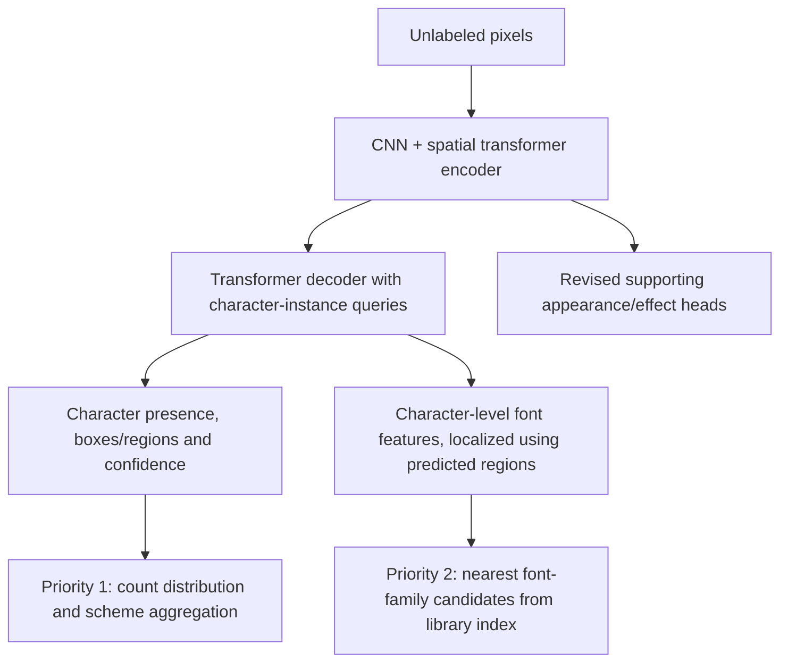
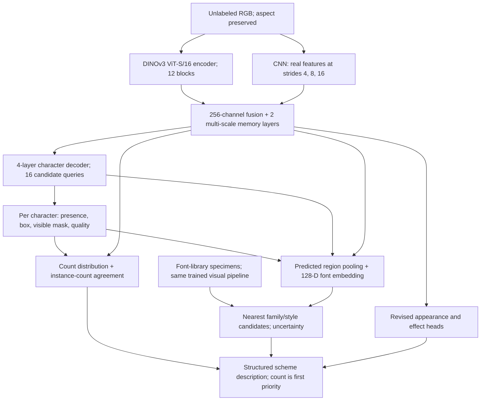
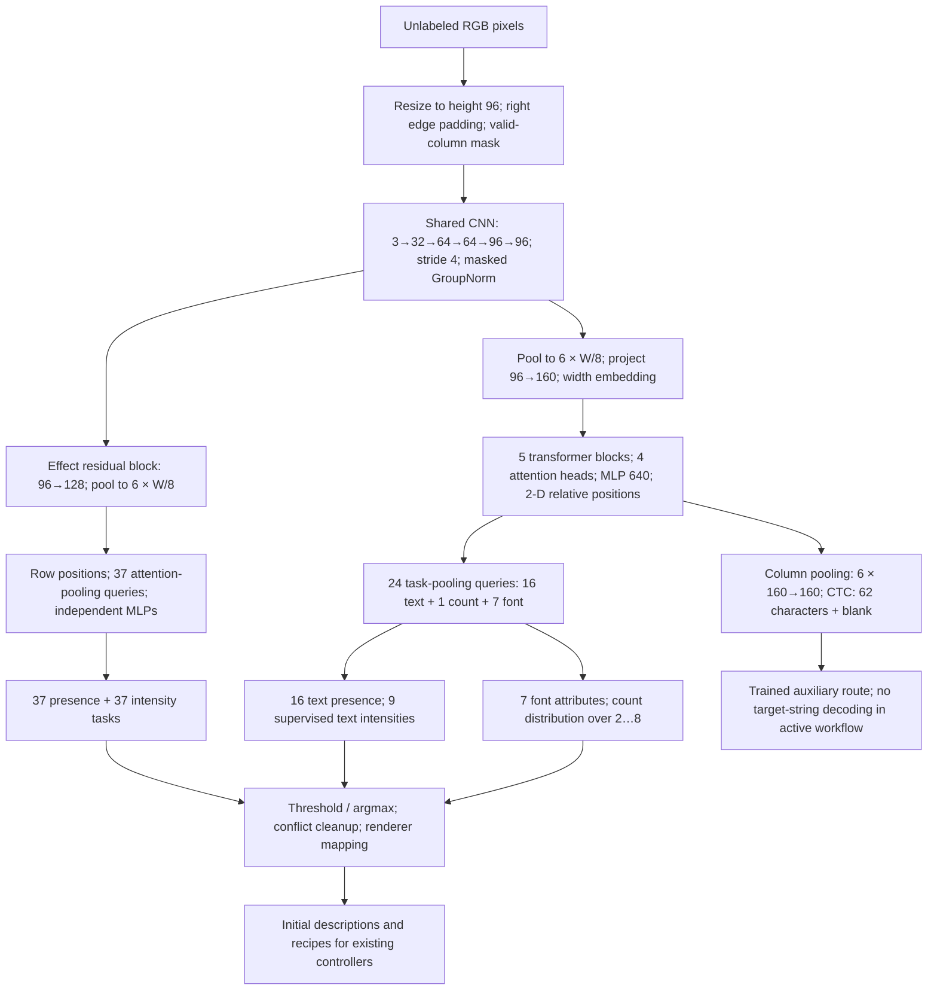
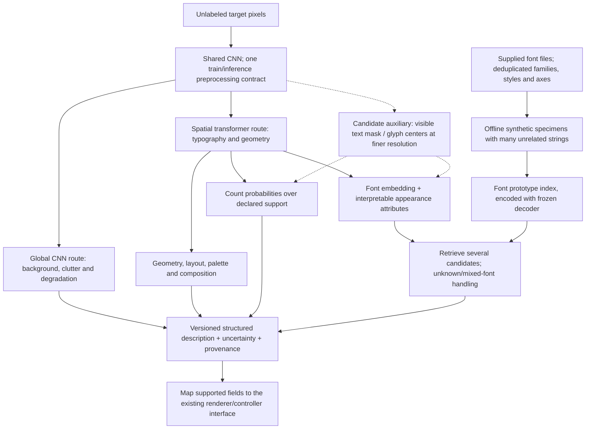

# Active handoff: CAPRI Decoder — next hybrid iteration

Updated 7 October 2026. This is the **single active handoff** for the next session. Its filename is retained to preserve existing links. It replaces the broader controller-redesign agenda previously in this file; older documents remain historical evidence.

## Original smaller-hybrid controller previews — 10 October 2026

User requested passing the previously discussed smaller-hybrid inputs through the controllers and explicitly selected **first6 images per scheme**, retaining all100 inputs as each reference distribution. This is a preview of the original active epoch15 hybrid, not the42.9M CAPRI Decoder. Schemes:DarkBay,City,CryptBB,SimpleCaptcha,Outlined. Preserved custom/DINO/mixed outputs with unchanged comparators, objectives, checkpoint selection and candidate search; no VLM, target answers, reader/model training or new corpus.

Implemented opt-in `controllers --preview` and `capri.py preview-smaller-hybrid`. First6 saved inputs are fixed before outcomes. Standard full runs retain the60/100 majority requirement. Preview-only fallback implements the existing CAPRI_WORKFLOW.md design: equal weighting across distinct observed model lengths via seeded shuffled cycles, with one assigned length fixed across every candidate/controller arm for that input. City uses the raw majority5; DarkBay6. CryptBB/SimpleCaptcha first6 assigned lengths5,3,2,4,5,3; Outlined3,2,5,8,7,6. These are model-derived assignments, not known real lengths; controller fitting does not correct length. `generate` rejects preview runs, verified by a negative CLI check. Raw inference is now saved before a no-majority failure. Standard mode majority behavior and59/60 boundary checks passed using the five saved vote histograms. Model registry/weights are unchanged.

DarkBay reused the first6 outputs from its completed controller run after verifying identical ordered100 RGB hashes and all4 active checkpoint hashes. Fresh previews completed City,CryptBB,Outlined. SimpleCaptcha selected5 usable recipes per controller, but input6 failed all existing candidate and generic recovery checks; no length change or substitute input was used. `capri.py review-smaller-hybrid` recovered those15 already-selected outputs from recorded pilot-attempt seeds and rechecked each on the original3 fresh validation seeds, without new search. The sixth row explicitly shows failure. Original failure logs and partial entries are preserved.

**87 generated/reused images available;3 missing outputs for the failed input.** All87 pass existing completeness/basic-usability checks; only40/87 pass strict readability. Strict counts(custom,DINO,mixed):DarkBay(4,5,4)/6;City(5,5,5)/6;CryptBB(3,4,4)/6;SimpleCaptcha(0,0,0)/5;Outlined(0,1,0)/6. These are renderer diagnostics, not target-fidelity or recognition accuracy. The gallery compares real originals with controller-generated images; it does NOT contain the hybrid-only render baseline and therefore cannot establish controller improvement over that baseline. Do not claim improved reconstruction or count accuracy from it.

Outputs are on E under runs/capri_decoder_500k_20261007/diagnostics/smaller_hybrid_controllers_20261010. **Final report:review/report.html**, five full6-row galleries and a two-example-per-scheme overview. Each scheme preserves pixel references, model counts, length policy, selected recipes/controls and audit evidence. Source hashes and all available candidate/validation scores verified; successful fresh runs reproduce the saved100 raw count predictions. None of the generated image hashes matches its target reference set. No controller job remains after completion; training and its heartbeat remain stopped/paused. Updated README, CODE_AND_MODELS and CAPRI_WORKFLOW to distinguish bounded preview support from the standard full-run guard.

## Count scoring completed for the three scheme tests — 8 October 2026

User explicitly asked for count accuracies for everything. Reused the frozen300 predictions; no additional inference, rendering, training or threshold/checkpoint changes. **CryptBB62/100=62%; SimpleCaptcha17/100=17%.** SimpleCaptcha's publisher specifies exactly5characters per image; public dataset metadata was saved and hashed and used only after prediction freeze for scoring. This is a dataset count specification, not a target-length model input.

For City, exact original-file SHA256 joins to existing benchmark/dev/test annotation records verify51 of the100 selected images: **33/51=64.71%** count accuracy. The other49 have no matched labels. Assuming all100 follow the same five-character City scheme gives **63/100=63%**, consistent with999 existing City annotations all having length5, but this remains an explicitly conditional full-sample number. Do not describe63% as fully per-image-verified accuracy. Prior DarkBay remains831/900=92.33%, a different900-image sample. All are count-only diagnostics; fixed-length class imbalance limits generalization claims.

Added `capri.py score-decoder-schemes` and `decoder_scheme_scoring.py`; City annotation location is in configs/local.json. Evidence: diagnostics/real_three_schemes_100_epoch8_20261008_v2/count_scoring.json, simple_dataset_metadata.json, unchanged prediction SHA25699f2039f16faf626006d7b9ac7a337dbb7d194ce1862149c74ef9afd8718c4e6. Scoring report stores matched-image hashes/counts, unmatched opaque IDs and annotation source hashes. Earlier unscored summaries below remain chronological records, superseded by this scoring addendum. The preview report is updated; no model-output artifacts were modified.

## 100-image CryptBB, City and Simple CAPTCHA diagnostics — 8 October 2026, 17:21 UTC

User requested real-input tests and examples of the synthetic images CAPRI would produce, then capped evaluation at100 images (interpreted and announced as100 per dataset). Completed **100 CryptBB +100 City +100 SimpleCaptcha** with the same fixed final epoch8 EMA checkpoint; no training, controller fitting, VLM or active-model change. SimpleCaptcha is the existing Kaggle bjosttveit/simple-captcha dataset under controller_mvp_v3/simple_captcha_dataset. Inputs were selected as the100 smallest unique RGB SHA256 hashes from551 CryptBB test images,1,999 unique City live images and6,518 SimpleCaptcha images, before scoring. All inference used only pixels/validity. Existing TRAIN+DEV font gallery was rebuilt under the pilot policy (6,720 specimens). No checkpoint or threshold sweep.

**CryptBB exact count:62/100 (62%).** All100 saved CryptBB labels have length5, so the posthoc always-five diagnostic is100/100; the model does not outperform this class-imbalance baseline. Count MAE0.58. Predicted counts:2:6,3:8,4:17,5:62,6:7. City predictions:2:9,3:9,4:4,5:63,6:9,7:4,8:2. SimpleCaptcha predictions:2:17,3:27,4:36,5:17,6:3. **City and SimpleCaptcha have no matched verified scoring annotations in this run; these distributions are not accuracy.** No real localization/font annotations or text-reading head; those accuracies remain unmeasured.

Added an explicitly approximate decoder-to-renderer preview adapter outside frozen decoder code. For each dataset, the first4 fixed hash-ranked inputs have2 fixed random-text variants (24 total). Count comes from count-head argmax, placement from top-count presence queries, font family from top1 visual retrieval, colours/background median from prediction heads, effects from fixed.5 presence and rounded predicted intensity. Font file selection is deterministic within the retrieved family; axes default. Glyph masks are resized to predicted boxes; zero extra rotation/shear/stroke; unsupported inverse-render controls are not fitted. Source pixels and real answer strings never enter generated images. Effects can distort predicted boxes again; observed intensity/colour estimates are not calibrated latent renderer knobs. These are unrefined procedural previews, not demonstrated authentic replicas. Exactly15/24 pass existing renderer acceptance checks (CryptBB4/8,City7/8,SimpleCaptcha4/8); failures are retained, not retried for appearance. Acceptance is clipping/visibility/contrast, not target fidelity.

Implementation: `capri.py test-decoder-schemes`, `capri.py render-decoder-schemes`, `decoder_scheme_evaluation.py`, `decoder_preview_render.py`, `decoder_scheme_previews.py`; input paths in configs/local.json. Outputs on E under diagnostics/real_three_schemes_100_epoch8_20261008_v2; final usable report and comparisons in **preview_verified/report.html**. First failed launch falsely identified the Windows venv parent as a duplicate; fixed to exempt own ancestors. First inference attempt exposed training preprocessing interpolation overshoot (maximum1.0000002384 in3/100 CryptBB inputs). The scoped evaluator now rejects deviations>1e-6 and clamps smaller roundoff to[0,1]; frozen training code is unchanged. Original attempted run is preserved. Preview audit serialization initially failed on NumPy int64; converted placement dimensions to Python integers. All24 corrected exports were verified byte-identical in rendered PNGs and identical in recipes to artifacts generated before label access. Original errors and exact source snapshots are retained.

Independent audit verifies300 RGB hashes, finite predictions, checkpoint/source hashes, unchanged frozen training sources,62 correct CryptBB counts and preview hashes. Prediction SHA25699f2039f16faf626006d7b9ac7a337dbb7d194ce1862149c74ef9afd8718c4e6. No original full-run/pilot restart; heartbeat stays paused. Results are historical diagnostics, not untouched final benchmarks. No new training recommendation is approved by this test.

## User-requested real CAPTCHA test — 8 October 2026, 16:53 UTC

After the pilot ended, the user requested **Test on real captchas**. Completed a diagnostic on all900 existing historical real DarkBay images using **final epoch8 EMA**, selected before reading real labels. This authorizes evaluation only; training and its heartbeat remain stopped/paused. Added `capri.py test-decoder-real`, implemented in `src/capri_controller/decoder_real_evaluation.py` outside the frozen decoder source directory. No original pilot source, model registry, checkpoint or controller changed.

Model input was only RGB pixels plus validity, using unchanged training preprocessing. Verified every opaque image's RGB hash. Predicted count probabilities, presence, boxes, nearest font families and effect/intensity outputs were saved for every image and SHA256-frozen **before** accessing existing real label lengths for scoring. No real text was passed to the model, no forced length, no VLM, no reader decoding/training, no threshold or checkpoint sweep. Font candidates use the same 6,720 TRAIN+DEV reference specimens and fixed .5presence/.25visibility/max-cosine policy as the pilot; candidates are uncalibrated visual suggestions.

**Count head:831/900 =92.33%.** Presence-based region count at the frozen .5threshold:837/900 =93.00%; this is a count diagnostic, not localization accuracy. Count MAE0.08111, NLL0.36436, ECE0.06184. Predictions:832 images length6,57 length5,8 length7,2 length4,1 length3. The saved scoring annotations contain899 length6 labels and one length7 label, not independently adjudicated here. Thus an always-six class-imbalance diagnostic gives899/900 =99.89%, exceeding the model. This baseline was calculated only after prediction freeze and did not modify model output. The near-constant-length historical set does not establish variable-length counting generalization or an untouched benchmark result.

No real font-family or bounding-box annotations are available in this manifest: **font accuracy and localization accuracy are unmeasured**, and this decoder does not produce answer strings. Saved the first12 fixed-manifest examples with predicted boxes, count/confidence and scored true length; examples were not selected by outcome. The report is visual inspection material, not manually created ground truth.

Outputs are physically on E at `runs/capri_decoder_500k_20261007/diagnostics/real_darkbay_epoch8_20261008`: `report.html`, `examples.png`, `predictions.json`, `prediction_freeze.json`, `summary.json`, `audit.json`, `protocol.json` and input/gallery manifests. Independent audit rechecked checkpoint/prediction/code/source hashes and reproduced831/900 and837/900 from saved predictions. Prediction SHA256 `0cdb20448151e6d467e4cff8f3d3faa35e13708f7fab66f468b8e4d77b799118`. Pixel-only input and inverse box geometry checks passed on wide, tall and width-capped shapes. Workspace inventory refreshed without errors. No training restart or active checkpoint replacement.

## Bounded pilot complete — 8 October 2026, 11:48 UTC

The authorized diagnostic pilot completed at **11:45:49 UTC / 04:45:49 Pacific**, after **4h 17m 26s**. It reached the frozen **eight-epoch maximum**, with 20,494 optimizer updates over eight passes of the fixed 20,000-image TRAIN subset (160,000 image presentations). This is earlier than the six-hour target and within the eight-hour ceiling; no extra training was added to fill time. It initialized original warmup recovery20,000 weights, so it is not training from scratch. Final evaluation used only the same fixed 2,000 synthetic DEV images.

| Metric | Initial | Final epoch 8 |
| --- | --- | --- |
| Exact count | 1,688/2,000 = 84.40% | 1,807/2,000 = 90.35% |
| Localization F1 | 93.8240% | 95.8819% |
| Font end-to-end top1 | 14/10,018 = 0.13975% | 100/10,018 = 0.99820% |
| Font end-to-end top5 | 77/10,018 = 0.76862% | 373/10,018 = 3.72330% |

**Result: mixed/inconclusive; do not scale automatically.** Count improved by 5.95 percentage points and localization F1 by 2.05796 points. Font top1 improved by only 0.85845 points, below the frozen 1-point final improvement gate, and remains very weak absolute retrieval. Final conditional font top1 is 100/9,581 = 1.04373%. All 1,453 candidate families were represented by 40,227 predicted-region prototypes from 6,720 library specimens; 93 library glyph detections were missing. Sparse glyph/style coverage limits interpretation. No useful font-intelligence, production readiness, final-test or real-target performance claim is justified.

Count accuracy peaked at 90.75% in epochs5/6, then declined to 90.35%. Font top1 peaked at 1.18786% in epoch7, then fell below1% in epoch8. Do not substitute an interim epoch to reverse the frozen final verdict. Confidence quality also deteriorated: final count NLL0.54790, Brier0.16438, ECE0.07462 versus epoch1 0.28196/0.13801/0.01944. Effects/intensity and appearance heads trained jointly but were not independently evaluated in this bounded evaluator. No specialists, affinity grouping or distillation ran in this pilot.

**Saved and verified:** all **8 complete epoch checkpoints plus40 recovery checkpoints** remain physically on E. Each has raw/EMA weights and full optimizer, scheduler, scaler, consumed sampler, RNG, metrics, execution and optimizer-layout state; every artifact was independently hashed and CPU-loaded with finite weight/optimizer checks during supervision. Completion audit rehashed all8 completed epochs and verified new recoveries19,500/20,000; prior recovery checks were retained with matching receipts/sizes. Final checkpoint `epochs/epoch_0008/checkpoint.pt`, step20,494,510,630,301bytes, SHA256 `4d054e6287ddef82bd95b002fb7320298b9d94bdea5b141925469c0ab1538840`. No artifacts were deleted or active checkpoints replaced.

At11:47:16 final supervision found no pilot or original baseline trainer processes, no frozen source changes or integrity alerts. GPU memory returned to559MiB (sampled0% utilization), E free5,820.08GiB. Main run `status.json` now marks bounded pilot complete and preserves `original_full_training: stopped_by_user` and `automatic_full_training: false`. The heartbeat `supervise-capri-decoder-build-and-specialist-training` is **PAUSED**, confirmed through the automation tool. Do not resume, extend, launch specialists or start full training without new user authorization.

Evidence under `runs/capri_decoder_500k_20261007/diagnostics/timed_pilot_20261008`: `completion.json`, `supervision.json`, `learning_curve.json`, `dev_epoch_08.json`, `epochs/epoch_0008/receipt.json`. Historical authorization and per-epoch records below remain evidence, not current instructions to keep training.

## Bounded pilot authorized — 8 October 2026, 07:28 UTC

The user explicitly requested: **Do a dummy run that finished in6/8hrs**. This authorizes this new bounded diagnostic pilot only; the stopped450k warmup and unlimited follow-up plan remain stopped. New root: `runs/capri_decoder_500k_20261007/diagnostics/timed_pilot_20261008`, physically on E. Start07:28:23UTC /00:28Pacific; target completion around13:28UTC /06:28Pacific. Optimization cutoff12:58UTC /05:58Pacific (5.5h), evaluation cutoff14:58UTC /07:58Pacific (7.5h), independent process-tree watchdog hard stop15:28UTC /08:28Pacific (8h). Do not extend these deadlines or scale up automatically.

Launch command: `capri.py decoder timed-pilot`; worker command `timed-pilot-worker`. Supervisor and worker have separate identity locks and logs. Existing heartbeat is now ACTIVE every15minutes with a pilot-only prompt and must pause on completion/failure/stop. The original full-training stop is not revoked beyond this pilot. A `STOP` file in the pilot root requests supervisor termination; preserve all checkpoints. No active-controller checkpoint replacement.

The pilot initializes raw weights from verified recovery20,000 but starts a new joint optimizer. Planned data:20,000 fixed TRAIN images selected as paired units, round-robin original family/count anchors with deterministic hash-ranked choices;2,000 fixed held-out DEV images selected similarly. Actual colour/layout/effect/intensity/family coverage is audited, not described as exact joint balancing. Training uses the existing larger CNN+DINOv2-S/14-registers+instance decoder, unchanged pixels-only input and spatial resolution; DINO stays frozen. Up to8 short20k-image pilot epochs, subject to the time budget. A short96-step fixed-batch localization learning gate must reduce its mean loss by10%; its weights are discarded before the actual pilot. Failure stops the run early.

Added separate `pilot_losses.py` for batched matching cost and localization losses, retaining exact SciPy assignment with one cost transfer per batch/layer. It is not an all-GPU Hungarian implementation. CPU/CUDA analytic assignment/loss/gradient comparisons passed. A full-model original-versus-optimized joint gradient/memory check precedes training. Existing frozen warmup files remain unchanged; process-local adapters affect only the pilot. Batch8, foreach AdamW/EMA, LR5e-5, weight decay.01, norm clip1, AMP same-batch retry. Joint96task groups are fixed before DEV: count4/localization4/font1/effect presence1/intensity.5/appearance.5/composition.5; per-task scales1, auxiliary localization retains existing frozen weights at.25. TRAIN reference pairing selects at most2 specimen images every4 updates, family mode, temperature.1. These are bounded pilot choices, not claimed optimal settings.

Before learning and after each saved epoch, evaluate count accuracy/per-length confusion, localization precision/recall/F1, and unseen-family font top1/top5. Font bank includes every TRAIN and DEV font file with its first3sorted specimens; visual presence>=.5/visibility>=.25, library association and query scoring IoU>=.5. Known library metadata attaches only after pixel-only forward; query family labels are used only after visual ranking for scoring. End-to-end retrieval counts missed glyph localizations as failures; conditional retrieval and missing bank families are separate. Candidate gallery is intentionally sparse; no final calibration/test or real-target evaluation. No specialist/distillation phase is promised inside this six-hour pilot.

Preserve raw/EMA plus optimizer/scheduler/scaler/sampler/RNG/execution state every completed pilot epoch and every500updates, with separate final partial-epoch checkpoint at the optimization cutoff. Stop early for a>10percentage-point count-accuracy or localization-F1 regression from initial DEV. The final fixed promise gate is >=2pp count gain, no more than2pp F1 drop and>=1pp end-to-end font top1 gain; otherwise report mixed/inconclusive rather than scaling automatically. The watchdog still enforces8hours if an operation hangs; progress after the last recovery could then be unsaved. Preparatory/quality checks may end the run earlier than6hours.

Implementation: `timed_pilot.py`, `timed_pilot_data.py`, `timed_pilot_eval.py`, `pilot_losses.py`, explicit CLI stages. At07:32UTC the GPU and tiny-learning gates passed and initial DEV evaluation started. The20k subset covers all1,332 TRAIN alias families, all37 effect types and2,830–2,876 images per count2..8. Real-model old/new joint loss agreed within2e-4 relative/absolute tolerance; maximum parameter-gradient relative L2 difference was0.004906 under FP16, with maximum absolute difference0.015625. Peak allocated GPU memory was5.615GiB. One diagnostic old/new timing was2.077/0.662s, but unequal warmup and a single batch prohibit a claimed steady-state speedup. The96-step learning gate reduced fixed31-image mean localization loss from1.8066 to0.6859 (62.03%); those weights were discarded and step20,000 raw weights reloaded before pilot training. This demonstrates bounded TRAIN learning, not held-out quality. Initial DEV completed: exact count1,688/2,000 (84.4%), localization F1=0.93824. Untrained font branch end-to-end top1=0.13975%, top5=0.76862%, conditional top1=0.14900%; all1,453 TRAIN+DEV candidate families have accepted prototypes. These are starting scores from prior warmup raw weights, not pilot improvements. Actual joint pilot optimization is now confirmed: at07:36:36UTC, PID39856, epoch1, step101/794 images, finite loss2.6830, gradient norm15.6295, AMP16. Initial observed9.04images/s includes loader startup; steady-state/epoch quality remain unmeasured. First pilot recovery is scheduled at500updates; every full epoch and time-cutoff partial state will be retained. Follow the pilot's own progress/logs rather than the original stopped warmup progress. Maintain this single handoff and maintenance log as results arrive.

### Pilot epoch 7 saved and evaluated — 8 October, 11:17 UTC

Seventh complete 20k-image epoch is saved at global step 17,933. SHA256 `77511e4289b12820e663a5bac2cfa193710f75c910ed34a3087bc622561e3758`, 510,630,301 bytes. Independent CPU reload verified finite raw/EMA and complete optimizer/scheduler/scaler/sampler/RNG/execution/layout state. All completed epoch hashes were rechecked; recoveries 17,500/18,000 were hashed and CPU-loaded. Prior recovery verification remains recorded with matching receipts/sizes.

EMA DEV evaluation at 11:14:22: count **1,810/2,000 = 90.5%**, down 0.25 percentage points from epoch 6; localization F1 **95.7831%**, up from 95.5929%. Font end-to-end top1 **119/10,018 = 1.18786%**, top5 **387/10,018 = 3.86305%**; conditional top1 119/9,574 = 1.24295%. All 1,453 families represented, 40,241 prototypes and 79 missed library glyphs. Font top1 now exceeds the initial value by 1.04811 points, numerically meeting that modest improvement criterion at this interim epoch; it remains very weak absolute retrieval and does not establish useful font intelligence. Top5 slightly declined. Count NLL 0.48919, Brier 0.16114 and ECE 0.06994 deteriorated further. Final pilot judgment awaits the frozen final epoch; no automatic scaling or real-target claim.

At 11:16:22 the final planned epoch 8 was running, step 18,076 / 1,116 of 20,000 images, finite loss 1.70126 and gradient norm 62.2908, AMP64. Supervisor 29340/trainer 39856/four loaders verified; frozen sources unchanged, no integrity/resource alerts, E free 5,822.45 GiB. Original full training remains stopped. Do not extend the eight-epoch maximum to fill unused time. Evidence: pilot `supervision.json`, `dev_epoch_07.json`, `epochs/epoch_0007/receipt.json`.

### Pilot epoch 6 saved and evaluated — 8 October, 10:47 UTC

Sixth complete 20k-image epoch is saved at global step 15,372. SHA256 `aeebbe503304b8cd3f098923a89b74c6bbc148fc47e8dfaec5e4a940902754a9`, 510,630,301 bytes. Independent CPU reload verified finite raw/EMA and complete optimizer/scheduler/scaler/sampler/RNG/execution/layout state. All completed epoch hashes were rechecked; recoveries 15,000 and 15,500 were hashed and CPU-loaded. Previous recovery verifications remain recorded with matching receipt/size checks.

EMA DEV evaluation at 10:42:57: count **1,815/2,000 = 90.75%**, unchanged from epoch 5; localization F1 **95.5929%** (epoch 5: 95.5616%). Font end-to-end top1 **104/10,018 = 1.03813%**, top5 **389/10,018 = 3.88301%**; conditional top1 is 104/9,544 = 1.08969%. All 1,453 candidate families remain represented, with 40,238 prototypes and 82 missed library glyphs. Font retrieval remains very weak; the gain over initial top1 is only 0.89838 percentage points, still below the frozen 1-point improvement criterion. Count NLL 0.42014, Brier 0.14968 and ECE 0.06056 worsened further. No real-target or final-test claim.

At 10:46:26 epoch 7 was running, step 15,651 / 2,177 of 20,000 images, finite loss 1.86537 and gradient norm 11.2985, AMP32, 10.47 images/s including startup. Supervisor 29340, trainer 39856 and four loaders were identity-verified; frozen sources unchanged, no integrity/resource alerts; E free 5,825.31 GiB. Original full training remains stopped. Frozen eight-epoch maximum and time limits remain unchanged; do not extend the run to fill unused time. Evidence: pilot `supervision.json`, `dev_epoch_06.json`, `epochs/epoch_0006/receipt.json`.

### Pilot epoch5 saved and evaluated — 8 October, 10:17 UTC

Fifth complete20k-image epoch is saved at global step12,808. SHA256 `47c51f0d8b841ccf139742487e804118ed92702c073918bca61a2da2c4e08298`,510,630,301bytes. Independent CPU reload confirmed finite raw/EMA and complete optimizer/scheduler/scaler/sampler/RNG/execution/layout state. All completed epoch hashes were rechecked; recoveries12,500/13,000 were independently hashed and CPU-loaded. Previous recovery verification remains recorded with receipt/size checks.

EMA DEV evaluation at10:11:35: count **1,815/2,000 =90.75%** (epoch4 90.4%; initial84.4%); localization F1 **95.5616%** (epoch4 95.3403%). Font end-to-end top1 **94/10,018 =0.93831%**, top5 **368/10,018 =3.67339%**; conditional top1 is94/9,538 =0.98553%. All1,453 candidate families remain represented,40,232 prototypes and88 missed library glyphs. Font retrieval remains very weak. Count NLL0.37274 and ECE0.05189 continue worsening; Brier0.14383 slightly improved from epoch4. Do not equate accuracy gains with improved confidence calibration. No real-target or final-test claim.

At10:16:18 epoch6 was running, step13,201 /3,062 of20,000 images, finite loss1.85368/gradient norm20.3839, AMP64 and10.87images/s including epoch startup. Verified supervisor29340/trainer39856/four loaders, unchanged frozen sources and no alerts; E free5,828.16GiB. Original full run remains stopped and pilot deadlines unchanged. Evidence: `supervision.json`, `dev_epoch_05.json`, `epochs/epoch_0005/receipt.json` under the pilot root.

### Pilot epoch4 saved and evaluated — 8 October, 09:47 UTC

Fourth complete 20k-image epoch is saved at global step10,250. SHA256 `6cd094c49b1a4464fe2f5eacb52b65798573c31ce0eeeb1affe94564554d585e`,510,630,301bytes. Independent CPU reload confirmed finite raw/EMA weights and complete optimizer/scheduler/scaler/sampler/RNG/execution/layout state. All completed epoch hashes were rechecked; new recoveries10,000 and10,500 were hashed and CPU-loaded. Prior recovery verifications are retained with matching receipt and size checks.

EMA evaluation at09:40:19 on the same2,000 DEV images: count **1,808/2,000 =90.4%**, unchanged from epoch3; localization F1 **95.3403%**, essentially unchanged. Font end-to-end top1 **78/10,018 =0.77860%**, up from0.56898%; top5 **320/10,018 =3.19425%**. Conditional top1 is78/9,504 =0.82071%. All1,453 candidate families remain represented, with40,237 prototypes and83 missed library glyphs. Font quality remains very weak. Count NLL0.33426, Brier0.14485 and ECE0.04683 worsened from epoch3 despite stable accuracy; record this limitation without changing the frozen protocol or making a real-target claim.

At09:46:10 epoch5 was running, step10,751 /3,922 of20,000 images; finite loss1.32365/gradient norm22.7205, AMP64,11.21images/s. Supervisor29340/trainer39856 and four loaders verified, frozen sources unchanged, no alerts; E free5,831.01GiB. The original full run remains stopped, pilot optimization cutoff12:58UTC and hard stop15:28UTC unchanged. Evidence: pilot `supervision.json`, `dev_epoch_04.json`, `epochs/epoch_0004/receipt.json`.

### Pilot epoch3 saved and evaluated — 8 October, 09:18 UTC

Third complete20k-image epoch is saved at global step7,685. Independently rehashed and CPU-loaded raw/EMA weights plus finite optimizer/scheduler/scaler/sampler/RNG/execution/layout state. SHA256 `bf8e1078cff38b509b6d46eab87ea687a08d96385843aa0c6917b510fbfef40e`,510,630,301bytes. Recoveries through8,000 are verified; all previous checkpoint hashes were rechecked. Frozen pilot sources and process identities match; no integrity or resource alerts.

EMA DEV evaluation at09:09:03: exact count **1,808/2,000 =90.4%** (epoch2 90.2%; initial84.4%); localization F1 **95.3378%** (epoch2 95.0111%; initial93.8240%). End-to-end font top1 **57/10,018 =0.56898%** and top5 **250/10,018 =2.49551%**. Conditional top1 is57/9,519 =0.59880%. All1,453 candidate families remain represented, with40,214 prototypes and106 missed library glyphs. Font retrieval remains very weak. Count accuracy improved slightly, but count NLL rose to0.30860 and ECE to0.03665 (epoch1 0.28196/0.01944); do not imply confidence calibration improved. These remain fixed synthetic DEV results only.

Epoch4 was progressing at09:17:28: step8,426 /5,776 of20,000 images, finite loss2.67620 and pre-clipping gradient norm85.5986, AMP64,11.46images/s. A logged norm3,948.68 atstep8,326 was finite and transient; subsequent samples returned to11.88–85.60. Existing optimization clips norm to1 and rejects nonfinite gradients; no protocol change was made. E free5,833.87GiB, GPU allocation11,664MiB. Original full training stays stopped; optimization cutoff12:58UTC and hard stop15:28UTC unchanged. Evidence: pilot `supervision.json`, `dev_epoch_03.json` and `epochs/epoch_0003/receipt.json`.

### Pilot epoch2 saved and evaluated — 8 October, 08:48 UTC

Second complete 20k-image pilot epoch is saved at global step 5,123. Independent SHA256 verification and CPU reload confirmed raw/EMA weights and finite, complete optimizer/scheduler/scaler/sampler/RNG/execution/layout state. Checkpoint SHA256 `098fa1cfa834abecafe3fc05ecb03989fd6d6727bb8e44dd51c559115ed27ff9`, 510,630,301 bytes. All recoveries through update 5,500 are also verified; prior checkpoint hashes were rechecked during this supervision.

EMA evaluation completed at08:37:46 on the same2,000 held-out DEV images: exact count **1,804/2,000 =90.2%**, versus90.05% after epoch1 and84.4% initially. Localization F1 **95.0111%**, essentially unchanged from95.0126% after epoch1 (93.8240% initially). End-to-end font top1 **43/10,018 =0.42923%**, versus28/10,018 =0.27950% after epoch1; top5 **179/10,018 =1.78678%**. Conditional top1 is43/9,446 =0.45522%. All1,453 candidate families remain represented, with40,221 prototypes from6,720 library images and99 missed library glyphs. Font retrieval remains very weak; these are bounded synthetic DEV results, not real-target or final-test accuracy.

At08:47:26 epoch3 was training, step5,976 /6,674 of20,000 images, finite loss2.08421/gradient norm25.3034, AMP64 and11.53images/s. Supervisor29340/trainer39856 and four loaders were identity-verified; frozen source hashes match, no alerts, E free5,836.72GiB. The original full run remains stopped. Pilot deadlines and protocol are unchanged; no restart or scale-up was performed. Evidence: pilot `supervision.json`, `learning_curve.json`, `dev_epoch_02.json` and `epochs/epoch_0002/receipt.json`.

### Pilot epoch1 saved and evaluated — 8 October, 08:17 UTC

First complete20k-image pilot epoch is saved at global step2,564. SHA256 `6e6f36dd2106624f71f089f8b9602d3b9bb07e2bbaeba2ea340b72ea1c3a4a4c`,510,630,301bytes. Independent hash verification and CPU reload confirmed raw/EMA and complete finite optimizer/scheduler/scaler/sampler/RNG/execution state. All recoveries500 through3,000 in500-step increments are also verified. Original frozen pilot sources match; no alerts.

EMA DEV evaluation completed08:06:33 on the same2,000 held-out images: exact count **1,801/2,000 =90.05%**, up5.65percentage points from1,688/2,000 =84.4%; localization F1 **95.0126%**, versus93.8240% initially. Unseen-family font end-to-end top1 is **28/10,018 glyphs =0.27950%**, versus14/10,018 =0.13975%; top5 is104/10,018 =1.03813%. Conditional top1 is28/9,430 matched glyphs =0.29692%. All1,453 candidate families are represented by40,203 predicted-region prototypes from6,720 library images;117 library glyph detections are missing. Exact font retrieval remains very weak despite improved count/localization; do not characterize this as useful font intelligence or overall pilot success. No final-test or real-target accuracy claim.

At08:16:34 epoch2 was in progress, update3,451 /6,929 of20k images, finite loss/gradient, AMP32,11.55images/s. Supervisor29340/trainer39856/four workers verified; E free5,839.58GiB. No regression guard triggered, duplicate jobs, source/protocol change or deadline extension. Continue only the bounded pilot; optimization cutoff12:58UTC and hard stop15:28UTC remain fixed. Current receipts/metrics: pilot `supervision.json`, `learning_curve.json`, `dev_epoch_01.json` and `epochs/epoch_0001/receipt.json`.

### Pilot recovery verification — 8 October, 07:46 UTC

Bounded pilot supervisor29340 and actual trainer39856/four workers are identity-verified; no alerts or changed frozen pilot sources. Epoch1 is in progress: update1,001 /7,799 of20,000 images, finite loss4.3937/gradient norm38.6602, AMP16, about11.44images/s including startup/checkpoint work. Zero completed pilot epochs; initial DEV scores above remain the only held-out quality evidence.

Recovery500 and1,000 were independently SHA256-verified, CPU-loaded and checked for complete raw/EMA, optimizer/scheduler/scaler, sampler, RNG, metrics and execution/layout state, with finite weights and optimizer tensors. Each is510,630,301bytes. Step500 SHA `d514654817550225ba084f2080121b4ea6b8ab3a97fb4d190616c890eefeafae`; step1,000 SHA `77ee9143640828cd686a2a80c30ac324812250a2ebab76183977bd0e1c03c73a`. Receipt: pilot `supervision.json`. E free5,841.95GiB; GPU memory11,664MiB. No duplicate job, restart, protocol/architecture change or deadline extension. Optimization still ends12:58UTC and watchdog hard stop15:28UTC.

## User stop — 8 October 2026, 02:43 UTC

The user explicitly instructed **Stop training**. CAPRI trainer PID 12920, all four loader workers and launcher PID 35252 were identity-verified, terminated and confirmed stopped. The supervision heartbeat `supervise-capri-decoder-build-and-specialist-training` is **PAUSED**. Do not restart training, launch later phases or re-enable the heartbeat without a new user instruction; earlier authorization and historical active-status entries below are superseded by this stop.

Latest fully saved resumable state remains recovery **20,000**, raw/EMA plus complete optimizer/scheduler/scaler/sampler/RNG/execution state. SHA256 was reverified after stopping: `6bee2dbcee7a965f24998855f343f545f2dfd075b2d3d0233409fa5cfb49d7e5`. The last progress report was update 22,251 / 174,607 images; work after 20,000 was unsaved and cannot be resumed. No completed epoch or DEV model evaluation exists. All data/checkpoints remain on E. `user_stop.json`, `status.json`, phase progress and the preserved stopped lock record this state.

### Runtime investigation after user stop — 2026-10-08 07:12 UTC

The user challenged the approximately 12-hour warmup pass. Training and its heartbeat remain stopped/PAUSED. Added `capri.py decoder profile-stopped` with isolated `decoder/performance_probe.py`: refuses a live baseline trainer, verifies frozen source/checkpoint hashes, loads raw recovery 20,000 into a disposable model, and runs bounded TRAIN-only forward/backward timings with **zero optimizer updates**. Diagnostic outputs do not replace stopped run status or any checkpoint. All 141 frozen training sources remain unchanged.

Measured four cached batches of eight images (128 pixels high; widths 272, 416, 608, 768), with two warmups and three repeats per case. Median synchronized forward times were 83.0/84.2/98.7/116.2 ms; matching/loss 217.7/215.1/219.0/220.5 ms; backward 273.3/294.2/338.3/363.3 ms. Total including input transfer was 575.0/596.6/658.5/703.0 ms. These exclude optimizer/EMA, AMP-recovery buffer/RNG capture, and concurrent loader wait; do not present them as full-epoch throughput. Synchronous uncached-at-call dataset decoding was 93.6–145.7 ms/batch, but that does not measure actual prefetched loader wait. Transferring targets to GPU once made little difference overall (569.2/604.8/658.7/701.4 ms), so copying targets alone is not a demonstrated fix.

Code/trace show per-image matching/loss repeated across four decoder outputs, CPU Hungarian transfers and many scalar validation round trips. The instrumented single batch recorded 591 scalar extractions, 2,547 `.to` operations (not all are transfers), 610 slice-backward operations and 32 per-image assignments. Profiler instrumentation greatly inflated runtime; its operator accounting is diagnostic, not uninstrumented GPU kernel occupancy. Portable FP32 grid sampling, unvectorized per-image losses, conservative batch8 and non-foreach optimizer/EMA processing are candidates for further optimization. Do not claim a speedup or attribute all backward time to one kernel. Frozen DINO and unused secondary forward computations also require measured attribution before changes.

The actual earlier PARSeq seed48 completion reports **6,843.90 seconds for 100,000 images x20 epochs**, batch128, with sampler base scale 128x32. Thus the user's under-24-hour expectation for a hypothetical 500k PARSeq run is plausible; linear extrapolation is about9.5h, not a measured500k run. CAPRI uses 128-high variable-width images (272–768 in this sample), dense multiscale features and four-stage localization/mask supervision, so parameter count alone does not predict equal runtime. Current warmup optimizes19.29M parameters out of42.90M; DINO22.06M is frozen. CAPRI has450k optimization images,20kDEV,10kcalibration,20ktest. No20-full-epoch budget was fixed.

The initial readiness already reported6.85images/s; allowing the full run without addressing throughput was an implementation/readiness oversight. Next performance work should compare mathematically equivalent batched losses/matching with preserved supervision/finite checks, measure larger exact-shape batches and optimizer/EMA overhead, and validate outputs/gradients before proposing any changed run. Architecture, image resolution, losses, checkpoints and stop instruction remain unchanged. Report: `diagnostics/performance_1791443378012070100/report.json`, with CPU/CUDA operator tables. No restart is authorized by this diagnostic request.

## Objective and scope

Design the next iteration of the CNN + transformer hybrid, named **CAPRI Decoder**. Here, decoder means the model that understands the target CAPTCHA scheme, not the PARSeq character decoder.

The component receives target pixels and produces a structured, useful starting description for the existing renderer/controllers: typography, font attributes or candidates, text appearance, background/effects, geometry and character count. The exact output contract and architecture changes are design decisions to establish, not already implemented features.

Focus exclusively on this hybrid's architecture, heads, supervision, training data, font understanding, length inference and evaluation. The user supplied a font inventory and now explicitly requests that we locate and download those assets in addition to the existing font collection; see the latest authorization below.

Model 3 is complete according to the user. Model 4 remains on hold. Do not start reader training, build another controller, regenerate a reader corpus or change the current controller mixture in this session. The validation controller and 100k-training-plus-5k-validation allocation are deferred work, not requirements for this decoder iteration. Existing controllers may be used unchanged as an evaluation harness.

### CAPRI storage moved to E — completed 8 October, 00:52 UTC

The user-requested move is complete. All CAPRI corpus images, acquired fonts, TRAIN references, pretrained weights, diagnostics, training checkpoints and future run outputs are physically under `E:/pranav/CAPRI/runs/capri_decoder_500k_20261007`. The original `runs/capri_decoder_500k_20261007` path is now a Windows junction, preserving the absolute logical paths in frozen dataset snapshots. Code/documentation remain in the workspace; historical experiments and selected controller models were not moved or replaced. `configs/local.json` records the explicit logical-to-physical storage mapping.

The migration verified all **19,028 files / 26,150,870,743 bytes (24.35 GiB)** by SHA256 before switching. Training stopped at verified recovery **15,000**, then restarted from that complete state under PID **12920** with four workers. First resumed update 15,001 at 00:52:36 had finite loss 2.4230, gradient norm 122.52 and AMP scale 256. After confirming the new trainer identity and successful update, the worker removed only the verified redundant C backup; completion at 00:52:50. At 00:53:16, C had **65.32 GiB free**, E **5,843.43 GiB free**, and supervision found no alerts. Update 15,026 / 117,906 of 450,000 TRAIN images was in progress; there are four verified recovery snapshots and zero completed training epochs. This is still epoch 1 of count/localization warmup, not completed baseline/font/specialist training.

The first switch attempt failed before renaming any directory because its background PowerShell session could not discover `Get-FileHash`. Both copies were preserved. Replaced that call with .NET SHA256, verified the digest against the original manifest, and added a guarded retry that requires the saved exact trainer-stop/checkpoint identities and re-verifies every file. The retry completed successfully. Original failure logs/receipts remain in `runs/capri_storage_migration_20261007`, alongside the final verified manifest, cutover, resume and completion receipts. The old migration worker is finished; ordinary supervision may resume. Do not launch another trainer while the verified live lock exists.

Recovery 15,000 SHA256: `063bc6079ec124257180f64ee1807fd0199885e5b4f08b15106ac550a743a850`. CPU loading confirmed raw/EMA, optimizer, scheduler, scaler, consumed sampler cursor, RNG/execution and the exact AMP amendment identity; consumed batches are 15,000, scale 256. All 141 original frozen training source hashes still match. The path resolver preserves the logical C path and permits only the configured E mapping; earlier actual junction and phase-engine tests passed. The workspace catalog now identifies this mapping and explains that logical catalog totals are not C-drive usage. No corpus regeneration, architecture change, controller/reader training or active-model replacement occurred.

### Runtime concern and read-only observation — 8 October, 00:31 UTC

The user raised the approximately 12-hour full-pass runtime and potential ten-day cost of 20 full epochs. Only one full count/localization warmup epoch is currently specified; no 20-epoch total was agreed. Before launching later phases, measure throughput and establish a realistic total optimization/evaluation budget. Specialist epochs may use targeted subsets, as already agreed; do not silently equate those with full 450,000-image passes or substitute a smaller architecture.

Added `capri.py decoder observe-training --run runs/capri_runtime_probe_20261008 --count 30`, a read-only existing-process/driver observer. It writes outside the migrating CAPRI run, loads no model, and changes no training state. At 00:30:42–00:31:12 UTC, GPU utilization samples averaged 37.22% (median 22%); the trainer averaged 1.04 CPU cores and four loader workers about 0.13–0.15 cores each. Driver samples can alias the update cycle and CPU/I/O counters include caching; this is not an operator-level bottleneck diagnosis or proof that data loading is free. Report `runs/capri_runtime_probe_20261008/runtime_observation.json`.

Static inspection identifies candidates for timing: the portable FP32 grid-sampling attention, repeated tensor validation/scalar synchronization, per-image Hungarian cost transfer to CPU at each supervised decoder layer, and secondary-head computation during localization-only warmup. Preserve count/localization objectives and numerical correctness; measure forward, matching/loss, backward, optimizer/EMA and data wait on a saved checkpoint before choosing changes. No speedup has been claimed or applied. At observation completion the existing trainer was at update 14,851 and migration was pending; migration has since completed as recorded above. GPU operator profiling remains pending and must not compete with the live trainer.

### DEV font gallery completed and audited — 8 October, 02:40 UTC

Prepared a separate, selection-only clean font library for the 121 DEV families excluded from optimization: **188 font files / 3,060 specimens / 24 archives**, physically on E under `font_gallery_dev_v1`. Existing 500,000 corpus images and 36,492 TRAIN references are unchanged. Fixed six-glyph coverage pages and default/one-axis endpoint variants use family-independent strings; no DEV CAPTCHA query text informs these specimens. Bounded retries change layout only. Duplicate library images remain explicit: 204 duplicates, 2,856 unique pixel images, no cross-family exact-pixel group within this DEV gallery. Cross-bank ambiguity still needs measurement when combined with TRAIN distractors.

Added `decoder/dev_gallery.py`, `decoder/dev_gallery_data.py` and commands `dev-gallery-tests`, `generate-dev-gallery`, `audit-dev-gallery`, `dev-gallery-reader-tests`. The 32-image pilot passed before generation. Full audit verified all archive hashes/CRCs, decoded all images, checked instance/font/axis/count provenance and bounds, and exactly replayed eight image/annotation renders. The reader verified complete exact-shape sample coverage, 32 deterministic decoded examples, pixel/validity-only model inputs, separate library labels, and refusal of TRAIN/calibration/test identities or altered pixel hashes. Explicit DEV identities are retained; existing TRAIN readers/objectives are not bypassed. No calibration/test images were read or generated.

Initial pilot refused the old corpus helper hash because the documented E-drive migration changed `common.py`. This new gallery protocol explicitly binds the inspected migration helper SHA `6cf8189a9da344daa127e07cf957fff3629edf2fa86751e22b77e7c3fc7e35e8`, while enforcing all original renderer/asset hashes and preserving the original corpus protocol. Failed attempt remains in events. Generation used two CPU workers and is finished; no GPU model was added. Generator source SHA `a236b66d675f48a8b2206f8bdb7a3b2416a1c3f0c8df8cf4f0c4d78d58d4e7a9`; audit/reader SHA `6ae932b0b11f571f4ba346fb0eca1671d0ff933f2cb31559eadcd12a16cfcc37`; gallery protocol hash `514ec1b355e6c84ddfa45ba1cf5ef2679eb881877ad34debb7181339d77dd36f`; snapshot hash `2188b0104bbff31498e0e2167c97ff42d9564c2706a5a88dae81cbb3a03a7f6a`. Receipts: `dev_font_gallery_pilot.json`, `dev_gallery_audit.json`, `dev_gallery_reader_checks.json`.

This is evaluation data/readiness infrastructure, not measured font performance. Next: explicit DEV predicted-region extraction, combined TRAIN+DEV retrieval candidates with complete missing-family/ambiguity accounting, and query-level DEV retrieval metrics; labels stay outside visual forward and query retrieval inputs. Do not feed the DEV library to optimization. Production joint initialization/launcher, safe-boundary GPU profiling/memory check and explicit phase/reference budget/weights remain pending, followed by actual TRAIN affinity, specialists, assigned-output distillation and separate intensity refinement.

At 02:39:17 supervision confirmed one trainer PID 12920/four workers, no alerts, E free 5,842.90 GiB, five verified recovery snapshots and zero completed epochs. Epoch 1 warmup had update 21,951 / 172,244 of 450,000 images, finite loss/gradient and AMP scale 128; all 141 frozen training source hashes match. Newly saved recovery **20,000** (02:10:07) is 498,106,669 bytes, SHA `6bee2dbcee7a965f24998855f343f545f2dfd075b2d3d0233409fa5cfb49d7e5`, with raw/EMA, optimizer/scheduler/scaler, consumed sampler cursor, RNG, metrics, execution state and optimizer layout. This is an in-progress recovery, not a completed epoch or DEV evaluation. Original heartbeat remains active; no duplicate training, reader/controller/Model4 work or active-checkpoint change.

### Joint scene/reference font objective — 8 October, 01:05 UTC

Added independent `font_training.py` and `capri.py decoder font-training-tests`. `joint_task_forward` forwards synthetic scene and TRAIN reference batches through the same model using only pixels/validity, retains the existing 96 task terms, and replaces only the font contrastive term with combined scene/reference embedding evidence. Known reference labels associate already-predicted regions afterward through the existing visual selector and one-to-one library IoU audit. Accepted vectors are re-indexed from the original differentiable predictions; no label-driven crop or forced six-glyph count is introduced. Missing reference detections remain missing support. Count/localization, attributes, effects/intensity and appearance losses remain unchanged by this adapter; the eventual phase caller still supplies auxiliary localization supervision and explicit weights.

Exact reference pixel/glyph duplicates cannot become trivial positives. Cross-family negatives between all glyphs of a pixel-identical specimen are excluded to prevent contradictory attraction/repulsion across aliases; this is a specimen-specific ambiguity mask, not a global family merge. Different family identities/provenance remain intact. Unsupported anchors return differentiable finite zero with evidence count zero. The adapter restores no sampler because it consumes no mutable sampling state: the phase must supply deterministic, already-selected reference batches for safe same-batch AMP retries.

Eight CPU analytic groups passed with CUDA hidden, report `diagnostics/font_training_20261008/font_training_checks.json` under the E-backed CAPRI run: existing task preservation/pixel-only forward; gradients into scene and accepted reference embeddings only; query permutation and no forced count; duplicate exclusion; cross-glyph alias ambiguity exclusion; finite zero gradients for unsupported/singleton/empty anchors; missing-region reporting without ground-truth fallback; and held-out/unknown/duplicate/invalid-input refusal. Source SHA `230713a190c231af8d73f8737f7deb048a93be67b0991a044b14c71d0c90d5af`. These fixture checks are not trained font quality or GPU readiness.

The deterministic reference sampler has since been implemented and checked below. Epoch-aware preparation and objective wiring have since passed CPU integration checks below. Production integration still needs explicit reference frequency/temperature/thresholds and phase loss scales, GPU memory/throughput checks for the two-forward graph at a safe training boundary, held-out gallery evaluation and a measured total budget. The current warmup is unchanged. At 01:04:35 it was at update 15,776 / 123,795 of 450,000 TRAIN images, finite loss/gradients, PID 12920; all 141 frozen source hashes match. Latest supervision verified four recoveries, zero completed epochs and no alerts. No second GPU job, regenerated corpus, controller/reader change or active checkpoint replacement.

### Deterministic TRAIN reference pairing — 8 October, 01:35 UTC

Added `reference_sampling.py` and `capri.py decoder reference-sampling-tests`. `ReferenceSampler` retains the corpus's original family indices, binds the verified TRAIN-reference snapshot/source/mapping in its contract, and selects one reference per chosen scene family within an explicit maximum-reference budget. Pairing mode is explicitly `family` (any TRAIN specimen in the same alias family) or `font_file` (a file observed in the synthetic scene). Family/specimen choices use hashes of the seed, epoch, scene identities and policy. No global RNG or mutable/prefetch cursor is consumed; retries and checkpoint resume reproduce choices. Unknown files, mismatched family indices, held-out records and stale/changed selection contracts are refused. Families omitted by a bounded budget are reported. The caller must freeze the mode, budget and reference frequency; diagnostic seed 918/budget 4 are fixture settings, not a selected training protocol.

Reference pixels are decoded from existing archives and collated into exact-shape subbatches without added padding. `joint_task_forward` now accepts one or multiple reference subbatches, concatenating their differentiable embedding evidence and checking for repeated specimen identities across batches. Its 96-task contract is unchanged. Multiple forwards retain graphs for the combined font loss, so actual GPU memory/throughput readiness remains mandatory before production use; no additional GPU model was launched.

Validation: six CPU sampler check groups passed for retry/resume/prefetch invariance, unchanged Python/NumPy/Torch RNG, scene/glyph ordering and epoch variation, bounded coverage/exact-file mode, serialized selection plus exact-shape decoding, invalid/held-out/changed-contract refusal, and real TRAIN I/O. The complete 36,492-reference snapshot matched its original SHA; the bounded corpus reader inspected one existing 1,000-image TRAIN shard and decoded 20 selected references across three scene batches/two modes. Nine font-objective CPU groups passed, now including multiple-subbatch evidence and order invariance. Reports under `diagnostics/reference_sampling_20261008` and `diagnostics/font_training_20261008` in the E-backed CAPRI run. Sampler SHA `2af29b777e4201c8f24a7e72ae98a3135f1a88a8bd8aac0b5666d3619405ce33`; updated font-objective SHA `1a30d3cc6e591d3542220e81a64d69174df1f8c26884c671f12cb79de2ca7257`.

Epoch-aware reference preparation and the weighted joint objective, including auxiliary supervision, have since been connected and CPU-tested below. Remaining next-stage work: build the production launcher/initialization gates; measure GPU memory/throughput at a safe boundary; freeze the joint/reference budget and weights; complete held-out font-gallery DEV evaluation, actual TRAIN affinity/grouping/specialists, assigned-output distillation and separate intensity refinement. No production joint phase or trained-font quality is claimed. At 01:34:45 the unchanged warmup was at update 17,726 / 139,104 of 450,000 TRAIN images, finite loss/gradients, AMP scale 128, PID 12920. Logs show bounded same-batch AMP retries at 16,410 and 16,415 followed by continued successful progress. Supervision found no alerts, four verified recoveries and zero completed epochs; all 141 frozen sources match. Corpus and references were not regenerated.

### Joint-phase engine integration — 8 October, 02:07 UTC

Added `joint_phase.py` with `JointPreparation` and `JointObjective`, and `capri.py decoder joint-phase-tests`. The independent later-phase engine now accepts an optional contracted batch preparer with explicit epoch/global-update/consumed-batch context. Preparation runs once before any AMP retries and must retain the original scene fields. Its contract and any callable objective contract are frozen into the phase protocol and checked for mutation. The running warmup continues using its original trainer; none of its 141 frozen source hashes changed.

`JointPreparation` applies an explicitly configured reference frequency from the first global update, with deterministic epoch-specific reference choices and exact-shape subbatches. Reference pixels are materialized before the retry closure, so retry reuses those inputs. `JointObjective` moves pixels/synthetic supervision separately to the model device, computes the existing 96 terms with optional reference embeddings, applies explicit task scales/group weights, and retains auxiliary count/localization supervision with explicit coefficients. Scene-only scheduled steps retain the ordinary joint losses. Objective sources, original family-index mapping, thresholds and coefficients are bound in its contract. The production launcher must still supply the phase lock, verified initialization checkpoint, TRAIN/DEV snapshots, complete source/protocol identities, readiness evidence and actual budget/weights.

CPU checks passed: fifteen generic phase-engine groups, including new epoch-aware preparation/resume, single preparation across AMP retry and preparation/objective mutation refusal; plus six complete tiny joint-phase groups. Two-epoch interrupted/resumed and forced-overflow versus clean-lower-scale joint runs exactly matched raw/EMA, optimizer, scheduler, scaler, sampler, RNG, execution and recorded metrics, with identical reference schedules/choices. Every diagnostic epoch remained saved; completed reruns did not overwrite/retrain. Scene-only objective arithmetic includes auxiliary supervision. Reports: `diagnostics/phase_engine_20261008/phase_engine_checks.json` and `diagnostics/joint_phase_20261008/joint_phase_checks.json` under the E-backed CAPRI run. Joint source SHA `ce22cfffbd22bd77b194990fbb7e92656d2cb24247ee75805e926c1c63c1bd6a`; engine SHA `2719ab61d7a58370d6fee4c589ec8b3a57951d48917a25b56062cbddd74ce015`.

These are fabricated CPU fixtures, not full-model GPU determinism, actual font learning, DEV quality or production joint readiness. GPU profiling/memory readiness must wait for a safe training boundary; explicit reference frequency/phase budget/task scales, production initialization/launcher and held-out font-gallery DEV evaluation remain outstanding before launch. Later actual TRAIN affinity/specialists, assigned-output distillation and separate intensity refinement still remain. At 02:06:10, live PID 12920 had update 19,751 / 154,984 of 450,000 TRAIN images, finite loss/gradients at AMP scale 64. Latest supervision had four verified recoveries, zero completed epochs and no alerts. No second GPU job, regeneration, controller/reader/Model4 work or active-model change.

### Latest authorization — 7 October 2026, renderer work tonight

The user explicitly clarified that the appended fonts are not installed: locate and download them, adding to the existing collection. This supersedes the earlier acquisition deferral and the assumption that the user will supply the binary files. Preserve source/license/file-hash provenance, deduplicate assets, and report unavailable or unverifiable matches rather than substituting silently.

The requested renderer/data target is **500,000 images for CAPRI Decoder**, with deliberate coverage of multicolour text/backgrounds, font families/styles, character tilt, variable lengths and character positioning. Interpret the target as accepted, unique images; the implementation split/quota contract is recorded below. This replaces the earlier approximately one-million-image scale proposal. Include the already discussed label-correctness fixes and count/localization-first priorities, then verify a bounded pilot and accepted distributions before full generation. This authorizes renderer implementation and decoder corpus work, not reader training, controller redesign, or Model 4 work.

The user subsequently explicitly said to start now, supervise periodically, use no VLMs, and save every epoch checkpoint. Work has started under `runs/capri_decoder_500k_20261007`. A 30-minute thread heartbeat, `supervise-capri-decoder-build-and-specialist-training`, is ACTIVE for continued implementation and supervision. It must inspect stage locks/processes before launching anything and avoid duplicate jobs. Full generation finished at 17:33 UTC on 7 October (10:33 Pacific), and the complete corpus audit passed at 17:59 UTC. The visual model core has been implemented and checked; the DINOv2 count/localization training stage launched at 20:50:59 UTC, with subsequent stages still required. Keep exploratory conversation out of the handoff unless the user asks to save it or an actual decision is agreed.

### DINOv2 switch authorized — 7 October, 20:45 UTC

The user asked why training had not started with DINOv2 as discussed. This authorizes the switch; do not wait for DINOv3 approval. Official visual-only **DINOv2 ViT-S/14 with four registers** replaces DINOv3 for actual training. No dino.txt/VLM. The initial downloaded main revision requires newer Python annotations; actual runtime uses unmodified official revision `85a24602099d397264d5b30461ad7f3bfd726ca1`, compatible with the existing Python 3.9 environment. Both source downloads are preserved. Public weights strictly loaded with `weights_only=True`, SHA256 `f433177089a681826f849f194ece3bb48f4d63fb38d32fc837e3dc7a4e5641fb`; acquisition receipts under `pretrained/dinov2/`. Source lives under maintained `src/capri_controller/vendor`, machine paths in `configs/local.json`.

The new hybrid has **42,904,702 parameters**: CNN 11,132,160; DINOv2 22,058,112; remaining fusion/decoder/heads 9,714,430. DINOv2 receives white right/bottom padding to multiples of 14, then its patch features are sampled at physical stride-16 fusion-cell centers. No image/glyph stretching, corpus changes or new target input. Existing DINOv3 diagnostics below are historical, not evidence for this backbone. Pretrained recovery and first-stage real-task diagnostics passed. Actual training launched at 20:50:59 UTC (13:50 Pacific); the first optimizer update completed at 20:53:24 UTC after full dataset verification and worker startup. PID 8416, command `capri.py decoder train-baseline --workers 4`. Epoch 1 is in progress; completed actual epochs remain zero.

The initial real stage is one full **450,000-image count/localization warmup pass**, with DINO frozen and secondary heads preserved but frozen. This is the first baseline stage, not the entire baseline or specialist run. It will save raw/EMA and full resumable state before evaluating EMA on all 20,000 DEV images. Font/effect joint baseline, measured TRAIN-only TAG groups, assigned-output specialist distillation, intensity refinement and final calibration/test remain required. Training first-stage implementation is `decoder/training.py`; the running command is `capri.py decoder train-baseline --workers 4`. It has 57,333 shape-preserving batches (maximum batch size 8), AdamW LR 1e-4 with 500-update warmup and cosine decay, clipped gradients, AMP and EMA. Frozen loss weights come from 16 TRAIN-only diagnostic batches and are recorded in the immutable `training/baseline_localization/protocol.json`; these are bounded initial-scale estimates, not claims of optimal weights. First-stage active parameters: 19,289,053; untrained secondary heads remain preserved and frozen. Raw/EMA plus optimizer/scheduler/scaler/sampler/RNG snapshots are also saved after update 100 and every 5,000 updates under separate `training_recovery/baseline_localization`; those are not completed epochs. Rerunning the same command resumes the latest verified recovery or finishes missing validation after a completed epoch. Do not edit frozen training sources or regenerate readiness while this phase is running. Initial measured maximum-canvas batch8 allocation was 5.34 GiB. Progress/logs live in `training/baseline_localization/progress.json` and `baseline_localization.stdout.log`/`.stderr.log`; warnings about optional xFormers are expected with the official portable PyTorch fallback. Do not block this initial count/localization stage on pending font-index or palette-summary work. The periodic automation now explicitly names authorized DINOv2.

**Verified live training (20:55 UTC):** 126 optimizer updates / 987 TRAIN images processed with finite losses (latest 13.996); first full recovery snapshot at update 100 is saved and independently hash-verified in `training_recovery/baseline_localization/epoch_0100`. It contains raw/EMA weights, optimizer, scheduler, scaler, consumed sampler cursor, RNG, execution/trainability/precision state and optimizer group ordering. This is an in-progress recovery, not a completed epoch. Full epoch checkpoints remain zero. Four loader workers are live; no supervision alerts; about 41.25 GiB free. CUDA driver reports 15.17 GB used including allocator reservations; the maximum-shape pilot measured 5.34 GiB allocated, so do not infer allocated training demand from the reserved pool alone. Check logs/progress before every next action; do not launch another trainer. Do not rerun diagnostics or edit the frozen source hashes during this active phase. Joint/font/specialist integration remains independent follow-up work while count/localization trains.

### Independent specialist/font integration — 7 October, 21:05 UTC

The live count/localization trainer continues with finite losses; at 21:04 UTC it had 851 updates / 6,676 images. Epoch 1 remains in progress and no completed epoch is claimed. No second GPU model/job was started, and every frozen baseline source hash still matches its protocol (`independent_integration_20261007_2105.json`). Keep full-epoch validation and checkpoint selection separate from online training counts.

Added `specialist_tasks.py`: 96 distinct, support-counted loss terms over existing model outputs (not 96 new feature heads), including each of the 37 presence and 37 conditional-intensity terms separately. Count/localization, seven font terms, appearance, composition and rows retain their identities. Unsupported font metadata and absent-effect intensity carry zero support. The assigned-task objective masks before group averaging and requires explicit frozen positive scales and group weights; it never quietly trains unassigned heads. New numerical phase weights/group membership are not chosen here.

Added `distillation.py`: teacher values detach; teacher/student instance queries align through synthetic glyph identity and one-to-one matching, not query slot numbers. Only explicitly assigned output terms are returned. Count/categorical/Bernoulli distributions, geometry, valid-pixel masks/background, observed colour, normalized font embeddings, valid intrinsic attributes and conditional intensity have adapters. Matched objectness distills glyph queries; hard synthetic supervision remains responsible for unmatched negatives and preservation anchors. No weight averaging, teacher selection or actual specialist training has occurred. The separate intensity phase remains required.

`capri.py decoder specialist-contract-tests` passed nine CPU analytic groups: complete task/support contract, reconstruction of the earlier aggregate losses, assigned-only gradients, absent-intensity masking/empty-support refusal, all-output query-permutation invariance, detached teachers, padding/unknown-attribute exclusion, nonzero aligned font imitation, and invalid-task/incomplete-assignment refusal. Report `specialist_contract_checks.json`. These are CPU contract tests, not trained-model quality or measured TAG groups. Trained joint-baseline readiness, per-task DEV teacher selection, affinity grouping, specialist loops and student merges remain outstanding.

Added `reference_data.py` and `capri.py decoder reference-data-tests`. The reader verifies the complete 36,492 TRAIN-reference snapshot, every archive hash, plan/font/specimen identity and pixel hashes on access, then shares the frozen aspect-preserving training pixel transform. Library labels remain outside `inputs={pixels, valid_pixels}`; no glyph text is returned in the library-label contract. Exact-shape batches cover every reference once. CPU checks decoded 75 deterministic specimens across all 73 shards, checked label separation, box coordinate conversion and repeatability. Snapshot SHA `0673bbd2b2aeca803d9405b5f3e71ebc3dad46c18dcc451c8bbf44fc0f943c13`. This produces neither new images nor a trained embedding index; predicted-region extraction, font-branch training and split-isolated held-out galleries still need completion.

### Measured grouping and teacher-selection preparation — 7 October, 21:32 UTC

Supervision found the existing PID 8416 and four workers healthy, with finite loss/gradients and no alerts. At 21:31 UTC: 2,926 updates / 22,965 TRAIN images; epoch 1 remains in progress, with zero completed epochs and the update-100 full recovery snapshot verified. About 41 GiB remains free. Every one of the 141 frozen training-source hashes still matches; no duplicate GPU job, corpus change, or live-model change.

Added `specialist_selection.py`, adapted from the inspected historical iteration-2 normalized-gradient TAG grouping/teacher-routing workflow. It clusters symmetrized directed TRAIN TAG (not gradient cosine), considers explicitly supplied candidate group counts, repairs sizes deterministically without losing groups, and selects the largest within-minus-between measured-affinity score. Task ordering and ties are canonical. Unlike the historical zero-fill policy, absent directed-pair evidence now refuses grouping and requires more TRAIN probes. Every pair must meet an explicit observation minimum, every self-affinity must be represented, and at least 90% must be positive. No actual task group, group count/budget, or affinity measurement has been selected yet.

Teacher routing requires the same frozen synthetic DEV dataset/evaluation identities, matching raw/EMA type and evidence counts, finite per-task scores, hash-verified checkpoint files, explicit task directions and explicit preservation limits. A candidate may only teach assigned tasks, must pass all frozen preservation guards, and must strictly beat baseline for that task. Equal/worse candidates retain the baseline; equal specialist scores prefer the earliest epoch then checkpoint hash. These are generic gates: the actual DEV metric definitions and count/localization/font preservation limits must be frozen in the phase protocol before inspecting candidate results. Real labels, calibration and test data cannot route teachers.

`capri.py decoder specialist-selection-tests` passed ten CPU fixture groups: known affinity clusters, ordering invariance, bounded group repair, insufficient/invalid/held-out affinity refusal, strict improvement and baseline ties, preservation-regression rejection, assigned-only routing, deterministic specialist ties, and incompatible/nonfinite/tampered checkpoint-report refusal. CUDA was hidden for this diagnostic. Report: `specialist_selection_checks.json`. Fabricated fixtures are not real measured groups or trained teachers. Remaining: joint baseline integration/GPU readiness at the available phase boundary, full DEV task metrics, real TRAIN affinity probes/targeted sampling, specialist optimization and assigned-output student merges, font embedding/index extraction, and separate intensity refinement.

### Subsequent-phase resume engine — 7 October, 22:05 UTC

The live localization job remains PID 8416 with four workers and finite losses. At 22:04 UTC it had processed 43,576 / 450,000 TRAIN images (5,551 updates); epoch 1 is still in progress, with no completed epoch or DEV result. The update-5,000 recovery checkpoint was committed at 21:57 UTC and independently hash-verified by supervision: 498,126,445 bytes, SHA256 `5fab137667c22ea8b8db49d3e273f9712abe398e0541baaaa25e71d0f53c2b7d`. Both update-100 and update-5,000 recoveries are preserved. No alerts; about 40.24 GiB free. All 141 frozen baseline source hashes still match (`independent_phase_engine_20261007_2205.json`); no second GPU job was launched.

Added independent `phase_engine.py` for subsequent full-corpus phases. It freezes dataset/model/trainability/optimizer/scheduler/scaler settings and caller-supplied objective/evaluation identities, tracks consumed exact-shape batches, updates EMA, saves complete immutable epoch and periodic recovery checkpoints, and saves each epoch before EMA evaluation. Validation restores raw weights, module modes, precision and RNG even when it fails. A resumed completed epoch retries missing validation without repeating optimization; completed phases are idempotent. Checkpoint hashes, sampler counts, prior validation identities and protocol changes are checked. Callers must provide deterministic data reads, frozen objective/source/scheduler-formula identities and a phase lock; production integration must still be completed before launch.

`capri.py decoder phase-engine-tests` passed ten CPU fixture groups at 22:04 UTC, with CUDA hidden: exact raw/EMA/optimizer/scheduler/CPU-scaler/RNG continuation; no repeated consumed samples; full per-epoch coverage/checkpoints; recovery after the final batch and inside a later epoch; validation-failure retry without checkpoint overwrite or retraining; completed-phase idempotence; raw/mode/RNG restoration; protocol/optimizer mutation refusal; corrupt-checkpoint refusal. The initial diagnostic found tuple-versus-JSON-list comparison in optimizer settings; canonical JSON normalization fixed it before the passing run. Report `phase_engine_checks.json`. Toy CPU results do not establish full-model GPU determinism, trained quality or specialist readiness. The engine is not connected to a new production phase yet. Joint/font objective and DEV integration, measured affinity probes, targeted specialist sampling, teacher routing/distillation, font index extraction and separate intensity refinement remain outstanding; the live first phase continues unchanged.

### Predicted-region font-library extraction — 7 October, 22:31 UTC

Added `font_extraction.py`, which runs exact-shape TRAIN library batches through only `pixels` and `valid_pixels`. It selects regions from predicted objectness/visibility and positive-area predicted boxes; it does not force the known six-glyph reference count or use library boxes for crops. The font embeddings come from the model's predicted-region branch. After forward, library-only boxes audit one-to-one overlap and associate accepted vectors with known specimen/font provenance. Duplicate and poor detections, missing glyphs, empty specimens, missing fonts and missing families are explicitly counted. An empty bank returns an audit rather than invented prototypes. Shared selection logic can also consume target predictions without library labels.

The extractor preserves all family identities for pixel-identical specimens, records axes, predicted quality, boxes, library overlap and source hashes with each prototype, and restores model modes/precision/RNG on success or failure. `FontIndex` retains tied candidates and uncalibrated cosine scores. Explicit extraction thresholds and loaded raw/EMA checkpoint/source identity must be frozen by the eventual caller; these CPU fixture thresholds are not calibrated production settings. The extractor returns a bank and coverage audit for a later publication gate; it does not load or select a checkpoint, certify coverage, publish a production index or train a model.

`capri.py decoder font-extraction-tests` passed eleven CPU fixture groups with CUDA hidden: pixel-only forward; no forced count/ground-truth crops; duplicate rejection; missing coverage reporting; cross-family identical-pixel preservation; RNG/mode restoration; diagnostic index round-trip/ties; post-forward-only label association; invalid/held-out/nonfinite/zero-vector refusal; empty-bank reporting; and injected-failure restoration. Report `font_extraction_checks.json`. No actual trained font index or retrieval accuracy is claimed. Current warmup has not trained its font branch. Joint/font training, full DEV metrics, held-out evaluation galleries, measured TRAIN affinity/specialists, distillation and intensity refinement still remain.

Supervision at 22:27 UTC found PID 8416 and four workers healthy, 57,484 / 450,000 TRAIN images processed in epoch 1, finite losses, two verified recovery snapshots, zero completed epochs, no alerts and about 40.16 GiB free. All 141 frozen live-training source hashes still match (`independent_font_extraction_20261007_2231.json`). Corpus and reference generation remain complete; neither was restarted, and no second GPU model/job was launched.

### Joint DEV evaluation preparation — 7 October, 23:01 UTC

Added independent `joint_evaluation.py`: all 96 task losses retain their true image/glyph/eligible-anchor/conditional-effect evidence counts. It also reports count/confusion/calibration diagnostics, localization misses/extra detections/F1, per-effect and composition confusion/Brier/balanced accuracy, conditional intensity MAE, supported font-attribute accuracy/MAE, rows, observed colour and coverage-correct background MAE. Unknown attributes and absent intensity remain unsupported; absent-class balanced accuracy is undefined, not reported as perfect. Different units are never implicitly averaged into a selection score. Font contrastive loss remains a fixed-batch diagnostic, explicitly not font retrieval accuracy; no `font_top1` is fabricated.

The full evaluator accepts synthetic DEV only, with fixed exact-shape batching and an evaluation contract binding dataset, full batch plan, source hashes, thresholds and its checksum. It rejects incomplete/repeated coverage and contract/source mismatches, forwards only pixels/validity, and restores RNG/module modes/precision on success or failure. Its report identities can be attached to a verified epoch for the existing teacher-selection adapter; the phase protocol must bind this evaluation contract. Actual teacher guard limits, font-gallery retrieval and phase selection remain separate requirements. Calibration/test and real labels are not read.

`capri.py decoder joint-evaluation-tests` passed eleven CPU fixture groups with CUDA hidden: all task supports, exact count/localization, conditional intensity masking, undefined single-class balanced accuracy, unknown font labels, no contrastive-as-retrieval claim, unequal-support aggregation, background padding/partial coverage, full pixel-only toy DEV traversal/restoration, wrong split/incomplete/mutated/nonfinite refusal, and injected-failure restoration. The initial diagnostic showed a batch-limit edit could retain the same tiny batch plan; an explicit contract checksum now detects that stale-contract mutation. Report `joint_evaluation_checks.json`. These are fabricated predictions, not actual DEV quality results or checkpoint selection.

At 23:00 UTC the unchanged localization job (PID 8416/four workers) had 9,951 updates / 78,092 of 450,000 TRAIN images, finite loss/gradients, no alerts, two verified recoveries and zero completed epochs; about 40.23 GiB free. All 141 frozen live source hashes match (`independent_joint_evaluation_20261007_2301.json`). Remaining production integration includes joint/font objective and readiness, held-out gallery evaluation, measured TRAIN affinity and targeted specialists, assigned-output merges and separate intensity refinement. No additional GPU job or data generation was launched.

**23:01 UTC recovery milestone:** update 10,000 full recovery was saved and independently hash-verified by supervision (`training_recovery/baseline_localization/epoch_10000`, SHA256 `4a41f97de66f7c53ef590c4e2ffca62ce0c0712e95c6ad69c9768648d6f97839`, 498,126,445 bytes). Three recovery snapshots are now verified and preserved; completed epochs remain zero. Progress reached 78,488 TRAIN images, no alerts, approximately 39.69 GiB free.

### Nonfinite-gradient recovery — 7 October, 23:30 UTC

The first localization process stopped at 23:04:14 UTC with a nonfinite gradient norm at clipping, after its latest logged successful update 10,251 (80,446 images), at AMP scale 512. This failure was detected at the 23:27 supervision heartbeat; no live trainer remained. Original stderr/stdout/events and all checkpoints are preserved. The last verified recoverable state is update 10,000 (SHA `4a41f97de66f7c53ef590c4e2ffca62ce0c0712e95c6ad69c9768648d6f97839`); uncheckpointed updates are replayed, not represented as retained training progress.

Added explicit `amp_recovery.py` runtime amendment, leaving all 141 original phase source hashes and the original protocol immutable. On nonfinite backward gradient elements with a finite forward loss, it retries the identical batch with restored pre-forward RNG/buffers, halves the AMP loss scale, and resets the scale growth tracker. There are at most nine attempts. A failed attempt never advances optimizer, scheduler, EMA or consumed sampler. Nonfinite forward loss, nonfinite norm without nonfinite gradient elements, or persistent failure stops with an error; no sample is skipped and no nonfinite update is accepted. Every retry logs step, offending parameter names, batch stems and scale change. New epoch/recovery metrics bind the amendment and source hashes; resumed amended checkpoints must match that identity.

`capri.py decoder amp-recovery-tests` passed CPU and CUDA fault injection: a single overflow followed by retry exactly matched a clean successful raw/EMA/optimizer/scheduler/scaler/RNG step on the tiny model; persistent overflow stopped after the bounded attempts with weights, optimizer, scheduler and EMA unchanged. These tests establish retry semantics, not the cause of the actual full-model failure. Amendment `amp_recovery/amendment.json`, SHA `52466832c4f2485e2814663f288f5e8bacec2136a9d9bb8e353e7a8987ade810`, binds original sources/protocol, tests, recovery code and starting checkpoint. Actual successful replay past the previous failure still needs observation.

After confirming no existing Python trainer, restarted `capri.py decoder train-baseline --workers 4` at 23:29:27 UTC. Authoritative PID 16572 (launcher 12492), new logs `baseline_localization.resume_amp_2329.stdout.log` / `.stderr.log`, launch receipt `amp_recovery/resume_launch.json`. The command now dispatches this verified amendment when present. At 23:29:57 it was re-verifying the frozen datasets with no alerts. No architecture, corpus, objective weights, optimizer LR schedule, active checkpoint or controller/reader design changed. Do not launch another trainer or rerun GPU checks while this resumed job is active.

**Recovery verified at 23:35 UTC:** the resumed model encountered nonfinite `initial_reference.weight` gradients on update 10,298 at AMP scale 512. The amendment retried that exact eight-image batch at scale 256 and successfully continued; `amp_recovery/retries.jsonl` records its stems and event. At 23:35:45 it had reached update 10,301 / 80,837 TRAIN images, finite loss 3.159 and gradient norm 21.34, with four workers, no alerts and about 39.74 GiB free. This demonstrates a real full-model backward overflow recovered by reduced loss scaling; it does not prove the original failed batch was identical. Native CUDA deformable sampling is not bit-exact across resumed runs, as already measured. All 141 original sources and the amendment hash still match. Receipt `amp_recovery/resume_verification.json`; three original recoveries remain verified, zero completed epochs. New amended recovery/epoch state will be saved at the existing scheduled boundaries. Continue supervising PID 16572; do not restart it.

### Subsequent-phase AMP safety — 8 October, 00:02 UTC

The live trainer and E-drive migration worker remain healthy; at 23:59 UTC they were PID 16572/four workers and PID 28392 respectively, with no alerts. Migration still waits for checkpoint 15,000. No duplicate job or additional GPU work was started.

Added `optimization.py` and connected it to the independent multi-epoch `phase_engine.py`. It applies the verified same-batch RNG/buffer replay, half-scale/growth-reset, nine-attempt limit to later phases, with nonfinite forward loss and persistent failure still stopping. Scheduler, EMA and sampler advance only after one successful optimizer update. Retry source/policy are frozen in each new phase protocol; retry events and scale are logged. Loss callbacks must not mutate external state or advance reference sampling within a retryable forward closure. The already-running warmup continues using its unchanged, hash-bound `amp_recovery.py` amendment.

`capri.py decoder phase-engine-tests` passed twelve CPU fixture groups with CUDA hidden. New full-epoch overflow replay exactly matched the clean lower-scale run's raw/EMA/optimizer/scheduler/scaler/RNG and metrics; persistent overflow stopped after eight retries with no optimizer/cursor/epoch advancement. The first test revision assumed eight batches, but exact-shape paired-unit packing yields ten for this shuffled fixture; the assertion now compares the actual baseline sampler result. Existing interruption/validation/checkpoint protections continue to pass. All 141 frozen baseline sources and the live AMP amendment hash match (`independent_phase_amp_20261008_0002.json`). No actual joint/specialist phase or new trained quality is claimed. Joint/font optimization, gallery evaluation, measured affinity/specialists and assigned-output merges remain pending.

### Historical implementation checkpoints — 7 October (current state above)

**Completed corpus and model core (18:08 UTC):** all 500,000 accepted unique images are committed in 500 shards: train 450,000 / dev 20,000 / calibration 10,000 / test 20,000. Archives total 17,540,399,832 bytes. Final independent audit `audits/corpus_1791395984088115400.json` verified every archive hash, receipt-level global pixel uniqueness, split/shard continuity and font-group membership. All 2,514 indexed font files and 1,907 family names are represented across their assigned splits; count-bin spread is at most two in each split. A 14,400-example TRAIN sample passed acceptance checks. Held-out labels were not sampled for exploratory analysis; their coverage came from production receipts. No alerts, no live generation job, roughly 46.3 GiB free. Do not restart generation.

`model.py` and `attention.py` now implement the agreed visual core: residual CNN widths 64/128/256/512 with two blocks per stage; actual DINOv3 ViT-S/16 from configured local source; stride-4/8/16 fusion; two 256-wide deformable memory layers; four query-decoder layers, eight attention heads, four sampling points per scale and 16 learned character queries; iterative boxes and intermediate presence/visible-mask/count outputs. Count consumes global features, presence-weighted query sum and expected instance count. Font features use predicted, aspect-preserved 16-square region crops, soft mask gates and normalized 128-D embeddings; crop coordinates/mask gates detach from font gradients. Implemented secondary outputs include 37 effect presence and 37 bounded intensity values, composition, rows, per-instance RGB and underlying-background RGB. Six interpretable font-attribute outputs were added at 19:03 UTC (details below). Calibrated retrieval and the remaining palette/geometry summaries are still incomplete.

Then-current DINOv3 diagnostic core size after the six attribute heads: **42,447,742 parameters**, including CNN **11,132,160** and DINO **21,601,152**. Frozen-DINO trainable count is 20,846,590; unfreezing the final four DINO blocks plus final normalization gives 27,948,286. The default constructor refuses missing pretrained weights. `diagnostic_random=True` is explicit and only used for tests. Full-core diagnostic optimizer updates have now run outside training; zero actual decoder training epochs have occurred. DINO stays in eval mode while selected parameters can receive gradients. No VLM, transcription branch, target string/count input, controller update or active-checkpoint change.

`capri.py decoder model-tests` passed analytic CPU/CUDA bilinear attention values/coordinate gradients, scale weighting, out-of-bounds and padding exclusion, crop aspect/gradient isolation, actual synthetic Hungarian assignment and intermediate losses, finite AMP gradients into CNN/fusion/font branch, frozen/partial DINO policies, normalized font embeddings, and pixel-only model inputs. Same-shape batch-composition and padding-content checks passed with TF32 disabled; the first TF32-enabled diagnostic differed by up to 0.000511 in mask logits, so it is not claimed bit-identical under TF32. The test also explicitly refuses extra batch-dependent padding. Diagnostic batch 2 at 128x768 used 1.45 GiB peak allocated memory for frozen-DINO loss/backward, and 1.52 GiB for a narrower partial-DINO backward objective. These exclude optimizer/EMA state and are not a training batch-size or throughput guarantee. See `model_checks.json` for measurements and source hashes.

Historical prerequisites at 18:08 UTC (superseded by the authorized DINOv2 launch above): approved DINOv3 weights and strict load/provenance check; finish palette/geometry summaries, training task/weight manifest and font-library prototype pipeline; repeat readiness with the final heads and approved weights; measured loss weights, batch/epoch budgets and selection protocol. Then baseline, measured TAG groups, specialists, assigned-output distillation, intensity refinement, calibration and held-out evaluation. The portable attention implementation follows the sampling equations checked against the [official Deformable DETR reference](https://github.com/fundamentalvision/Deformable-DETR/tree/main/models/ops); compiled acceleration is not installed or silently substituted. Continue independent implementation while weights are pending.

**Reference library complete and audited (20:36 UTC):** all 36,492 planned TRAIN reference images finished at 20:35:33 UTC, in 73 shards totaling 1,121,419,032 bytes. All 2,052 TRAIN font files / 1,332 outline-alias groups have exactly their planned specimens. Of these, 36,475 passed attempt0, 14 used original attempt3, two used added attempt6 and one added attempt7. The 20:36 final independent audit passed all archive SHA/CRC checks and every specimen/font/axis/text/count/acceptance label, plus 1,170 deterministic decoded pixel/mask checks including all extended fallbacks. Report: `audits/font_references_1791405405178309500.json`; current pointer `font_reference_audit_latest.json`. No live reference process, no alerts, roughly 43.8 GiB free. Do not relaunch either completed rendering job.

There are 30,073 renderer-reported unique pixel hashes / 6,419 duplicate reference images. **670 pixel-hash groups span different outline-alias families**: some fonts produce identical six-character specimens even when their complete font outlines differ. These are genuine input ambiguities, not evidence to merge whole families or alter frozen splits. The audited alternatives are retained in `audits/font_references_1791405405178309500_ambiguities.json`. Retrieval must preserve equal candidates; future font-loss/evaluation calibration must account for indistinguishable views rather than claiming uniquely recoverable font identity. Unlike the separate 500k corpus, library references were never required to be globally unique. No trained embedding index or model inference was produced by rendering/auditing. Pixel-only region extraction, palette/geometry and final training integration, pretrained weights and actual baseline/specialist training remain pending; saved training epochs remain zero.

**Reference-layout recovery (20:34 UTC):** the clean reference job stopped at 20:17 UTC with 26,500 committed references / 53 shards. Specimen `bb8880c3992295facd0a/default/4` (jsMath-cmex10, synthetic text `8Ii9Jj`) exhausted all six original size/layout attempts. Diagnosis showed unusually tall glyphs reaching the top/bottom canvas edge, including about 14.8% clipped coverage in one instance; contrast/visibility were otherwise adequate. A size fraction of 0.4 fits all six glyphs without changing font, axes, text or acceptance thresholds (minimum height 47 pixels).

Added `reference_recovery.py` and `reference-diagnose` / `reference-recovery-tests` commands. Recovery appends three bounded settings (512-wide canvas, size fractions 0.4/0.3/0.2, spacing 0.18) after the original six. The original renderer/reference-generator source files and the base reference protocol are unchanged; a process-local worker initializer extends only the retry table. `reference_recovery/amendment.json` records original/current hashes, exact added settings and validation. `generate-font-references` dispatches this recovery only when that verified amendment is present. Validation reproduced the original failure, recovered it at attempt6, and compared every encoded payload of all 96 pilot specimens byte-for-byte against the saved originals. Recovered example and detailed diagnosis are retained in `reference_recovery/`. No quality gate was lowered, and all original failure logs and partial files remain.

Restarted at 20:31 UTC only after confirming no live generation process. The same `capri.py decoder generate-font-references --workers 4` command revalidates committed shards before continuing. Authoritative stage lock PID21064 with four children; new logs `font_references.resume_2031.stdout.log` / `.stderr.log`, launch receipt `reference_recovery/resume_launch.json` binds the amendment SHA. At 20:33 UTC, 32,000 references committed and stderr empty. Added `audit-font-references` for independent archive SHA/CRC, complete specimen/font/axis/text/acceptance-label checks, font/variant coverage and duplicate-hash ambiguity reporting; deterministic decoded pixel/mask checks include every extended-retry specimen. Final completion/audit remains to be verified. The 500k corpus, model architecture and active checkpoints are unchanged; no decoder training epochs.

**Clean reference rendering launched (20:08 UTC):** `reference_render.py` adds a bounded TRAIN-only clean specimen pilot using the unchanged, hash-verified instance renderer. Font, axes and synthetic text stay fixed through six bounded layout/size retries; no effects, artificial shear/stretch or stroke changes are added. Each accepted PNG, background and compressed mask round-trips; six instance identities, actual axes and serialized boxes/masks are checked. The 96-specimen pilot passed all cases on the first attempt, including jsMath-cmex10, with byte-identical deterministic replay. One duplicate pixel pair came from Noto Sans Hanunoo / Noto Sans Linear B; both already belong to the same `notomusic` ASCII-outline alias group. Reference duplicates are counted and preserved as known library ambiguity, distinct from the unique 500,000-image training corpus. Preview and archive: `font_reference_pilot_1791403298323323200/`; 2,989,538 archive bytes. Visual review of the contact sheet found clean, legible style variation; this is not a full-library quality guarantee.

`reference_generation.py` adds resumable 500-reference ZIP shards with hash/CRC verification, explicit specimen ordering, immutable completed archives, preserved partial/orphan files and a 30 GiB free-space floor. It stops on an exhausted specimen without replacing the font/axis/string or relaxing renderer gates. `reference-storage-tests` passed a deliberate stop after eight references, recovery to 16, preservation of an incomplete file, and a no-change completed restart. Reference code, source/font/plan hashes and readiness are verified before production. Commands: `capri.py decoder reference-pilot --count 96 --workers 4`, `reference-storage-tests`, and `generate-font-references --workers 4`.

The full **36,492 TRAIN reference specimens** are now rendering separately under `font_references_train_v1/`, launched only after confirming no active duplicate job. At 20:08 UTC: live lock PID 18776 with four workers, 1,000 accepted references / two published shards, empty stderr, no supervision alerts and about 45.0 GiB free. Independent verification checked both archive hashes/CRCs and all first-1,000 font/axis/count labels. Launch receipt `font_reference_launch.json`; authoritative lock `generate-font-references.lock.json`; logs `font_references.stdout.log` / `.stderr.log`; progress `font_references_train_v1/progress.json`; launch verification `font_reference_launch_verification.json`. Protocol hash `b374661614c53f7ae720a96acac82ab67300a49441fdee3c41a9f18efd290a08`. Supervision now checks reference-process liveness, failure and stale progress too. Never restart while the matching lock PID is alive. The 500k corpus is complete and untouched. There is still no trained embedding index or actual decoder training epoch; predicted-region extraction, remaining model/training integration and approved DINO weights remain pending.

**Font-reference infrastructure (19:33 UTC):** added `retrieval.py`, `specimens.py`, `retrieval_checks.py` and the commands `capri.py decoder retrieval-tests` / `prepare-font-references`. The replaceable index stores 128-D visual embeddings with exact font/specimen/alias-family/split provenance. It binds queries to the same checkpoint hash, raw-versus-EMA choice, preprocessing hash, embedding-pipeline hash and font-manifest hash; mismatches are refused. Publication verifies non-pickle NPY plus JSON hashes before atomic rename, refuses overwrite, and production loading refuses diagnostic indexes by default. The index does not add model parameters or change the DINO backbone.

Retrieval preserves multiple specimen/style modes via maximum cosine per alias-aware family, reports per-character candidates and an optional quality-weighted mean across queries, and retains best-match weight fractions as descriptive mixture evidence. Exact ties split that weight; ordering is deterministic. All outputs explicitly remain uncalibrated: cosine, winner fractions and weighted means are not identity probabilities. Excluding a true family returns nearest available candidates without claiming true identity. A family with more/diverse specimens can obtain a larger maximum; prototype counts are reported and any eventual rejection policy must be calibrated for the exact bank. No hard category filter, target strings, supplied target length or real labels enter the query API. Quality weights still require a separately validated predicted-quality policy; equal weights are the diagnostic default.

Analytic retrieval checks passed known neighbours, style/alias grouping, two-family mixtures, quality weighting, absent-family queries, query/prototype order invariance, exact ties, empty/zero evidence, nonfinite/zero vector refusal, duplicate/cross-split provenance refusal, identity mismatch, immutable save/load, tamper detection and diagnostic-index refusal. These checks use synthetic vectors, not trained font accuracy. No model or training run was started.

Prepared and independently validated a TRAIN-only specimen plan: 2,052 actual font files, 36,492 six-character specimens / 218,952 planned glyphs. Each default or one-axis endpoint variant receives 12 coverage-based strings; supported weight/width/italic/slant axis endpoints are recorded, while other axes retain defaults. Fonts share a fixed interleaved character schedule restricted by actual coverage, never seeded by family identity. All font file hashes, unique specimen IDs, recorded ASCII coverage, alias/split identities and axis ranges passed. Plan: `font_reference_plans/train_9ce91eddad1d1a7ed8ebd8355fcf44fd41d63ac6e798a859e7007b73b8fc0bb7.json`, file SHA256 `66ea7f42f5752d5d2f726fd932ea497ffa094340ae3b55d148757a3d3ff45ddc`; validation in the same directory. This is a plan only: **zero reference images and no trained embedding index** have been produced. The existing 500,000-image corpus is unchanged. Clean specimen rendering, verified predicted-region extraction, split-isolated dev/calibration/test gallery protocols and calibrated end-to-end retrieval remain to implement. Approved DINOv3 weights and remaining training integration are still required; zero actual training epochs.

**Font and appearance supervision (19:03 UTC):** `appearance.py` now encodes six per-instance auxiliaries with separate validity bits: category (five known classes), stroke class (three), intrinsic italic, nominal font weight, stored x-height and intrinsic width. A separate style MLP receives the same localized spatial/query features as the family embedding, followed by six heads; it does not force style information into the normalized family vector. Raw category/stroke/italic logits use CE/BCE; nominal weight is sigmoid(logit) scaled to the 1..1000 metadata range by dividing labels by 1000; positive x-height/width use softplus and Smooth L1. These are library metadata predictions, not independently identifiable renderer commands or observed stroke width.

Unknown category/stroke and absent/nonfinite measurements receive zero support and zero gradient, not an invented negative/class. Actual applied `wght` overrides the font default. Nondefault variation instances mask default width/x-height measurements; x-height also requires a lowercase glyph. Fractional `ital` values and changed `slnt` without an explicit `ital` target are masked. Metadata may still be heuristic and visual ambiguity remains; this is a conservative supervision policy, not proof that a glyph uniquely determines each attribute. Count/localization remains the primary task; aggregate weights are still to be measured/frozen. No extra duplicate slant/condensed/expanded renderer commands were introduced.

Added matched-instance observed RGB and spatial underlying-background losses. A missing RGB label is ignored. The saved background target remains the pre-photometric under-layer; it is not a final background segmentation. At partially padded stride-4 cells, the target's area coverage is divided out before RGB comparison, then used to weight the loss; fully padded cells carry no loss/gradient. This prevents teaching a dark padding edge. Each appearance task returns a separate loss and valid-evidence count for future affinity/selection adapters. The visual input remains exactly pixels plus pixel-derived padding validity; strings/metadata only construct synthetic supervision.

`appearance-tests` passed CPU/CUDA-AMP fixtures for unknown/NaN masking, variable-axis rules, matched-only gradients, query permutation and partial-background/padding semantics. A 53-image TRAIN sample (262 glyphs) had valid category/stroke/italic/weight/x-height/width counts 246/162/262/262/69/203. `data-tests`, `objective-tests` and expanded `model-tests` passed; a real TRAIN pair exercised finite nonzero gradients through all six attribute heads and font contrastive loss. Architecture diagnostics used no optimizer. `model-resume-tests` then saved a 563,937,559-byte full-state diagnostic checkpoint for the expanded core and restored raw/EMA/optimizer exactly before continuation. The next loss matched at 18.148292541503906; raw post-update drift was 5.88968e-6 versus 3.24287e-6 for the live-memory control, again exceeding nominal raw tolerance but within the documented empirical control bound. This is not bit-exact GPU continuation. Prior core reports are preserved in `checks_history/`; new source hashes include targets/losses. Zero actual training epochs. Approved pretrained DINO weights and final retrieval/palette/geometry/task/phase-readiness work remain outstanding.

**Full-core checkpoint recovery (18:40 UTC):** added v2 resumable state recording ordered trainable parameters, optimizer parameter names/groups, DINO unfreezing/pretraining configuration, each module's train/eval mode and precision/determinism settings. Resume rejects mismatched trainability/provenance or optimizer order before changing model/optimizer tensors, restores modes/precision, and checks scheduler/scaler presence. Legacy v1 files remain readable. Per-epoch raw/EMA, optimizer, scheduler, scaler, consumed sampler cursor, RNG and hash receipts remain atomic and immutable; nonfinite scheduler/metrics are also refused.

`capri.py decoder model-resume-tests` passed on the current 42.09M core with final-four-block DINO gradients, AdamW, AMP/scaler, scheduler and EMA. It uses random DINO **only as a diagnostic**, a TRAIN-shard snapshot and two logical updates, with the second replayed twice. Its 558,113,959-byte checkpoint restored raw/EMA/optimizer tensors exactly before the next step; shape-batch cursor, RNG draws, module modes, precision, scheduler and scaler also restored. Wrong freezing and reversed optimizer order were refused. Loss before/after restart was 14.828869819641113. The subsequent GPU update was **not bit-exact**: maximum raw difference 4.39724e-6, EMA 4.42378e-8 and optimizer 4.53903e-7. A replay solely from live memory, without file reload/reconstruction, differed by 3.91807e-6 in raw weights. Both raw comparisons exceeded the initial 2e-6 absolute / 2e-5 relative diagnostic tolerance; the resumed result passed a separately recorded empirical bound of ten times native replay variation. This supports correct persistence, not deterministic CUDA continuation or a convergence guarantee. See `model_resume_checks.json` for all comparisons and limits. The first two failed diagnostic artifacts remain preserved; the second failure exposed aliasing of CPU optimizer step counters in the test's in-memory snapshot, corrected by cloning before replay.

CPU exact continuation and tiny CUDA/AMP exact continuation also passed after the schema change; nonfinite EMA/optimizer and epoch overwrite guards remain checked. Latest supervision: complete corpus, no live stages/alerts, 46.1 GiB free and zero actual training epochs. Remaining appearance/font task contracts and approved DINO weights still gate real baseline/specialist training.

Maintained code is `src/capri_controller/decoder/`, called through `capri.py decoder <stage>`. Stages cover source/archive/historical/Debian font acquisition, indexing, renderer/checkpoint/storage tests, pilots, readiness and resumable production. The existing controller mixture, reader code, active registry and external renderer source are unchanged.

- **Fonts:** 1,133 of 1,139 inventory path entries resolved/downloaded; six remain explicitly unresolved. Sources are pinned upstream Git trees, official release archives and official Debian HTTPS packages; licenses, archive/file hashes and match types are retained. Historical byte identity is unproven without the old file hashes. `fonts/acquisition.json` and source receipts are authoritative. Remaining entries: DroidSansFallbackFull, opens___, and the four named Ubuntu/UbuntuMono variable files. Existing fonts remain included.
- **Final indexed bank:** 2,514 usable unique files, 1,907 family names, 1,646 split groups after identical normalized ASCII-outline alias grouping. 111 entries fail visible ASCII coverage or other recorded checks. Train/dev/calibration/test contain 2,052/188/88/186 files respectively. Nonidentical visual near-duplicates may remain. Frozen manifest SHA-256: `f05491c0e24a862b17b66e2bdafa40c5a2f0f8804c85f2c4a96e4e94f1ff70c5`.
- **Renderer:** separate glyph core geometry, composited visible coverage and attached decoration; nearest-source bold ownership/colour; actual two-row layouts including two-character cases; validated coverage/variable axes; masks follow actual warp fields and visible resampling/blur. Hollow/thin/translucent operations restore the underlying background; attached decorations do not overwrite core glyphs. Quantization precedes box derivation so exported uint8 masks and boxes agree. Raw pixels exclude debug boxes. JPEG/photometric soft coverage remains an annotation convention, not a unique physical decomposition.
- **Pilot:** the final `pilot_04096` accepted 4,096 unique images with zero duplicates or failed pairs, covering all 1,907 family names and all 37 effect heads. Counts 2–8 each have 570–596 examples; 1,893 multicolour examples; 2,575 line/835 curve/686 two-row examples; easy/medium/hard 830/1,944/1,322. Measured 24.49 images/sec with eight workers. Earlier 256/512 pilots remain diagnostic history. Visual review includes random examples and smallest/lowest-contrast tails: extreme cases remain ambiguous and require uncertainty evaluation, not a guarantee of recoverable count.
- **Production contract:** 500,000 accepted unique images, split 450k train / 20k dev / 10k calibration / 20k final test, with disjoint family/outline-alias groups and within-split siblings. Deterministic family/count anchors persist across rejection; 10% clean/degraded, 10% same-font/different-content, 10% same-content/different-font pairs, 70% independent. Remaining factors are stochastic and their accepted distributions are recorded; do not claim exact joint effect/intensity balancing. Source hashes, font manifest, thresholds and split rules are frozen by `prepare-corpus` after checks.
- **Storage:** 1,000-image ZIP shards contain raw PNG, underlying-background PNG, compressed instance masks and full labels/recipes. Pixel uniqueness spans splits. Every archive is CRC/hash checked and atomically published with a receipt; recovery reconstructs the index from receipts, validates completed archives and preserves orphan/incomplete files. The 40-image storage test passed injected interruption recovery and no-change restart. Metadata/pixel/mask verification and a conservative disk budget gate the long run. A 30 GiB reserve protects future checkpoints; actual training epoch budgets still need measurement. Production launch status is recorded below and in `corpus/progress.json` when present.
- **Epoch checkpoints:** `checkpoints.py` atomically publishes raw+EMA+optimizer+scheduler+scaler+sampler+RNG state and a verified SHA receipt per epoch. It refuses completed-epoch overwrite and low disk space; it never prunes epochs. Exact CPU continuation and a tiny CUDA/AMP continuation diagnostic passed, including optimizer/EMA/scaler/RNG and actual shape-batch-plan restoration. Nonfinite raw, EMA and optimizer state is rejected before publication. The current full-core recovery diagnostic is described below; final-head/pretrained readiness remains required. No CAPRI Decoder training epoch exists yet.
- **DINOv3 prerequisite:** official ViT-S/16 endpoints returned HTTP401/403; historical local status also records missing approved weights. Architecture-only instantiation succeeded at 21,601,152 parameters, using random weights solely for the API check. A pending question asks the user for an approved checkpoint path/URL, never an access token. Do not substitute another DINO version or call random initialization the agreed pretrained model.
- **Environment:** RTX A4000 16GB, 32 logical CPUs. The Python3.9 renderer environment lacks HTTPS SSL and SQLite DLL resolution. Font downloads use the already installed Python3.12 environment configured as `decoder_download_python`; no VLM is loaded. Corpus indexing uses durable JSON shard receipts instead of SQLite. Machine paths are in `configs/local.json`.

**Training preparation added during rendering (09:34 UTC):** `data.py` reads a fixed snapshot of verified shards and keeps `inputs={pixels, valid_pixels}` separate from synthetic targets. Shared train/inference preprocessing preserves aspect, fits within 128x768 and deterministically pads to multiples of 16. Batches have identical padded shape; declared font/content pairs stay together. Visible boxes are the primary localization target; core boxes and three coverage maps remain available. Effect intensity has an explicit presence validity mask. Family IDs use the frozen alias groups; intrinsic attribute metadata remains masked/encoded at the later loss-contract stage rather than invented from missing values. Background-under targets keep their documented pre-photometric/under-layer meaning. No transcription input or CTC route was added.

`capri.py decoder data-tests` passed on a diagnostic snapshot of the first complete TRAIN shard: 1,000 indexed examples, 53 fully inspected samples covering counts 2–8, 270 exact-shape batches, all examples once, paired-unit integrity, deterministic consumed-cursor resume, box-coordinate round trip, shared pixel preprocessing and explicit refusal of test-for-optimization access. Production training refuses an incomplete corpus; calibration/final-test access also requires frozen selection records. The dataset stores an immutable snapshot hash; loader prefetch does not advance the trainer-owned consumed cursor. Windows spawn drops open ZIP handles. This does not claim full-corpus loader performance or complete model integration.

`capri.py decoder checkpoint-cuda-tests` passed an exact tiny-model GPU/AMP restart on the RTX A4000, including restored shape-batch-plan cursor. It also refused nonfinite EMA and optimizer state. Its saved epoch is an **infrastructure smoke artifact**, not a trained CAPRI Decoder checkpoint. See `data_checks.json` and `checkpoint_cuda_checks.json`.

`capri.py decoder supervise` now records active lock PID/creation-time matches, corpus progress age, disk/RAM/GPU resources, and actual decoder epoch receipts under `training/`, excluding smoke artifacts. It never launches jobs. `decoder status` reports this live view without writing. The generic `status.json` is merely the last stage event and can reflect a completed diagnostic while rendering is still active; use `supervision.json`, the generation lock and `corpus/progress.json` together. Latest check at 09:34 UTC: eight renderer workers, 13,000 published unique images, no alerts, 64.7 GiB free; zero decoder training epochs. Frozen renderer/sampler/font manifest are unchanged.

**Objective/evaluation preparation (10:03 UTC):** added `objectives.py` and `metrics.py`, tested through `capri.py decoder objective-tests`. Training-only Hungarian assignment uses character presence, visible boxes/GIoU and padded-region-excluded visible-mask BCE/Dice; no label/count is introduced into the visual forward pass. Losses return separate task means for objectness/localization, count CE/cardinality/consistency, optional visibility/font contrastive/effect presence/conditional intensity/composition/rows. Aggregate training coefficients and final intensity parameterization are still to freeze against the implemented model; the optional scalar-severity adapter expects bounded [0,1] values and must not silently consume ordinal logits. Matching cost defaults are provisional infrastructure values, not a claim of measured optimality.

Font contrastive loss ignores anchors lacking both same-family positives and different-family negatives. Specialist query alignment joins teacher/student queries through the same synthetic glyph identities, rather than assuming slot-number correspondence. The primitive is ready; this does not implement teacher selection, full distillation, task affinity or specialist training yet. Count diagnostics include confusion by length, exact accuracy, MAE, NLL/Brier/ECE and explicit count-head/instance-count disagreement. Localization separately reports misses and extra detections; matching maximizes above-threshold match count before IoU. Thresholds are explicit diagnostic inputs, never swept or fitted here.

`objective_checks.json` records 11 passing analytic fixture groups: known assignment, query/ground-truth permutation invariance, teacher alignment, padding exclusion, finite CPU/CUDA-AMP gradients, absent-intensity zero gradient, contrastive positive/negative handling, invalid/capacity refusal, duplicate/miss/disagreement detection, and stable NLL for confidently wrong counts. No corpus examples were trained on, no model instantiated, no real labels used and no final-test scoring performed. Actual model-output integration, task-weight/affinity measurement and end-to-end benchmarks remain required. Frozen production sources are unaffected.

**Independent production audit (10:29 UTC):** `capri.py decoder audit-corpus` checked a frozen snapshot of 71 published TRAIN shards / 71,000 unique images, independently hashing 2,482,281,070 archive bytes and checking receipt-level uniqueness, shard continuity, font splits and count balance. Counts 2–8 have 10,142–10,144 examples each. All 1,565 train family names and 2,051/2,052 train files are represented; the one not yet drawn is Lato Medium Italic (`ecbce6cffa42d8a67afe`, one of 18 Lato faces), not a missing asset. Recheck file coverage on the completed corpus; do not change the frozen font bank to compensate during generation.

A deterministic 2,272-image TRAIN-only sample passed acceptance/coverage checks. Descriptive count mutual information was 0.00849 bits with native height, 0.00573 with aspect bin, 0.00710 with layout, 0.00260 with difficulty, 0.01001 with effect count and 0.00134 with multicolour status. These small sampled associations are not proof of independence or a learned count benchmark; finite-sample MI is biased upward. Requested severity acceptance has mild imbalance and the shared scribbles head represents two operations; retain measured distributions instead of claiming uniform realized intensity/effect coverage. No held-out labels were sampled for exploratory analysis. No alerts were raised; renderer PID/creation time and eight workers remained valid. `corpus_audit_latest.json` points to the immutable report under `audits/`. Routine supervision remains sufficient between larger data milestones; re-audit at substantial new coverage or a detected anomaly, and at completion. Rendering, not decoder training, is active.

**Specialist-affinity preparation (11:04 UTC):** re-read the actual historical implementation at `E:/pranav/Final sem/sourcefree_synth/feature_bank/iter2/specialists.py` (TAG/grouping and assigned loss), plus its specialist handoff. The prior method uses directed normalized-gradient lookahead transfer `1 - loss_after/loss_before`, with gradient cosine as a companion diagnostic; cosine alone is not the requested grouping method. New `affinity.py` preserves that method using functional parameter/buffer copies, synthetic TRAIN-only batches, explicit shared-parameter names and unscaled FP32 losses. It restores RNG, mixed module train/eval flags and the original TF32 settings on success/failure; optimizer/EMA are never passed or updated.

Zero-label, near-zero-loss and no-shared-gradient tasks remain missing evidence, not invented zero affinity. Aggregation retains pair observation counts and missing values. Epsilon selection requires every declared task to be represented and at least 90% positive self-affinity; failed steps must be backtracked or coverage improved before clustering. Actual shared CNN parameters, per-head loss adapters, probe batches, group assignments and specialist budgets remain to be declared against the trained decoder baseline. Existing aggregate effect losses must be expanded to per-head tasks for that stage; no old group membership is imported automatically.

`assigned_objective` masks unassigned/unknown tasks before group averaging, with explicit count/localization/font preservation anchors and group weights supplied by the future training protocol. `capri.py decoder affinity-tests` passed 11 analytic CPU/GPU checks for directed transfer/cosine, missingness/counts, epsilon gating, unchanged parameters/buffers/existing gradients/RNG/modes/TF32, injected-failure recovery, TRAIN-only enforcement and no gradients through unassigned/unlabelled tasks. This is a two-parameter diagnostic, not measurement of a CAPRI baseline or specialist training. See `affinity_checks.json`. Frozen corpus sources and the running renderer remain unchanged.

**Production recovery (13:00 UTC):** generation stopped at 12:41 UTC after 212 complete shards / 212,000 accepted unique images. TRAIN pair `106013` (indices 212026/212027, seven characters, jsMath-cmex10) exhausted the original 80 attempts, mainly on canvas-edge/clipping/contrast gates. `capri.py decoder diagnose-render-failure` reproduced the failure and found the first valid pair at deterministic attempt 110. This is a retry-budget failure, not grounds to replace the font or lower acceptance gates.

Added bounded operational continuation to 400 attempts in five unchanged 80-attempt sampler blocks. Renderer, sampler, label definitions, font/count anchors, frozen protocol and completed shards are unchanged. This supersedes the original writer's 80-attempt execution limit: `recovery/retry_extension.json` records the original/new writer hashes, recovery-code hash, frozen protocol hash and validation. The original writer is archived there; `generate-corpus` now refuses an unverified writer revision. Do not treat the original `writer_sha256` as the running writer without this explicit amendment. Published labels retain actual attempt numbers and prior rejection history; budgets remain finite and a new exhaustion still fails visibly. Generation failures now mark corpus progress failed rather than leaving it marked running.

`capri.py decoder recovery-tests` verified byte-identical complete payloads for four ordinary pairs, reproduced original exhaustion, and recovered both instances at attempt 110 with the same seven-character/font quota and all existing mask/PNG checks. An independent audit verified all 212 published shards, their archive hashes and global pixel uniqueness; counts 2–8 differ by at most two, all 1,565 TRAIN families and all 2,052 TRAIN font files are present, and 6,784 sampled TRAIN labels passed acceptance checks. No alerts or held-out label analysis. Details: `audits/corpus_1791378009038782000.json`. The partial uncommitted shard and original failure logs are preserved. Restart uses the same `capri.py decoder generate-corpus --workers 8` command, with new logs `generation.resume_1300.stdout.log` / `generation.resume_1300.stderr.log` and launch receipt `recovery/resume_launch.json`; the live lock remains authoritative. Restart verified at 13:02 UTC: shard 212 committed, 213,000 accepted unique images, both recovered labels retain attempt 110 and seven characters, eight live workers, empty new stderr and no supervision alerts. Free space 57.0 GiB. Training remains unstarted and approved DINOv3 weights are still required.

**Initial production verification:** the first 1,000-image shard was saved at 09:23 UTC, with all counts 2–8 and all 37 effect heads represented. Eight renderer workers were alive with matching PID creation time; stderr was empty. Initial measured throughput about 15.3 images/sec includes archive compression/verification, not a guaranteed completion time.

**Production launched:** `capri.py decoder generate-corpus --workers 8`, at 09:22 UTC on 7 October. Logs: `generation.stdout.log` / `generation.stderr.log`; launcher receipt: `generation_process.json`; the authoritative live worker PID/creation time is in `generate-corpus.lock.json`. Verify `corpus/progress.json` and receipt growth, not just launcher existence. Re-run the same command only after proving no matching live stage process exists. Calibration JSON and runtime versions were added to the frozen protocol before launch; all 4,096 pilot intensity labels were rechecked. Source/manifest/label changes during generation require a separately versioned corpus, not mixing shards.

Supervision: the 30-minute thread heartbeat `supervise-capri-decoder-build-and-specialist-training` is active. Inspect stage lock PID/creation time and current progress before resuming; avoid duplicate jobs and stay quiet on unchanged progress. Continue implementation after data readiness: build the agreed model, test losses/matching/padding/AMP/resume, then baseline → measured task affinity → assigned-group specialists → assigned-output distillation → intensity specialists/merge. Full training is authorized but requires approved DINOv3 weights and measured resource/readiness checks. No controller or reader training. Preserve every epoch. Do not declare completion because supervision was scheduled.

### Subsequent agreed direction — larger CNN, retained intensity, specialist training

The user requested a larger CNN alongside the DINO visual transformer. The discussed implementation candidate is four residual stages of widths 64/128/256/512 with two residual blocks per stage, approximately 11M CNN parameters and roughly 40–45M total; these are unmeasured estimates, superseding the small-CNN sizing recommendation below. Exact implementation dimensions remain to be validated.

The user explicitly approved retaining effect presence **and intensity**, correcting the assistant's provisional proposal to drop all 37 effect-intensity targets. Audit realized-strength labels, use meaningful physical/normalized measurements where possible, mask absent/unknown supervision appropriately, and preserve effect metadata. The discussed 95-target accounting remains provisional because background spatial outputs and the final task manifest are not frozen. The seven unsupported legacy text-intensity outputs remain removal candidates, distinct from the 37 supervised effect-intensity targets.

The user now explicitly directs **specialist training when CAPRI Decoder is trained**. This refers to the earlier iteration-2 workflow: train a shared baseline; measure synthetic task affinity; fine-tune fresh baseline copies on assigned groups with targeted/shared samples and preservation losses; merge into one student using synthetic ground truth plus assigned-output teacher distillation; separately specialize/refine intensity tasks and merge again. Do not merge by averaging weights. Use per-task synthetic selection to avoid adopting a weaker teacher. Prior completed evidence: five presence specialists (four 20k-draw epochs each), eight presence-merge epochs, three intensity specialists (four 20k-draw epochs each), four intensity-merge epochs, under `iteration2_specialists_work/run_20261003_01`. Those counts/budgets are historical, not automatically the schedule for the new architecture.

Adapt grouping/losses to the new task manifest and shared trainable representations. Preserve count/localization throughout specialization and font retrieval after its baseline is established; the old CTC anchor does not restore a CTC branch to this design. Instance-query distillation requires geometric/instance alignment, not matching arbitrary query indices across teachers. Group identities, epochs, DINO unfreezing and resource budgets must be measured for the larger model. Keep training/affinity data, synthetic checkpoint selection, calibration and final tests separate; real target answers remain excluded. This is a training-method decision, not a training launch or permission to replace active controller checkpoints. Exploratory hypotheses remain excluded from the handoff.

## Read first

- [Original hybrid handoff](<E:/pranav/Final sem/sourcefree_synth/docs/ITERATION2_CONTROLLER_HANDOFF.md>) — baseline architecture, simple/specialist training and earlier comparisons.
- [Workspace instructions](C:/Users/pranav/Documents/ChatGPT/thesis/AGENTS.md).
- [Code and models](C:/Users/pranav/Documents/ChatGPT/thesis/docs/CODE_AND_MODELS.md).
- [Model registry](C:/Users/pranav/Documents/ChatGPT/thesis/models/registry.json).
- [DarkBay methodology through Model 2](C:/Users/pranav/Documents/ChatGPT/thesis/docs/DARKBAY_THROUGH_MODEL_2.md).
- [Machine paths](C:/Users/pranav/Documents/ChatGPT/thesis/configs/local.json).

Workspace: `C:/Users/pranav/Documents/ChatGPT/thesis`. Inspect actual later-run artifacts if Model 3 results become relevant; this handoff does not independently verify them.

## Actual baseline

The selected model is the **simple neural hybrid, epoch 15 EMA**, about 3.66M parameters. It is not XGBoost or the specialist replacement. Its source checkpoint is:

`E:/pranav/Final sem/sourcefree_synth/runs/iter2_baseline_15_20261003_04/baseline_training/epoch_15/ema.pt`

Use the model registry for the active copy and exact hash. Read its saved training configuration/data manifest and implementation before assuming capabilities.

A shared CNN stem feeds effect and transformer branches. The recorded inventory is:

- 37 effect presence and 37 effect intensity outputs.
- 16 text-feature presence and nine supported text-intensity outputs.
- Seven font attributes: category, stroke class, weight, width, x-height, slant and italic.
- Character count/length.
- A separate CTC branch, not decoded by the current controller workflow.

Current inference processes 100 target images individually, retains raw predictions, resolves incompatible heads by probability, clamps renderer settings and aggregates length votes. DarkBay produced 72/100 votes for six under a 60% majority rule. Agreement is not calibrated correctness.

Do not infer character-localization capability from earlier visual boxes or from the mere existence of CTC/attention. Audit the actual outputs and evidence.

## Questions the new iteration must address

### Feature heads and supervision

The user questioned whether too many heads leave the hybrid guessing and suggested focusing on fewer useful features. This is a hypothesis, not a demonstrated feature-importance result. Audit label definitions, losses, balance, calibration, ambiguity and conflicts, and trace every output to a renderer control.

Separate classification accuracy from reconstruction usefulness. Propose consolidation/removal or different supervision based on controlled evidence. Do not silently switch to specialist or XGBoost checkpoints, increase model size, or assume a particular new head count has been agreed.

### Font intelligence and supplied libraries

The user has supplied the font inventory appended below. **Those listed font libraries are not available locally and need to be downloaded.** The repository-relative and Linux cache paths in the inventory are historical references, not usable local locations. Do not ask the user to provide the inventory again or assume those files exist on this machine.

Earlier acquisition plan: identify official or otherwise verifiable sources, check availability and license terms, and download available assets into a recorded local font-library directory. **Current-session instruction (6 October): the user will provide the font libraries; this session first audits and designs CAPRI Decoder. Acquisition is deferred while awaiting those assets.** Preserve family/style names, source URLs, licenses and file hashes; deduplicate by content. Report unavailable fonts or uncertain matches rather than silently substituting different files. Existing baseline renderer fonts are a separate resource and do not establish that this supplied inventory is installed. No font download has been performed in this design session.

Current rendering already uses fonts and the hybrid predicts font attributes. Dedicated font intelligence is not integrated into the documented baseline. Investigate stronger font-aware supervision, embeddings/similarity, candidate retrieval or richer attributes; these are possible approaches, not selected designs.

Inventory family/style metadata, duplicate hashes, glyph coverage, variable axes, source provenance and rendering failures. Design family-aware train/validation/test splits, avoiding undisclosed style/duplicate leakage. Use varied strings, colors, scales, rotations, effects and backgrounds so evaluation is more than recognition of clean font specimens.

Font matching must work without knowing real target answers. Retain uncertainty or multiple plausible candidates when exact identity is unsupported. Distinguish generic-library overlap from deliberately supplied target-generator font identities; record provenance and scope claims accordingly.

Audit multicolor text, outlined/hollow glyphs, stroke structure and geometry. Some renderer controls already exist: identify whether the missing part is decoder representation, supervision, inference or rendering rather than claiming every capability is new.

### Character count

Revisit the length head's learning and calibration, per-image uncertainty and aggregation across a scheme. Original requested behavior: use a default length with a clear model-derived majority; otherwise give lengths equal weight. Current code supports only the majority case and stops otherwise.

Specify which lengths are eligible for the uniform fallback and what constitutes a clear majority. Test mixed-length schemes and misleading visual components; preserve predictions and decisions for audit. Do not manually supply the known family length. Character count is separate from training-image count.

## Information boundary

Target inputs are **unlabeled pixels**: no real strings, true character positions, font names, texture/effect labels or renderer settings. The decoder may infer properties and regions from pixels. Do not parse answer-bearing filenames into model inputs.

Synthetic training may use full renderer-generated strings, masks and settings. Real labels remain evaluation-only and must not guide training, checkpoint selection or target-specific tuning. Do not introduce VLMs or XGBoost without a new explicit user instruction. GLM-OCR was a separate external benchmark, not a CAPRI component.

## Work sequence and deliverables

1. Audit the actual baseline model, upstream training and data generation, saved simple/specialist evidence, and renderer mappings. Record implemented capabilities versus proposals.
2. Draw the current CNN/transformer routes and proposed CAPRI Decoder. Show how fonts, count inference and structured outputs fit together; keep downstream controller redesign outside scope.
3. Define the output contract, uncertainty handling, synthetic labels and measurable evaluation criteria. Architecture, loss weights and training budget are not yet chosen.
4. Incorporate the supplied font libraries into a reproducible data/split plan with manifests and provenance.
5. Run small consistency and training pilots when implementation is requested. Compare against the frozen simple hybrid on identical held-out examples and a fixed rendering harness. Save representative failure cases as well as aggregate metrics.
6. Establish the training protocol before scaling. Preserve the baseline, use new output paths and record changes. This handoff itself starts no training.

Evaluate per-head accuracy/calibration, unseen-font and unseen-effect generalization, character-count uncertainty, consistency/renderability and quality of the initial rendered scheme. Synthetic label accuracy, unlabeled real appearance similarity and downstream reader transfer are separate claims. Full reader retraining is outside this handoff and should be proposed separately if later needed.

## Source and integration map

| Component | Location |
|---|---|
| Hybrid source and training | E:/pranav/Final sem/sourcefree_synth |
| Renderer/font plumbing | E:/pranav/Final sem/captcha-effects |
| Prior font-similarity resources | E:/pranav/Final sem/CaptchaThesis |
| Active hybrid | models/active/hybrid/hybrid.pt |
| Hybrid-to-recipe cleanup/interface | src/capri_controller/pipeline.py |
| Perception entry points | src/capri_controller/features/ |
| Fixed rendering harness | src/capri_controller/rendering/ |
| Saved raw DarkBay descriptions | capri_darkbay_workflow/raw_hybrid_predictions.json |
| Saved refined descriptions/recipes | capri_darkbay_workflow/refined_predictions.json and refined_recipes.json |

Workspace-relative locations use the workspace above. Check repository instructions before editing external source. Keep integration code in `src/capri_controller`, experiments in fresh `runs/` directories, and preserve existing models/data/results. Update the registry only when deliberately selecting a replacement checkpoint. Maintain the change log.

Keep updates short. The immediate new-session deliverable is an audited baseline and a drawn, reviewable CAPRI Decoder design, including the font-data plan, character-count plan, training methodology and tests. Continue updating this one handoff as decisions are made; do not create parallel handoffs or continue Model 4.

## 7 October 2026 — user-directed architecture priorities

This section supersedes the earlier recommendation to keep baseline capacity and treat localization as an optional extension. The user wants a **larger CAPRI Decoder**, with a separate encoder/decoder structure and explicit character localization as a central capability.

Priority order:

1. **Accurate character count from target pixels, per image and across a CAPTCHA scheme.** This is the most important task. Predict character instances/locations as evidence for counting, with confidence and aggregate count uncertainty.
2. **Nearest font-family estimation from localized character evidence.** Use the supplied font libraries and a larger synthetic corpus; aggregate evidence across characters and scheme images, retaining mixed-font and unknown-font possibilities.
3. **Revise supporting feature heads.** Remove or consolidate redundant/unhelpful outputs and add localization/font-related outputs. Exact removals, additions and their loss weights remain to be designed.

The trained reader architecture is an SVTRv2 encoder plus PARSeq decoder, with 20,076,927 parameters (about 20.1M). Relative to the current 3,662,050-parameter hybrid, this is **about 5.48 times** the total parameter count. The comparison motivates considering more capacity; it does not establish an optimal decoder size or show that parameter count alone fixes localization. A roughly reader-scale model is a candidate budget, not a selected configuration. Allocate capacity between CNN, transformer encoder and character-instance decoder explicitly.

Proposed structure to develop next:

This is a character-instance decoder; its task need not be transcription. Localization is a shared design choice for both priorities, not a mathematical requirement for every possible counting or font-recognition method. Boxes alone do not guarantee correct count: split/merged glyphs, repeated glyphs, overlapping text and decoys require explicit synthetic supervision and evaluation. Decoder queries must allow absent slots and must not receive the real count. Query capacity is a declared model limit, never a manually chosen target-family length.

**Red-box clarification:** the inspected renderer computes final per-glyph boxes from synthetic glyph IDs after post-effects and saves them as slot labels. These can supervise localization. The exact red-box visualization the user recalls has not been identified; it must not be assumed to be a trained detector. Separately, `frame_width` can render an actual decorative frame into glyph pixels and is not a localization annotation. Diagnostic box overlays should be displayed on previews only, not burned into ordinary model training/input images.

Plan a corpus larger than the previous 100,000 images, with verified glyph/region/count/font labels and family-separated splits. Exact size, sampling distribution, parameter budget, decoder query count, losses and training schedule remain open. No corpus generation, model implementation, reader training or controller redesign is authorized by this design discussion alone. Continue with architecture/head/data design in this handoff.

### DINO proposal — 7 October discussion

The user proposes using a DINO attention transformer in place of the current small transformer. Interpret this in the established context as **DINO-pretrained visual features**, and investigate it as the leading encoder candidate. Exact DINO version, checkpoint, input resolution, fusion method and fine-tuning policy are not selected. No architecture has been implemented or checkpoint switched.

DINO is a self-supervised training method; its ViT backbones already use transformer self-attention. The present hybrid also has self-attention. The potential improvement comes from pretrained visual representations and capacity, not simply adding attention. References: [original DINO paper](https://arxiv.org/abs/2104.14294), [official implementation and checkpoints](https://github.com/facebookresearch/dino).

Proposed placement: pixels feed a DINO-pretrained **encoder** and a CNN route retaining fine stroke/effect information; their spatial features feed a supervised **character-instance decoder**. That decoder predicts presence and locations for count first, and font features/candidates second. Use spatial patch features, not just the global image embedding or a thresholded attention heatmap. Keep the CNN + transformer hybrid design; arbitrary CNN features cannot simply replace a pretrained ViT's RGB patch input without an explicit adaptation/fusion design.

The existing controller's frozen DINO is original ViT-S/8, not DINOv2/v3: 12 blocks, width 384, six attention heads and 8-pixel patches. The official table rounds its encoder size to 21M parameters (approximately 21.7M locally). A new character decoder and CNN route add parameters beyond that encoder budget. The existing controller keeps its own unchanged checkpoint; a decoder experiment would use a separate copy.

Attention saliency does not identify individual characters reliably by itself and provides no guaranteed count or font identity. Renderer-generated boxes/regions, counts and font IDs still supervise the new decoder. At the current controller's 256×64 input, ViT-S/8 gives a 32×8 patch grid; bilinear enlargement of attention maps adds no independent spatial detail. Evaluate character coverage per patch, higher input resolution and CNN feature fusion, especially on touching/thin/outlined characters. Do not carry over the controller's preprocessing or heuristic attention masks without testing.

Proposed comparison when training is authorized: (1) same larger architecture with random encoder initialization, (2) DINO initialization with frozen encoder, (3) DINO initialization with controlled synthetic fine-tuning. Keep data, decoder and evaluation comparable; report trainable/total parameters and compute because frozen and trainable encoders differ in cost. Select by held-out synthetic count/localization first, font retrieval second. Useful natural-image features are a hypothesis for CAPTCHA transfer, not demonstrated CAPTCHA accuracy. Inputs remain pixels only; no VLM, real target strings or real-label tuning.

### Concrete architecture recommendation — 7 October research review

The earlier diagrams were conceptual. The following is the assistant's concrete recommended **CAPRI Decoder v0.1 research design**, requested by the user after asking for deeper architectural thought. It supersedes the open-ended DINO sketch as the current recommendation, but is not a user-approved implementation or measured result. The user priorities remain count first, nearest font family second, supporting appearance third. No new code, weights or training were created.

**Recommendation:** a DINOv3 ViT-S/16 visual encoder in parallel with a small CNN, a fused three-resolution feature pyramid, and a four-layer Deformable-DETR-style character-instance decoder, with per-instance masks and a font-retrieval branch. Estimated total **30–35M parameters**, to be measured when instantiated. This includes the encoder; it is not a 30M decoder added to it. Do not substitute the larger S+ or B checkpoint silently.

#### Architecture specification

| Component | Proposed starting configuration | Purpose |
|---|---|---|
| Input | RGB; fit within height 128 and width 768 with one uniform scale; preserve aspect; fixed edge padding to multiples of 16 | Preserve font proportions, avoid squeezing every image into a fixed rectangle |
| Visual transformer | DINOv3 **ViT-S/16**, visual-only LVD-pretrained backbone; 12 blocks, 384-dimensional features; final spatial patch tokens | Pretrained contextual representation; source has approximately 21M parameters |
| CNN | Four residual stages at strides 2/4/8/16, widths 48/96/192/256; two 3×3 convolutions/stage, normalization and residual projections | Real fine-resolution features for strokes, outlines, touching glyphs and clutter |
| Fusion | Project DINO and CNN stride-16 maps to 256 channels and add; top-down upsample/add CNN lateral maps at strides 8 and 4, followed by 3×3 refinement | Combine contextual features with observed detail; upsampling DINO alone cannot recover missing information |
| Multi-scale memory | Two deformable encoder layers over stride-4/8/16 maps; width 256, eight heads, FFN 1,024, four sampling points/head/scale; 2-D and scale positions | Share information between coarse context and fine boundaries without full attention over all high-resolution pixels |
| Character decoder | **16 learned instance queries**, four layers; width 256, eight heads, FFN 1,024; self-attention between queries and multi-scale deformable cross-attention; iterative reference-box refinement | Predict a set of characters without requiring a reading order or supplied count |
| Instance outputs | Text-character presence; normalized box; visible glyph mask via query/pixel embeddings; visibility/quality estimate | Localization supervision and inspectable counting evidence |
| Count output | Seven-way distribution over the initial supported counts 2–8, using global spatial features, presence-weighted query sum and expected instance count | Combine whole-image and instance evidence; keep separate instance-count diagnostics |
| Font output | Aspect-preserving 16×16 region pooling of stride-4 features, softly weighted by predicted mask, plus query features; small projection to normalized 128-dimensional embedding | Retrieve candidates per character; combine evidence into image/scheme-level font distributions |
| Appearance output | Small task-specific MLPs/query pools on spatial features; per-character appearance where appropriate | Revised geometry, color, composition, outline and effect outputs |

Approximate allocation: DINO encoder 21–22M, CNN/fusion 3–5M, multi-scale memory/character decoder 5–6M, outputs about 1–2M. This is an engineering estimate, not a counted model; no memory/throughput measurement exists. Proposed default is four decoder layers because contextual processing already has 12 DINO blocks and only a small instance set needs refinement; compare four versus six on synthetic development rather than adding depth by habit.

Use identical train/inference interpolation and normalization. Both branches see the same geometry; preserve original dimensions and coordinate transforms. Batch images with identical deterministic padded sizes for the first implementation, so DINO receives no batch-dependent extra padding. Exclude padded regions from downstream pooling/losses/sampling. The official DINO `masks` argument must not be assumed to be an attention padding mask. Any later variable-width batch implementation needs explicit padding-invariance tests.

At a 128×512 example input, DINO provides an 8×32 patch map; the CNN supplies genuine 32×128, 16×64 and 8×32 maps. This is why the fine CNN branch matters with 16-pixel patches. Final localization uses features finer than the DINO grid. Upscaling preserves access to existing pixels but creates no new image information. Evaluate height 128 against 192, particularly for narrow glyphs, before scaling the corpus.

#### Why this decoder and how count is supervised

Treat each intended text glyph as one instance, even when its pixels are disconnected or its box overlaps another glyph. A two-row layout needs no left-to-right assignment. In synthetic training, one-to-one Hungarian matching associates predicted instances with renderer glyph instances; unmatched queries learn absence. Losses include presence classification, box L1/GIoU and mask BCE/Dice, with intermediate decoder supervision. This aims to reduce duplicate predictions and omissions; it is not a guarantee of exact counts.

The 16 queries are capacity, not a command to produce 16 characters. They are shared across all schemes and learned without human-specified target lengths. Initial task support stays 2–8 to match the audited renderer/workflow. More queries do not validate performance on lengths 9–16; wider support requires an explicit renderer/data/evaluation extension.

For query presence probabilities p_i, retain expected instance count `sum(p_i)` and a calibrated hard instance count. A small count MLP consumes the presence-weighted sum of query features, masked global mean of stride-16 memory, and `sum(p_i)`; it predicts the seven count probabilities. Train count CE against synthetic length and an instance-cardinality consistency term against that same length. Do not assume query events are independent or multiply their probabilities into a supposedly calibrated count posterior.

At inference, the count distribution supplies the per-image estimate. Calibrate the instance threshold separately and report count-head/instance-count disagreement. Never force a fixed number of boxes using the predicted count merely to manufacture agreement. Scheme decisions retain the earlier majority/uniform-fallback contract; disagreement and weak visibility can disqualify a confident default under a synthetic-calibrated policy. Fully hidden glyphs or visually indistinguishable decoys may make exact count unidentifiable; the model must express uncertainty rather than promise perfect recovery.

The first localization target is a **visible-instance mask**, derived from renderer ownership/coverage after the same warps and occlusion as the image. Boxes enclose that final visible instance. Preserve intended glyph IDs and character counts separately. Audit opacity, translucency, outline, shadow and occlusion semantics before generating masks at scale; opaque-ID maps alone may omit translucent contributions. Main training examples need nonempty valid instances; fully erased glyphs belong to a separately declared ambiguity/stress set, not silently wrong boxes.

Auxiliary query denoising from the detector literature is a training candidate: perturb known synthetic boxes and train their recovery/rejection. Regular inference queries must not attend to those ground-truth-derived queries, and count/font outputs must exclude them. Disable this branch entirely for validation/inference. Introduce it only after basic set matching is verified; it adds no target labels at inference.

#### Why a separate local font branch

Font differences live in proportions, terminals, counters and strokes. Use the actual localized region in addition to the contextual character query; do not expect an objectness feature or a whole-image embedding alone to identify family. Region pooling must retain aspect and relative glyph geometry, and use soft mask weights so an imperfect mask does not delete thin strokes. In the first joint stage detach predicted region coordinates/mask gates from font-loss gradients; visual feature gradients can still learn font detail. Monitor any count regression as the font loss is introduced.

Learn family-discriminative embeddings with different synthetic strings/glyphs from the same family as positives and similar competing families as negatives. Keep style/axis attributes separate so family similarity does not erase italic, weight or width. Balance character composition across families. An auxiliary classifier over training families is acceptable for supervision; **retrieval against a replaceable prototype index is the inference interface**, so new library families can be added without resizing a closed-set classifier.

Index multiple glyph/string/style specimens per font through the same trained visual pipeline. Library-side synthetic labels may associate embeddings with fonts, but real target text is never supplied. Use predicted regions for the reported end-to-end benchmark; ground-truth regions are only a synthetic oracle diagnostic measuring the localization gap. Aggregate candidates across characters with learned/calibrated quality weights; preserve multiple modes for mixtures. A single ambiguous glyph such as a simple vertical stroke may justify several candidates. Report family identity separately from nearest available visual substitute, and test true-font-in-index versus true-font-absent cases separately.

#### Proposed head changes

- Add character presence, box, mask, visibility, 128-D font embedding and explicit count uncertainty. Derive count evidence from instances while retaining a global count estimate.
- Remove the unused seven binary-feature intensity outputs from the new model. Remove the **CTC transcription route from the primary v0.1 design**: the first two priorities have direct synthetic supervision and this model does not need to output text. A future controlled auxiliary experiment could revisit recognition, but no reader training is part of this session.
- Merge tight/wide spacing into a signed gap estimate; derive scheme spacing from localized glyph geometry. Consolidate applied slant into one signed appearance estimate. Keep intrinsic italic as uncertain library/style information.
- Consolidate condensed/expanded into apparent width/scaling representation, distinguishing candidate font width from applied stretch. Do not independently emit competing renderer commands for the same quantity.
- Replace four content flags with presence probabilities for digit/uppercase/lowercase groups, allowing combinations. These are character-class composition, not target strings. Mapping combinations unsupported by the existing renderer interface must be flagged; no interface changes now.
- Add explicit palette, fill/outline/hollow appearance and row/layout summaries using instance regions. Retain relevant font attributes as interpretable auxiliaries with missing-label masks; avoid hard category filtering before retrieval.
- Initially retain the 37 effect identities as a secondary output group. Current low F1 does not prove a feature is useless. Prune/merge individual effects only after visibility audits and controlled rendering-utility ablations. Do not give dozens of effect losses equal aggregate influence to localization/count merely because there are many of them.

#### Training and evaluation proposal

Proposed scale is a **50,000-image decoder pilot, then approximately 1 million synthetic training images** if the design passes. These are proposed counts, not jobs or generated artifacts. Final corpus sizing depends on unique usable families and renderer throughput. Keep family/style/duplicate splits frozen before sampling; independently reserve development, calibration and final test data. The million images must expand combinations and coverage, not repeat the old one-appearance/3–5-effects schedule ten times.

Begin with DINO frozen while training the CNN, fusion and localization/count outputs. Introduce font supervision after matching/localization is stable, then compare selective unfreezing of the last four DINO blocks with a fully frozen encoder; full fine-tuning is a measured follow-up. Use smaller encoder learning rates than new modules. The exact learning rates, loss weights, epoch count and batch size will be fixed after pilot memory/gradient checks on the available hardware. Effective batch size can use gradient accumulation; do not promise a 16GB fit from parameter count alone. Deformable attention implementation must be checked in the Windows runtime; a reference implementation can establish correctness before relying on compiled acceleration.

Each recipe should log string/count, family/style/file hash/axis values per glyph, boxes/masks after transformations, final visibility, appearance/effects, seeds and rejection reasons. Include clean and cluttered scenes, interacting text appearances, repeated/touching/outlined/disconnected glyphs, decoys, variable counts, two rows and font mixtures. Match count distributions across widths and style groups; final measured distributions matter more than requested quotas. Additional training pairs for font contrastive learning should vary content independently of family.

Predeclare checkpoint selection as count exact accuracy across development strata, with localization duplicate/miss and calibration checks; use font retrieval as a secondary selection criterion within a fixed count tolerance. Preserve per-stratum results so average gains cannot hide count failures on overlaps or new fonts. Calibrate majority/unknown/instance thresholds on disjoint synthetic calibration schemes and freeze before real predictions. No real labels choose architecture, checkpoints or thresholds.

First necessary comparisons: frozen original hybrid; same larger detector with random DINO-architecture initialization; DINOv3-initialized model; DINOv3 with and without fine CNN features/mask supervision; original DINO-S/8 as an encoder challenger at matched image-resolution and separately matched token/compute settings. Then compare frozen versus partial fine-tuning and four versus six decoder layers only when pilot errors justify it. Report exact count, missed/duplicate characters, localization quality, count calibration, family Recall@1/@5 and absent-font rejection, render usefulness, total/trainable parameters, latency and memory. Rendering uses the existing fixed harness; controllers and reader experiments remain unchanged.

#### Research basis and choices not adopted wholesale

| Primary research | Relevant evidence/design idea | CAPRI-specific choice or limit |
|---|---|---|
| [DINOv3, 2025](https://arxiv.org/abs/2508.10104), [official model table](https://github.com/facebookresearch/dinov3) | Pretrained visual representations for dense and global tasks; small visual-only ViT available | Recommend ViT-S/16; published broad benchmarks do not establish CAPTCHA superiority over original S/8 |
| [ViT-Adapter, 2022/2023](https://arxiv.org/abs/2205.08534) | Combine a ViT with convolutional spatial information for dense prediction | Our parallel CNN/top-down fusion is a simpler adaptation, not the full ViT-Adapter architecture |
| [Deformable DETR, 2020/2021](https://arxiv.org/abs/2010.04159) | Multi-scale sparse spatial attention and iterative object localization | Four-layer character-set decoder; 16 queries; glyphs are instances rather than connected components |
| [DETR, 2020](https://arxiv.org/abs/2005.12872) | One-to-one set prediction/matching | Character identity transcription and left-to-right ordering are unnecessary for the primary task |
| [Mask2Former, 2021/2022](https://arxiv.org/abs/2112.01527) | Query-associated masks and spatial features | Add masks as supervised outputs; do not initially hard-gate attention by predicted masks, since an early bad mask could exclude glyph evidence |
| [DINO detector, 2022/2023](https://arxiv.org/abs/2203.03605) | Denoising and reference-box refinement | This detector acronym is distinct from Meta's DINO visual pretraining; use only audited training ideas, no Grounding DINO/VLM |
| [CPPD, 2023](https://arxiv.org/abs/2307.12270) | Explicit counting/context tasks in text recognition | Its per-symbol counting/order/transcription system is not a box detector; our count/instance consistency is an adaptation, not a copied CPPD decoder |
| [DeepFont, 2015](https://arxiv.org/abs/1507.03196), [Supervised Contrastive Learning, 2020](https://arxiv.org/abs/2004.11362) | Image-based font similarity and supervised embedding learning | Train on synthetic varied content; open-library retrieval with uncertainty and family-separated evaluation |

Reasons for this recommendation: a plain larger global classifier supplies weak evidence about missed/duplicated glyphs; attention thresholding supplies saliency without instance identity; a full autoregressive reader spends capacity on an output we do not require. Dense CNN detail plus a pretrained spatial encoder and supervised instance decoder directly matches the two priority outputs. An 86M+ encoder is premature: first test whether resolution, supervision and feature fusion solve the failures. This combined architecture is our proposed synthesis, not a published CAPTCHA result. Its usefulness remains to be demonstrated against simpler equal-budget controls.

## 7 October 2026 — renderer audit for CAPRI Decoder data

The user responded positively to the architecture recommendation and moved the session to inspecting the current renderer. This audit recommends reusing its drawing/effect capabilities, while fixing instance-label correctness and adding a dedicated decoder data contract and sampler before scaling the corpus. It does not authorize a reader run or change the controller mixture. No renderer source, model, controller, or corpus was changed; the only executed renders were nine bounded diagnostic cases (two tiny ownership probes and seven fixed-scene variants), plus one two-character layout probe. No production generation or training was launched.

### Current rendering and export path

Core implementation is [captcha.py](<E:/pranav/Final sem/captcha-effects/captcha_effects/captcha.py>), [text.py](<E:/pranav/Final sem/captcha-effects/captcha_effects/text.py>), [canvas.py](<E:/pranav/Final sem/captcha-effects/captcha_effects/canvas.py>), [glyph.py](<E:/pranav/Final sem/captcha-effects/captcha_effects/glyph.py>), [warp.py](<E:/pranav/Final sem/captcha-effects/captcha_effects/warp.py>) and [extras.py](<E:/pranav/Final sem/captcha-effects/captcha_effects/extras.py>). The old hybrid's distribution and export live in [balanced.py](<E:/pranav/Final sem/sourcefree_synth/feature_bank/iter2/balanced.py>) and [generate.py](<E:/pranav/Final sem/sourcefree_synth/feature_bank/iter2/generate.py>). Workspace [rendering/renderer.py](C:/Users/pranav/Documents/ChatGPT/thesis/src/capri_controller/rendering/renderer.py) adds controls/hooks; [corpus.py](C:/Users/pranav/Documents/ChatGPT/thesis/src/capri_controller/corpus.py) exports reader corpora and is not a decoder dataset exporter.

Useful existing capabilities: supersampled per-glyph drawing, stable drawing-operation IDs, individual font-family metadata, variable weight, rotation/shear/stretch, curved/two-row placement, mixed fonts, under/glyph/over/post effect stages, geometric label-map remapping, deterministic seeded recipes, and completeness/readability checks. These are worth retaining.

The red-box mechanism exists in [label_maps.py:123](<E:/pranav/Final sem/sourcefree_synth/feature_bank/label_maps.py:123>): `boxes_image` overlays boxes obtained from intercepted synthetic drawing records. [review.py:60](<E:/pranav/Final sem/sourcefree_synth/feature_bank/review.py:60>) uses green/red boxes for kept/clipped glyphs. This identifies two relevant review implementations, not which specific screenshot the user remembers. Neither is learned localization. The older interception labeller matches drawing calls to the known synthetic answer; this is legitimate synthetic supervision but must never be used to supply real target answers. Debug overlays must stay separate from training RGB.

### Confirmed defects and annotation limitations

| Finding | Evidence | Consequence for CAPRI Decoder |
|---|---|---|
| **Bold expansion assigns pixels by largest numeric ID, not nearest glyph.** | `glyph.bold` applies `MaxFilter` to integer IDs. A pixel one pixel from the left glyph and three from the right is assigned ID 2 for both `(left=1,right=2)` and `(left=2,right=1)`. Its geometric owner changes when IDs are permuted. | Fix before instance-mask training. Use a defined distance/coverage rule with deterministic ties; IDs must not determine geometry. Preserve local glyph colour when expanding multicolour text. |
| **Two-row label can describe a row that was never rendered.** | `draw_text_spec` creates two rows only for at least four glyphs, but `text_labels` emits `two_layer` from the requested layout. A two-character `A7` probe returned `two_layer=1` with both boxes at y=19..64. | Emit actual realized row IDs/layout; reject or normalize unsupported requested combinations. Do not silently supervise the requested layout. |
| **Operation ownership is not an exact visible-alpha mask.** | `Canvas.blend` stores the latest ID at coverage >=0.5, in separate opacity >=0.5 / <0.5 maps. Coverage and the full compositing history are not retained per glyph. | Keep ownership as provenance; add explicit per-instance geometry/coverage and visibility semantics. Avoid calling the current maps exact final visible masks. |
| **Glyph decoration loses parent-instance identity.** | Outline/shadow/extrude use a union of glyph masks and create effect-operation IDs. Final boxes use the original glyph IDs. In the fixed scene, outline changed 4,111 pixels while all character boxes remained equal to the clean boxes. | Define core-glyph versus decorated-character boxes/masks. Preserve parent IDs for attached decoration; do not count shadows/outlines as extra characters. Core boxes can be valid targets if explicitly named, but are not complete decorated extents. |
| **Some appearance changes leave geometric labels untouched.** | Pixelation changed 11,883 RGB pixels and resampling 7,458, with zero changes to the ownership maps; transparency changed 5,111 RGB pixels while maps and slot colours stayed unchanged. Warps do remap IDs, using nearest-neighbour sampling while RGB is interpolated. | Distinguish source geometry, post-warp geometry, and final image appearance. RGB-only blur/JPEG need not move geometric boxes; they do invalidate a claim that the binary ownership map exactly describes all visible ink. Store applied opacity and measured final appearance separately from source colour. |
| **Font-axis and coverage guarantees are incomplete.** | Low-level glyph drawing supports `width_axis`, but `draw_text_spec` does not pass it. Other axes retain defaults. `_font_with_axes` silently ignores variation-setting exceptions. Font metadata contains `chars`, but the glyph drawing boundary does not enforce coverage. | Validate each requested glyph against the selected face; reject missing-glyph/tofu and record failure. Log resolved/clamped axes and application success. Intrinsic width axes and artificial horizontal stretch are different controls. |
| **Existing exports discard required supervision.** | Hybrid `pack` exports resized RGB and text slots/boxes, not per-instance masks or drawing records. Slots omit glyph IDs and actual per-glyph axis settings. Its image hash covers native RGB, not the resized cached RGB. The current reader ZIP exporter is also not an instance-label format. | Add a separate decoder exporter with stable glyph IDs, final coordinate transforms, masks, resolved face/axis provenance, and hashes for both native and model-input pixels. |

Fixed-scene probe: `Roboto`/`roboto`, synthetic string `Ai7gW2`, 300x80 white canvas, render seed 42, size .72, spacing .18, line layout, no jitter/rotation/shear/stretch or weight override, one effect at level 10. Clean/bold/shadow/pixelate/resample/translucent returned `usable=True`; outline returned false. These are deterministic implementation probes, not corpus failure-rate estimates. The tests do not establish that all unchanged boxes are incorrect: geometric boxes and final visible support have different meanings.

Audited source SHA-256: `glyph.py` = `beb5233b66d25b8165a1cc8a49d6f20c88f53d0e909c4449455b8aeb87c742e5`; `text.py` = `c87b1571088f47a4fd6c9bc016e8ddd80fe1ee82037c47b1ca892575d6395f5e`; `captcha.py` = `711a20d93ae964b38fc3ea9b2248fcd4864fbe22241120a3a7e8a7ace6259a7d`.

### Why expanding the old corpus is insufficient

The old balanced sampler uses native height 65–85, aspect ratio 3.8–5.0, exactly 3–5 effects and one selected text-appearance mode. The earlier saved-corpus audit found 90,909/100,000 examples with zero slant, identical text/font slant labels, and substantial missing stroke labels. These are coverage/label-design issues; increasing sample count alone does not resolve them.

Its strict readability gate requires minimum glyph contrast 70, retained fraction .8, glyph height 12, clipping <=.05, and stroke width >=1.2. These are engineering heuristics, not proof of human readability. Retention is measured relative to the glyph **after** glyph effects, and warp scaling can change pixel counts. Blindly reusing the gate can discard the touching, thin, translucent or outline cases the detector needs to learn. Keep hard validity gates separate from easy/medium/hard appearance strata; measure the accepted distribution and rejection reasons by font/count/layout, not just requested quotas.

### Proposed decoder renderer/data contract

For each generated scene retain:

- **Synthetic truth:** requested string, successfully placed glyphs, stable instance IDs, row/order, logical character count, retained/observable instance count, clipping and visibility measures. Never substitute a shorter rendered string without an explicit failure record. Count semantic glyph instances, not connected components: a dotted `i`, broken stroke or outlined `8` remains one character. Record decoy roles explicitly.
- **Localization:** per-instance soft coverage before occlusion, transformed core geometry, surviving visible coverage, and attached-decoration ownership. Keep boxes with explicit inclusive/exclusive conventions; derive them from the chosen mask definition after each geometric transform. Overlapping characters require separate masks, not only one winning ID map. Preserve the transform/resampling history to model-input coordinates.
- **Fonts:** canonical family/style, exact file hash, face index, character coverage, actual variation axes, synthetic stroke/shear/stretch, source/license metadata and load status per glyph. Keep intrinsic font attributes separate from applied visual transformations. Mask uncertain/missing auxiliary metadata rather than inventing a class.
- **Images/provenance:** native RGB, clean paired view where requested, final model input or deterministic preprocessing recipe, native/processed hashes, renderer/schema version, font manifest hash, seeds, resolved recipe, effects and rejection diagnostics. Raw RGB is the only model input; strings/IDs/metadata are training targets or audit records.

The existing architecture proposal's generic “visible mask” must be implemented against this explicit contract. Use post-warp core geometry for consistent localization, visible coverage for mask/visibility supervision, and optional decorated extents for crop/context. Define blur/resampling support via stored soft coverage and a fixed threshold where a hard box is needed; do not claim a physically unique alpha decomposition after JPEG or nonlinear colour operations. Treat severe occlusion and visually indistinguishable decoys as ambiguity/uncertainty examples, not as confidently recoverable hidden counts.

### Proposed sampling design, in priority order

1. **Count and localization:** balance supported lengths 2–8 across width/aspect, character height, font family, clutter and layout. Include count-changing matched scenes with equal canvas/style, repeated characters, narrow/wide glyphs, disconnected glyphs, touching/overlap, outlines, shadows, crossing lines and two rows. Audit residual correlations from automatic fit-to-canvas shrink so width/size cannot become a cheap substitute for counting. Use valid distinguishable decoys and separate ambiguous cases. Counts outside 2–8 remain an explicit out-of-support evaluation stratum until model/renderer support is revised together.
2. **Font learning:** sample family first, then face/axes, then independent text and rendering conditions. Create same-family/different-text positive pairs, same-text/different-family comparisons and visually similar hard negatives. Include clean reference glyphs, degraded full scenes and region crops, plus mixtures with per-glyph truth. Single characters may not uniquely identify a family: aggregate evidence across glyphs/images and allow multiple plausible neighbours or unknown. The paired clean view and family labels never become target-side inputs.
3. **General appearance:** cover clean scenes, single effects and controlled interactions before dense clutter. Vary resolution, compression, colour, spacing, weight, shear, background and texture independently where feasible. Give hard cases quotas instead of letting a strict easy-image gate erase them. Exact percentages and production volume remain to be set from a measured pilot.
4. **Evaluation splits:** deduplicate font files/aliases and near-identical variants before family grouping; assign whole family groups to train/dev/calibration/test. Group all sibling renders, clean/degraded pairs and recipe variants into one split. Separately test unseen strings/styles, unseen families present only in the reference library, absent-from-library fonts, mixtures, and unseen effect combinations. In library-present unseen-family evaluation, clean reference renders are allowed but must be excluded from encoder fitting and hyperparameter selection for the final test; absent-font evaluation excludes them from the index. No real-label tuning.

### Implementation order and acceptance gate

Next implementation should live under a dedicated CAPRI Decoder data path in the maintained workspace package, preserving the existing external renderer and old dataset reproducibility. First establish schema/instance semantics and tests, then fix bold ownership and realized-layout labels, add coverage/axis checks and parent-aware masks, then implement the decoder exporter and sampler. This is a proposed next step, not an implementation completed by this audit.

Before the proposed 50k pilot, verify: ID-permutation invariance; box/mask/transform consistency; overlap and decoration parentage; missing-font/glyph rejection; exact requested/placed-count reconciliation; actual axis receipts; deterministic replay; training RGB free of debug overlays; no split leakage; accepted count/family/effect coverage; and measured render speed/storage. Use a small stratified visual audit alongside these semantic tests. Only then decide whether the proposed million-image scale is justified. Keep count exact accuracy/misses/duplicates primary and font retrieval secondary when assessing the pilot; never choose renderer difficulty thresholds by sweeping real target accuracy.

## 6 October 2026 — audited baseline and initial CAPRI Decoder proposal

### Decision state

Confirmed scope: CAPRI Decoder only; target input is unlabeled pixels; synthetic renderer labels may supervise training. Model 3 is complete; Model 4 stays on hold. No controller redesign, reader training, new corpus generation, checkpoint replacement or model training was performed in this session. The architecture below records the **initial proposal**; the 7 October user-directed priorities above supersede its small-backbone and optional-localization recommendations. Exact backbone size, final head inventory, loss weights, training budget and calibrated decision thresholds remain open.

The appended inventory contains 1,139 font-path lines, not 1,139 verified unique fonts. Keep it intact. The user will supply the assets; do not ask for the inventory again.

### Verified current architecture

Active checkpoint SHA256 rechecked: `ae73375ead99071d55c6394f7c4eb7c4d27c0a3285f8f15d8d84c9df43bc6b32`. The saved run reports **3,662,050 parameters**: shared stem 220,704; effect branch 875,671; text/CTC branch 2,565,675. Actual class: `feature_bank.iter2.model.Iter2Model`, not the older `Hybrid` class in `feature_bank/train/model.py` that includes a slot decoder.

Here W is padded input width; valid columns are masked in normalization and attention. Each ordinal task emits ten cumulative logits. The text MLP physically emits intensity logits for all 16 text features, but seven binary-only features have no intensity supervision. Thus **107 scored attribute/count tasks** means 74 effect + 25 supported text + 7 font + 1 length; it is not the number of neural layers or scalar logits. The 24 queries are task summaries, not character slots. There is no glyph localization output in `Iter2Model`.

Important preprocessing mismatch: cached training pixels use bilinear resizing at height 96, width capped at 480; maintained inference uses Lanczos, height 96, width capped at 960. Ordinary DarkBay aspect ratio gives width 384, so the cap difference is not active there. Measure the interpolation effect; do not claim it explains the observed errors. Preserve frozen baseline behavior for comparisons.

### What the selected model actually learned from

The saved sampler is `readable_static_corpus_v7_fast`. Its current sampler, text-renderer and font-metadata hashes match those pinned in the inspected training cache. This supports the source audit; it is not a complete historical environment reproduction.

| Item | Saved baseline protocol |
|---|---|
| Data | Frozen 100,000 synthetic images; 10 cached shards; no new online generation during training |
| Fixed sets | Steering 2,000; selection 2,000; calibration 2,000; seen test 2,000; held-out-font generalisation 2,500 |
| Sampling | Exactly 3–5 measured present effects; one scheduled text appearance from 11 options, including neutral; width-derived labels may coexist |
| Count | Lengths 2–8 balanced: 14,285 or 14,286 examples each, verified from all ten training indexes |
| Optimization | Seed 0; 15 epochs; 1,026 width-batched updates/epoch; nominal batch 128, subject to pixel budget |
| Optimizer | AdamW, betas 0.9/0.95, weight decay 0.05; LR 0.0005, 300-step warmup, cosine to 0.00001 |
| Regularization | Dropout 0.1; maximum drop path 0.1; gradient clipping 1.0; bf16 forward; EMA decay cap 0.999 |
| Losses | Sum of seven equally weighted, internally averaged groups: effect presence/intensity, text presence/intensity, font, count, CTC |
| Supervision | BCE presence; cumulative BCE positive effect/text levels; font category/stroke CE, font ordinal BCE, italic BCE; count CE; CTC synthetic strings |
| Balancing | Effect/text intensity inverse-frequency weights clipped to 0.25–4; font ordinals do not receive those weights |
| Selection | EMA scored each epoch on steering/selection; final report selects best equal mean of seven metric groups on selection, earliest tie; epoch 15 won |

The loss module's opening comment mentions learned uncertainty, but the actual configuration and training path require **fixed weights**. Calibration data exist, but active inference uses presence probability 0.5 and count argmax; existence of that split does not establish calibrated deployment.

All effect-positive totals are approximately 10,811, yet this is not full joint balance. Actual font slant is zero on 90,909/100,000 images; stroke class is unknown on 37,897; font-weight bin 0 has just 51 examples. Text slant and font slant levels are identical on all 100,000 cached training rows. One-appearance sampling limits exposure to combinations such as multicolor + rotation + mixed fonts. Readability rejection changes the accepted distribution and must be logged, not treated as random sampling of every difficulty.

The cache already contains `glyph` attributes and final `glyph_box` arrays; the training collator only passes image-level labels, characters and length. Those saved glyph labels are unused supervision. Renderer operation maps can produce visible text masks, but these masks are not inputs/outputs of the current hybrid and are not stored as mask arrays in the inspected index. Any new mask supervision needs a verified extraction/replay path, including post-warp geometry and translucent/hollow glyph handling.

### Saved evidence, without new testing or training

| Metric | Simple: seen test | Simple: held-out fonts | Specialist: seen test | Specialist: held-out fonts |
|---|---:|---:|---:|---:|
| Font category accuracy | 68.70% | 56.56% | 73.50% | 57.24% |
| Mean font ordinal within ±1 | 78.69% | 75.67% | 79.81% | 76.91% |
| Count accuracy | 84.90% | 85.32% | 87.75% | 88.40% |
| Effect macro F1 at 0.5 | 49.30% | 49.23% | 54.03% | 54.24% |

Simple values come from its saved `final_report.json`; specialist values from its saved final report. These are reused synthetic benchmarks. Specialist received substantial extra training with no equal-compute continued-simple control. Its held-out category gain is only 0.68 percentage points. Neither these scores nor DarkBay's 72/100 count votes demonstrate real font/count correctness. Joint all-seven-font correctness and calibrated real uncertainty were not established. The CTC-derived count scored 66.35%/70.80% on these two baseline sets, below the dedicated count head; it is not an evidenced replacement.

### Head-to-renderer audit and proposed changes

All 37 effect heads already map to renderer operations. Exact mappings, grouped only for readability:

| Current effect heads | Renderer operations in the same order |
|---|---|
| `bg_gradient`, `bg_image_texture`, `bg_blocks`, `bg_grid`, `bg_circles`, `bg_decoy_chars`, `border_frame`, `bg_pattern` | `gradient`, `texture`, `blocks`, `grid`, `circles`, `decoys`, `border`, `pattern` |
| `straight_lines`, `bands`, `curves`, `scribbles`, `dot_noise`, `blob_noise` | `lines`, `bands`, `curves`, `scribbles`/`scribbles2`, `dots`, `blobs` |
| `glyph_shadow`, `extrude_3d`, `glyph_outline`, `hollow_outline_glyphs`, `stroke_bold`, `stroke_thin`, `glyph_fill_texture`, `translucent_text` | `shadow`, `extrude`, `outline`, `hollow`, `bold`, `thin`, `fill_texture`, `translucent` |
| `strike_through`, `noise_over_text`, `occlusion`, `glyph_cuts` | `strike`, `noise_over`, `occluders`, `cuts` |
| `wave_warp`, `morph_distortion`, `perspective`, `blur`, `local_warp`, `inverted_regions`, `pixel_noise`, `compression`, `pixelation`, `low_resolution`, `colour_quantization` | `wave`, `morph`, `perspective`, `blur`, `swirl`, `invert`, `grain`, `jpeg`, `pixelate`, `resample`, `quantize` |

The initial mapper chooses the first operation for a shared head, so `scribbles` does not retain subtype identity. Predicted levels are measured visible-effect bins, not guaranteed inverse renderer settings. Cleanup suppresses some coexisting effects by engineering rules. Assess final visibility, compatibility and actual rendered results, as well as label accuracy.

| Current text/font/count outputs | Existing use or limitation | Proposed treatment |
|---|---|---|
| Rotation, vertical jitter, size variation, curve | Map to `rotation`, `jitter`, `size_jitter`, `curve/layout`; coarse nonnegative severity | Estimate normalized geometry and signed directions where observable; preserve distributions across glyphs |
| Tight spacing / wide spacing | Both control signed `spacing` | One signed gap/spacing estimate with uncertainty; derive compatibility flags |
| Condensed / expanded; font width | Synthetic x-scale and intrinsic font width are entangled; active `initial_recipe` primarily uses font width | Predict apparent width first; candidate-conditioned font axis/x-scale settings, avoiding duplicate independent commands |
| Text slant; font slant; italic | Duplicate applied-shear magnitude plus intrinsic italic metadata; original shear sign is lost | Share apparent slant geometry; retain uncertain intrinsic italic as a font attribute; do not pretend pixels uniquely identify shear versus italic |
| Four content flags | Select fresh synthetic character class; no real string is decoded | Structured composition probabilities; explicit semantics: current uppercase/lowercase flags can include digits |
| Two-layer | Maps to `layout=two_layer`; cleanup conflicts with curve | Row/layout estimate; test combinations rather than treating cleanup exclusions as physical laws |
| Font mixture | Adds another font from a ranked pool | Mixture confidence plus multiple regional candidates; an image-wide dominant label hides mixtures |
| Multicolor | Boolean toggles renderer colors; actual palette unspecified by hybrid | Visible text palette, color assignment mode and uncertainty; avoid equating multicolor with a known number of glyphs |
| Font category, stroke, x-height, italic | Hard category filter, then rank by italic mismatch, stroke mismatch and x-height distance; random among ties | Soft compatibility plus learned font retrieval; allow unknown attributes, especially x-height in uppercase-only images |
| Font weight, width | Weight fitting and x-scale conversion for the chosen file | Separate observed stroke/width from intrinsic font metadata and synthetic emboldening |
| Length | Argmax 2–8; scheme majority overrides image-level counts | Calibrated full distribution and frozen scheme decision, described below |

Outline, hollow text, multicolor palettes, font pools, weight, width, shear, spacing and glyph geometry **already have rendering support**. The main missing pieces are adequate decoder outputs, reliable supervision, and uncertainty-aware mapping. Rich arbitrary per-glyph placement may exceed the current recipe interface; first use glyph predictions internally to summarize supported controls and flag unsupported detail. This does not authorize a new controller.

Recommendation: do not choose a smaller head count by intuition. First consolidate demonstrably duplicated/contradictory representations, mask unsupported targets, then ablate feature groups under equal training budgets. Removal requires evidence that count/font quality and held-out rendering utility are preserved. Keep existing effect coverage for the first control experiment.

### Proposed CAPRI Decoder architecture

In this initial proposal, solid routes described the first design and dashed mask/center routes were a separately measured addition. **Superseded on 7 October:** the user now prioritizes a larger encoder/decoder architecture with explicit character localization; use the newer diagram above for continued design. Retain the current model as the frozen baseline/control, and report all parameter and inference-cost changes explicitly.

CTC remains a candidate **synthetic-only auxiliary loss**, with an on/off ablation; it never supplies target strings to font matching. Its benefit to count/font learning must be measured independently of recognition accuracy. No PARSeq or other reader training belongs in this work.

### Font intelligence and library use

The existing renderer metadata has **2,186 records / 1,872 distinct family strings**: 1,873 train records in 1,602 families, 310 held-out records in 267 families, and three excluded records/families. There are 703 variable-font records. No exact family string crosses these splits; renamed duplicates and related families have not been ruled out. Metadata SHA256 is `e9fe21f920ac8c67f25e61dec6d6fb8ee9cedb70e2863df3ebd677d31db7b17e`, matching the saved training cache. These are metadata counts, not a fresh integrity/license audit of every font file. The old `font_split.py` comments describing 175 families are not authoritative for this bank.

More font files alone will not fix coarse supervision. Proposed use of the supplied library:

1. **Manifest before training.** Keep original files; assign content hashes and stable family/style IDs; record source, license evidence, family aliases, related-family groups, cmap coverage, variable axes/ranges/defaults, native metrics and render failures. Record missing assets and uncertain identities explicitly. Planned destination: a new `runs/capri_decoder_font_library_<date>/` manifest/assets directory when ingestion is requested; no files acquired yet.
2. **Split families before drawing.** Group byte duplicates, static/variable equivalents and near-identical renamed outlines; keep every style and variable instance of a family/related group in one split. Proposed family groups: 70% train, 10% development, 10% calibration, 10% final test, stratified by coverage/category; finalize feasible counts after ingestion. Add a separate same-family/new-string benchmark. Freeze seeds, split hashes, font hashes and generator configuration.
3. **Learn content-independent similarity.** Positive pairs share family/style but use different random strings, colors, backgrounds and degradations. Negative pairs include the same string in visually similar different fonts. Use family similarity and style/axis estimation separately so useful within-family differences are not erased. Sample variable axes across their valid ranges and record actual instances; include multicolor, hollow/outline, cropping, overlap and mixed-font examples.
4. **Index a distribution of specimens per font.** Use several independent strings covering upper/lower/digit glyphs and several legitimate styles/axes. Encode them through the same frozen image encoder; retain multiple prototypes rather than one clean canonical word. Real queries contain pixels only. Candidate scores aggregate over specimens and, if reliable, inferred text regions; no answer text or filename-derived string is required.
5. **Return candidates with uncertainty.** Keep top-k family/style/file candidates and calibrated confidence or an unknown result. For mixtures, retain regional evidence and several font identities. If the true font is absent, report a visual substitute rather than claiming identity. Font metadata is library-side knowledge, never supplied target metadata.
6. **Separate evaluation regimes.** (a) Seen training families/new strings; (b) unseen families whose generic specimens are available only in the retrieval index; (c) unseen fonts excluded from both training and the index. Regime (b) tests retrieval to new library entries, not complete font exclusion. Record generic-library overlap versus deliberately supplied target-generator fonts separately.

Method references: image-based font matching and similarity are supported as research directions by [DeepFont](https://arxiv.org/abs/1507.03196); class-conditioned embedding training by [Supervised Contrastive Learning](https://arxiv.org/abs/2004.11362). Neither paper establishes CAPTCHA performance for this proposed design. The first experiment is our adaptation to synthetic CAPTCHA supervision, without real-label training or target-domain fine-tuning.

Historical `CaptchaThesis/.../font_identifier.py` Test A renders `img_path.stem` as the real answer. `mass_font_rank_v2.py` also reads stems as ground truth. These are not acceptable retrieval implementations for CAPRI Decoder. Reuse only separately audited, label-independent utilities; do not run these scripts on target data.

### Character-count proposal

Keep categorical count probabilities as the primary output; do not count connected components, attention peaks, or CTC characters as ground truth. Synthetic glyph-center density or instance-presence supervision can provide a second geometric signal. Glyphs with holes, disconnected strokes, touching neighbors, shadows, borders and decoys need explicit examples. Training must vary length independently of width, font, spacing and effect severity to reduce canvas-width shortcuts.

For the first design, eligible lengths are **all renderer-supported and trained values `{2,3,4,5,6,7,8}`**. Do not narrow that set from family knowledge. Add explicit unsupported/low-evidence status for unreadable or out-of-range inputs; a seven-class head cannot prove an arbitrary input belongs to its support.

Proposed scheme policy for 100 unique inputs:

- Save per-image logits, calibrated probabilities, argmax and quality flags before aggregation. Compute vote shares and the mean probability distribution; retain both.
- Use a default length only when the argmax winner clears a synthetic-calibrated vote threshold **and** frozen confidence/stability gates. Start by evaluating the historical 0.60 threshold as a candidate, not as calibrated truth. Choose the final rule on synthetic scheme batches, including homogeneous, mixed-length and near-tie schemes; a proposed acceptance target is at most 5% false-default decisions on held-out synthetic calibration schemes. Freeze the target and policy before real inference.
- If there is no qualifying majority, return exactly `1/7` weight for every eligible length. Preserve the inferred histogram as diagnostic evidence, but do not quietly use it as the fallback sampling weights.
- Distinguish a confident dominant default from proof that every image has that length. Report mixed-length evidence even when a default qualifies. Save model/preprocessing/calibration hashes, support, sample membership and reason for the decision.

The existing pipeline stops on no majority, and currently reaches that error before writing its raw prediction file. CAPRI Decoder's output contract must preserve inference evidence regardless of decision outcome. Supporting the uniform fallback in downstream generation is deferred integration work; this session does not alter the controller workflow.

### Output contract, training order and evaluation

Proposed per-image record: `schema_version`, opaque input ID/RGB hash, native size, model/preprocessing/font-index/calibration hashes, count probabilities/support/status, font candidates and raw scores, observed typography attributes with validity/uncertainty, layout/geometry summaries, text/background palettes, effect presence and conditional severity, optional predicted regions, and unsupported-field flags. Keep raw predictions separate from renderer-compatible fields; log every default, clamp and discarded field. Do not include real text. Retrieval similarity is not automatically a probability.

Proposed training sequence, to execute only after implementation is requested:

1. Freeze the baseline and define a reproducible decoder benchmark. Preserve the old sets as historical evidence; new library splits and final test must remain untouched during design. Audit all label meanings, missingness and renderability before selecting heads.
2. Establish a continued-simple control on the same new data and update budget as each candidate. Evaluate preprocessing alignment separately. Hold dataset seeds, renderer version, augmentation draws and selection rules fixed where possible; report parameter/compute changes.
3. Train font embeddings on varied synthetic text with supervised contrastive loss, alongside valid attribute losses. Add palette and geometry targets derived from known synthetic layers/slots. Separate intrinsic metadata from final visible appearance; missing or unobservable labels need explicit masks. Recompute geometry after augmentation; transformation-invariant metadata alone may be reused unchanged.
4. Test consolidation, font retrieval and mask/count auxiliaries in separate ablations before combining winners. Include synthetic-only CTC on/off. Inspect group gradient norms and conflicts before selecting new loss weights; avoid a large collection of guessed constants. Use CE for categorical fields, masked/monotonic ordinal losses or bounded continuous losses for measured attributes, and appropriate mask/center losses if that route is added.
5. Use development data for architecture/checkpoint selection and a disjoint calibration partition for probability/unknown/majority rules. Freeze a selection objective emphasizing count, font retrieval and rendering utility with per-group regression limits before training; do not reuse a CTC-heavy aggregate by default. Final tests and real labels never choose the checkpoint. Training epochs, sample count and numerical loss weights remain to be chosen after a small decoder pilot.

| Evaluation question | Required measurements |
|---|---|
| Are useful features correct? | Per-head precision/recall/F1; conditional and end-to-end intensity error; per-class support; Brier/NLL/calibration; raw conflict and clamp rates |
| Does font intelligence generalize? | Family and style Recall@1/@5, retrieval rank; all valid font attributes jointly; per-attribute exact/MAE/within-one; unknown-font false acceptance and coverage; family-macro results |
| Does geometry help count? | Exact count, MAE, confusion matrix, per-length and difficulty results, NLL/Brier; center/instance error separately from count; mask quality if used |
| Is scheme aggregation trustworthy? | Wrong-default rate, default coverage, mixed-length behavior, near ties, correlated errors, subset stability and exact uniform fallback |
| Do outputs produce a better starting scheme? | Fixed renderer, fresh unrelated synthetic strings/seeds, same supported controls and budget; appearance distributions, font/stroke/layout diagnostics, completeness, strict readability, mapping failures |
| Is the gain attributable? | Frozen simple versus equal-update continued-simple versus each ablation; matched examples, multiple seeds for final candidates, uncertainty intervals grouped by family/scheme |

For synthetic reconstruction, the true synthetic string may be used in a separately labeled diagnostic to isolate style error. The primary pixels-only evaluation must also use unrelated strings so it does not depend on that privilege. Compare **initial** recipes before any controller search; existing controllers may later run unchanged with identical budgets as a separate diagnostic. Real appearance similarity and blinded visual failure review are unlabeled evidence, not real font/feature accuracy. Downstream reader-transfer claims require a future separately authorized study.

Include stress cases absent from the old sampling rules: clean/no-effect images, fewer/more than 3–5 effects, interacting text appearances, both slant signs, mixed fonts, mixed lengths, multirow text, repeated glyphs, decoys, hollow outlines, extreme compression, low contrast, occlusion and unsupported counts. Do not silently filter every hard example for readability; record visibility and retain a declared difficulty distribution. Invalid/missing glyph renders remain generation failures, not mislabeled examples.

### Audit source anchors and limits

- [Baseline model](<E:/pranav/Final sem/sourcefree_synth/feature_bank/iter2/model.py>), [shared CNN/attention primitives](<E:/pranav/Final sem/sourcefree_synth/feature_bank/train/model.py>), [losses](<E:/pranav/Final sem/sourcefree_synth/feature_bank/iter2/losses.py>), [training loop](<E:/pranav/Final sem/sourcefree_synth/feature_bank/iter2/train.py>).
- [Saved config](<E:/pranav/Final sem/sourcefree_synth/runs/iter2_baseline_15_20261003_04/training_config.yaml>), [data manifest](<E:/pranav/Final sem/sourcefree_synth/runs/iter2_baseline_15_20261003_04/data_manifest.json>), [final baseline scores](<E:/pranav/Final sem/sourcefree_synth/runs/iter2_baseline_15_20261003_04/baseline_training/final_report.json>), [specialist report](../iteration2_specialists_work/run_20261003_01/final/REPORT.md).
- [Sampler](<E:/pranav/Final sem/sourcefree_synth/feature_bank/iter2/balanced.py>), [corpus orchestration/selection](<E:/pranav/Final sem/sourcefree_synth/feature_bank/iter2/corpus.py>), [cache labels](<E:/pranav/Final sem/sourcefree_synth/feature_bank/iter2/generate.py>), [collator](<E:/pranav/Final sem/sourcefree_synth/feature_bank/iter2/data.py>).
- [Font metadata](<E:/pranav/Final sem/captcha-effects/fonts/font_meta.json>), [glyph rendering and labels](<E:/pranav/Final sem/captcha-effects/captcha_effects/text.py>), [final visible boxes/effects](<E:/pranav/Final sem/captcha-effects/captcha_effects/captcha.py>), [initial recipe mapping](<E:/pranav/Final sem/sourcefree_synth/feature_bank/iter2/controller.py>).
- [Active inference](../src/capri_controller/features/base.py), [cleanup and length decisions](../src/capri_controller/pipeline.py), [existing rendering controls](../src/capri_controller/rendering/renderer.py).

Validation this session: source/config/report audit; active checkpoint hash; training-cache sampler/text-renderer/font-table hash matches; all ten training indexes checked for count distribution, duplicate slant labels and cached glyph supervision; current font metadata grouped by family/split; effect registry mappings inspected. No fresh model accuracy, font-file deduplication/license audit, training pilot or real-data evaluation was performed. Improvements above remain testable hypotheses.

Font Inventory (addons)
# Full font inventory — generated 2026-10-04

## Repo fonts: system1_synthetic_generator/prebuilt_generator/fonts/ (originals)
system1_synthetic_generator/prebuilt_generator/fonts/AHGBold.ttf
system1_synthetic_generator/prebuilt_generator/fonts/AntykwaBold.ttf
system1_synthetic_generator/prebuilt_generator/fonts/Bangers.ttf
system1_synthetic_generator/prebuilt_generator/fonts/Bungee.ttf
system1_synthetic_generator/prebuilt_generator/fonts/Candice.ttf
system1_synthetic_generator/prebuilt_generator/fonts/ComicNeueBold.ttf
system1_synthetic_generator/prebuilt_generator/fonts/DejaVuSans-Bold.ttf
system1_synthetic_generator/prebuilt_generator/fonts/DejaVuSansMono-Bold.ttf
system1_synthetic_generator/prebuilt_generator/fonts/DejaVuSans.ttf
system1_synthetic_generator/prebuilt_generator/fonts/DejaVuSerif-Bold.ttf
system1_synthetic_generator/prebuilt_generator/fonts/Ding-DongDaddyO.ttf
system1_synthetic_generator/prebuilt_generator/fonts/Duality.ttf
system1_synthetic_generator/prebuilt_generator/fonts/FredokaOne.ttf
system1_synthetic_generator/prebuilt_generator/fonts/Heineken.ttf
system1_synthetic_generator/prebuilt_generator/fonts/Jura.ttf
system1_synthetic_generator/prebuilt_generator/fonts/KalamBold.ttf
system1_synthetic_generator/prebuilt_generator/fonts/Lobster.ttf
system1_synthetic_generator/prebuilt_generator/fonts/NotoSerif-Bold.ttf
system1_synthetic_generator/prebuilt_generator/fonts/Pacifico.ttf
system1_synthetic_generator/prebuilt_generator/fonts/PermanentMarker.ttf
system1_synthetic_generator/prebuilt_generator/fonts/PressStart2P.ttf
system1_synthetic_generator/prebuilt_generator/fonts/Righteous.ttf
system1_synthetic_generator/prebuilt_generator/fonts/RobotoSlab.ttf
system1_synthetic_generator/prebuilt_generator/fonts/SpecialElite.ttf
system1_synthetic_generator/prebuilt_generator/fonts/StayPuft.ttf
system1_synthetic_generator/prebuilt_generator/fonts/TimesNewRomanBold.ttf
system1_synthetic_generator/prebuilt_generator/fonts/VeraSansBold.ttf

## Repo fonts: system1_synthetic_generator/prebuilt_generator/fonts_expanded/ (expanded set)
system1_synthetic_generator/prebuilt_generator/fonts_expanded/coolphpcaptcha_AntykwaBold.ttf
system1_synthetic_generator/prebuilt_generator/fonts_expanded/coolphpcaptcha_Candice.ttf
system1_synthetic_generator/prebuilt_generator/fonts_expanded/coolphpcaptcha_Ding-DongDaddyO.ttf
system1_synthetic_generator/prebuilt_generator/fonts_expanded/coolphpcaptcha_Duality.ttf
system1_synthetic_generator/prebuilt_generator/fonts_expanded/coolphpcaptcha_Heineken.ttf
system1_synthetic_generator/prebuilt_generator/fonts_expanded/coolphpcaptcha_Jura.ttf
system1_synthetic_generator/prebuilt_generator/fonts_expanded/coolphpcaptcha_StayPuft.ttf
system1_synthetic_generator/prebuilt_generator/fonts_expanded/coolphpcaptcha_TimesNewRomanBold.ttf
system1_synthetic_generator/prebuilt_generator/fonts_expanded/coolphpcaptcha_VeraSansBold.ttf
system1_synthetic_generator/prebuilt_generator/fonts_expanded/curated_AnonymousPro.ttf
system1_synthetic_generator/prebuilt_generator/fonts_expanded/curated_Archivo.ttf
system1_synthetic_generator/prebuilt_generator/fonts_expanded/curated_Asap.ttf
system1_synthetic_generator/prebuilt_generator/fonts_expanded/curated_AzeretMono.ttf
system1_synthetic_generator/prebuilt_generator/fonts_expanded/curated_Barlow.ttf
system1_synthetic_generator/prebuilt_generator/fonts_expanded/curated_Bitter.ttf
system1_synthetic_generator/prebuilt_generator/fonts_expanded/curated_Cabin.ttf
system1_synthetic_generator/prebuilt_generator/fonts_expanded/curated_Cardo.ttf
system1_synthetic_generator/prebuilt_generator/fonts_expanded/curated_Catamaran.ttf
system1_synthetic_generator/prebuilt_generator/fonts_expanded/curated_Caveat.ttf
system1_synthetic_generator/prebuilt_generator/fonts_expanded/curated_Comfortaa.ttf
system1_synthetic_generator/prebuilt_generator/fonts_expanded/curated_CormorantGaramond.ttf
system1_synthetic_generator/prebuilt_generator/fonts_expanded/curated_CourierPrime.ttf
system1_synthetic_generator/prebuilt_generator/fonts_expanded/curated_CrimsonText.ttf
system1_synthetic_generator/prebuilt_generator/fonts_expanded/curated_DancingScript.ttf
system1_synthetic_generator/prebuilt_generator/fonts_expanded/curated_EBGaramond.ttf
system1_synthetic_generator/prebuilt_generator/fonts_expanded/curated_EncodeSansSemiCondensed.ttf
system1_synthetic_generator/prebuilt_generator/fonts_expanded/curated_Exo2.ttf
system1_synthetic_generator/prebuilt_generator/fonts_expanded/curated_FiraCode.ttf
system1_synthetic_generator/prebuilt_generator/fonts_expanded/curated_FiraSans.ttf
system1_synthetic_generator/prebuilt_generator/fonts_expanded/curated_GentiumBookPlus.ttf
system1_synthetic_generator/prebuilt_generator/fonts_expanded/curated_Hind.ttf
system1_synthetic_generator/prebuilt_generator/fonts_expanded/curated_IBMPlexMono.ttf
system1_synthetic_generator/prebuilt_generator/fonts_expanded/curated_JetBrainsMono.ttf
system1_synthetic_generator/prebuilt_generator/fonts_expanded/curated_Kalam.ttf
system1_synthetic_generator/prebuilt_generator/fonts_expanded/curated_Kanit.ttf
system1_synthetic_generator/prebuilt_generator/fonts_expanded/curated_Karla.ttf
system1_synthetic_generator/prebuilt_generator/fonts_expanded/curated_Khand.ttf
system1_synthetic_generator/prebuilt_generator/fonts_expanded/curated_Lato.ttf
system1_synthetic_generator/prebuilt_generator/fonts_expanded/curated_LibreBaskerville.ttf
system1_synthetic_generator/prebuilt_generator/fonts_expanded/curated_LibreFranklin.ttf
system1_synthetic_generator/prebuilt_generator/fonts_expanded/curated_Lora.ttf
system1_synthetic_generator/prebuilt_generator/fonts_expanded/curated_Mada.ttf
system1_synthetic_generator/prebuilt_generator/fonts_expanded/curated_Merriweather.ttf
system1_synthetic_generator/prebuilt_generator/fonts_expanded/curated_Montserrat.ttf
system1_synthetic_generator/prebuilt_generator/fonts_expanded/curated_MPLUS1p.ttf
system1_synthetic_generator/prebuilt_generator/fonts_expanded/curated_Mukta.ttf
system1_synthetic_generator/prebuilt_generator/fonts_expanded/curated_NanumGothic.ttf
system1_synthetic_generator/prebuilt_generator/fonts_expanded/curated_NewsCycle.ttf
system1_synthetic_generator/prebuilt_generator/fonts_expanded/curated_NotoSerif.ttf
system1_synthetic_generator/prebuilt_generator/fonts_expanded/curated_Nunito.ttf
system1_synthetic_generator/prebuilt_generator/fonts_expanded/curated_OldStandardTT.ttf
system1_synthetic_generator/prebuilt_generator/fonts_expanded/curated_OpenSans.ttf
system1_synthetic_generator/prebuilt_generator/fonts_expanded/curated_Orbitron.ttf
system1_synthetic_generator/prebuilt_generator/fonts_expanded/curated_Oswald.ttf
system1_synthetic_generator/prebuilt_generator/fonts_expanded/curated_Overpass.ttf
system1_synthetic_generator/prebuilt_generator/fonts_expanded/curated_PassionOne.ttf
system1_synthetic_generator/prebuilt_generator/fonts_expanded/curated_PlayfairDisplay.ttf
system1_synthetic_generator/prebuilt_generator/fonts_expanded/curated_Prompt.ttf
system1_synthetic_generator/prebuilt_generator/fonts_expanded/curated_PTSans.ttf
system1_synthetic_generator/prebuilt_generator/fonts_expanded/curated_PTSerif.ttf
system1_synthetic_generator/prebuilt_generator/fonts_expanded/curated_Quicksand.ttf
system1_synthetic_generator/prebuilt_generator/fonts_expanded/curated_Raleway.ttf
system1_synthetic_generator/prebuilt_generator/fonts_expanded/curated_Roboto.ttf
system1_synthetic_generator/prebuilt_generator/fonts_expanded/curated_Rubik.ttf
system1_synthetic_generator/prebuilt_generator/fonts_expanded/curated_SairaCondensed.ttf
system1_synthetic_generator/prebuilt_generator/fonts_expanded/curated_Saira.ttf
system1_synthetic_generator/prebuilt_generator/fonts_expanded/curated_Signika.ttf
system1_synthetic_generator/prebuilt_generator/fonts_expanded/curated_Silkscreen.ttf
system1_synthetic_generator/prebuilt_generator/fonts_expanded/curated_Sora.ttf
system1_synthetic_generator/prebuilt_generator/fonts_expanded/curated_SourceCodePro.ttf
system1_synthetic_generator/prebuilt_generator/fonts_expanded/curated_SourceSansPro.ttf
system1_synthetic_generator/prebuilt_generator/fonts_expanded/curated_SpaceMono.ttf
system1_synthetic_generator/prebuilt_generator/fonts_expanded/curated_Spectral.ttf
system1_synthetic_generator/prebuilt_generator/fonts_expanded/curated_Teko.ttf
system1_synthetic_generator/prebuilt_generator/fonts_expanded/curated_TitilliumWeb.ttf
system1_synthetic_generator/prebuilt_generator/fonts_expanded/curated_Tourney.ttf
system1_synthetic_generator/prebuilt_generator/fonts_expanded/curated_Ubuntu.ttf
system1_synthetic_generator/prebuilt_generator/fonts_expanded/curated_Vollkorn.ttf
system1_synthetic_generator/prebuilt_generator/fonts_expanded/curated_WorkSans.ttf
system1_synthetic_generator/prebuilt_generator/fonts_expanded/curated_YanoneKaffeesatz.ttf
system1_synthetic_generator/prebuilt_generator/fonts_expanded/gf_42dotsans_42dotSans[wght].ttf
system1_synthetic_generator/prebuilt_generator/fonts_expanded/gf_abeezee_ABeeZee-Regular.ttf
system1_synthetic_generator/prebuilt_generator/fonts_expanded/gf_abel_Abel-Regular.ttf
system1_synthetic_generator/prebuilt_generator/fonts_expanded/gf_abhayalibre_AbhayaLibre-Bold.ttf
system1_synthetic_generator/prebuilt_generator/fonts_expanded/gf_aboreto_Aboreto-Regular.ttf
system1_synthetic_generator/prebuilt_generator/fonts_expanded/gf_abrilfatface_AbrilFatface-Regular.ttf
system1_synthetic_generator/prebuilt_generator/fonts_expanded/gf_abyssinicasil_AbyssinicaSIL-Regular.ttf
system1_synthetic_generator/prebuilt_generator/fonts_expanded/gf_aclonica_Aclonica-Regular.ttf
system1_synthetic_generator/prebuilt_generator/fonts_expanded/gf_acme_Acme-Regular.ttf
system1_synthetic_generator/prebuilt_generator/fonts_expanded/gf_actor_Actor-Regular.ttf
system1_synthetic_generator/prebuilt_generator/fonts_expanded/gf_adamina_Adamina-Regular.ttf
system1_synthetic_generator/prebuilt_generator/fonts_expanded/gf_adlamdisplay_ADLaMDisplay-Regular.ttf
system1_synthetic_generator/prebuilt_generator/fonts_expanded/gf_adobeblank_AdobeBlank-Regular.ttf
system1_synthetic_generator/prebuilt_generator/fonts_expanded/gf_adventpro_AdventPro-Italic[wdth,wght].ttf
system1_synthetic_generator/prebuilt_generator/fonts_expanded/gf_afacad_Afacad-Italic[wght].ttf
system1_synthetic_generator/prebuilt_generator/fonts_expanded/gf_afacadflux_AfacadFlux[slnt,wght].ttf
system1_synthetic_generator/prebuilt_generator/fonts_expanded/gf_agbalumo_Agbalumo-Regular.ttf
system1_synthetic_generator/prebuilt_generator/fonts_expanded/gf_agdasima_Agdasima-Bold.ttf
system1_synthetic_generator/prebuilt_generator/fonts_expanded/gf_aguafinascript_AguafinaScript-Regular.ttf
system1_synthetic_generator/prebuilt_generator/fonts_expanded/gf_agudisplay_AguDisplay[MORF].ttf
system1_synthetic_generator/prebuilt_generator/fonts_expanded/gf_akatab_Akatab-Bold.ttf
system1_synthetic_generator/prebuilt_generator/fonts_expanded/gf_akayakanadaka_AkayaKanadaka-Regular.ttf
system1_synthetic_generator/prebuilt_generator/fonts_expanded/gf_akayatelivigala_AkayaTelivigala-Regular.ttf
system1_synthetic_generator/prebuilt_generator/fonts_expanded/gf_akronim_Akronim-Regular.ttf
system1_synthetic_generator/prebuilt_generator/fonts_expanded/gf_aksarabaligalang_AksaraBaliGalang-Regular.ttf
system1_synthetic_generator/prebuilt_generator/fonts_expanded/gf_akshar_Akshar[wght].ttf
system1_synthetic_generator/prebuilt_generator/fonts_expanded/gf_aladin_Aladin-Regular.ttf
system1_synthetic_generator/prebuilt_generator/fonts_expanded/gf_alansans_AlanSans[wght].ttf
system1_synthetic_generator/prebuilt_generator/fonts_expanded/gf_alata_Alata-Regular.ttf
system1_synthetic_generator/prebuilt_generator/fonts_expanded/gf_alatsi_Alatsi-Regular.ttf
system1_synthetic_generator/prebuilt_generator/fonts_expanded/gf_albertsans_AlbertSans-Italic[wght].ttf
system1_synthetic_generator/prebuilt_generator/fonts_expanded/gf_aldrich_Aldrich-Regular.ttf
system1_synthetic_generator/prebuilt_generator/fonts_expanded/gf_alef_Alef-Bold.ttf
system1_synthetic_generator/prebuilt_generator/fonts_expanded/gf_alegreya_Alegreya-Italic[wght].ttf
system1_synthetic_generator/prebuilt_generator/fonts_expanded/gf_alegreyasans_AlegreyaSans-Bold.ttf
system1_synthetic_generator/prebuilt_generator/fonts_expanded/gf_alegreyasanssc_AlegreyaSansSC-Bold.ttf
system1_synthetic_generator/prebuilt_generator/fonts_expanded/gf_alegreyasc_AlegreyaSC-Bold.ttf
system1_synthetic_generator/prebuilt_generator/fonts_expanded/gf_aleo_Aleo-Italic[wght].ttf
system1_synthetic_generator/prebuilt_generator/fonts_expanded/gf_alexandria_Alexandria[wght].ttf
system1_synthetic_generator/prebuilt_generator/fonts_expanded/gf_alexbrush_AlexBrush-Regular.ttf
system1_synthetic_generator/prebuilt_generator/fonts_expanded/gf_alfaslabone_AlfaSlabOne-Regular.ttf
system1_synthetic_generator/prebuilt_generator/fonts_expanded/gf_alice_Alice-Regular.ttf
system1_synthetic_generator/prebuilt_generator/fonts_expanded/gf_alike_Alike-Regular.ttf
system1_synthetic_generator/prebuilt_generator/fonts_expanded/gf_alikeangular_AlikeAngular-Regular.ttf
system1_synthetic_generator/prebuilt_generator/fonts_expanded/gf_alkalami_Alkalami-Regular.ttf
system1_synthetic_generator/prebuilt_generator/fonts_expanded/gf_alkatra_Alkatra[wght].ttf
system1_synthetic_generator/prebuilt_generator/fonts_expanded/gf_allan_Allan-Bold.ttf
system1_synthetic_generator/prebuilt_generator/fonts_expanded/gf_allerta_Allerta-Regular.ttf
system1_synthetic_generator/prebuilt_generator/fonts_expanded/gf_allertastencil_AllertaStencil-Regular.ttf
system1_synthetic_generator/prebuilt_generator/fonts_expanded/gf_allison_Allison-Regular.ttf
system1_synthetic_generator/prebuilt_generator/fonts_expanded/gf_allkin_Allkin-Regular.ttf
system1_synthetic_generator/prebuilt_generator/fonts_expanded/gf_allura_Allura-Regular.ttf
system1_synthetic_generator/prebuilt_generator/fonts_expanded/gf_almarai_Almarai-Bold.ttf
system1_synthetic_generator/prebuilt_generator/fonts_expanded/gf_almendra_Almendra-Bold.ttf
system1_synthetic_generator/prebuilt_generator/fonts_expanded/gf_almendradisplay_AlmendraDisplay-Regular.ttf
system1_synthetic_generator/prebuilt_generator/fonts_expanded/gf_almendrasc_AlmendraSC-Regular.ttf
system1_synthetic_generator/prebuilt_generator/fonts_expanded/gf_alumnisans_AlumniSans-Italic[wght].ttf
system1_synthetic_generator/prebuilt_generator/fonts_expanded/gf_alumnisanscollegiateone_AlumniSansCollegiateOne-Regular.ttf
system1_synthetic_generator/prebuilt_generator/fonts_expanded/gf_alumnisanscollegiateonesc_AlumniSansCollegiateOneSC-Regular.ttf
system1_synthetic_generator/prebuilt_generator/fonts_expanded/gf_alumnisansinlineone_AlumniSansInlineOne-Regular.ttf
system1_synthetic_generator/prebuilt_generator/fonts_expanded/gf_alumnisanspinstripe_AlumniSansPinstripe-Regular.ttf
system1_synthetic_generator/prebuilt_generator/fonts_expanded/gf_alumnisanssc_AlumniSansSC-Italic[wght].ttf
system1_synthetic_generator/prebuilt_generator/fonts_expanded/gf_alyamama_Alyamama[wght].ttf
system1_synthetic_generator/prebuilt_generator/fonts_expanded/gf_amarante_Amarante-Regular.ttf
system1_synthetic_generator/prebuilt_generator/fonts_expanded/gf_amaranth_Amaranth-Bold.ttf
system1_synthetic_generator/prebuilt_generator/fonts_expanded/gf_amarna_Amarna-Italic[wght].ttf
system1_synthetic_generator/prebuilt_generator/fonts_expanded/gf_amaticsc_AmaticSC-Bold.ttf
system1_synthetic_generator/prebuilt_generator/fonts_expanded/gf_amethysta_Amethysta-Regular.ttf
system1_synthetic_generator/prebuilt_generator/fonts_expanded/gf_amiko_Amiko-Bold.ttf
system1_synthetic_generator/prebuilt_generator/fonts_expanded/gf_amiri_Amiri-Bold.ttf
system1_synthetic_generator/prebuilt_generator/fonts_expanded/gf_amiriquran_AmiriQuran-Regular.ttf
system1_synthetic_generator/prebuilt_generator/fonts_expanded/gf_amita_Amita-Bold.ttf
system1_synthetic_generator/prebuilt_generator/fonts_expanded/gf_amstelvaralpha_AmstelvarAlpha-VF.ttf
system1_synthetic_generator/prebuilt_generator/fonts_expanded/gf_anaheim_Anaheim[wght].ttf
system1_synthetic_generator/prebuilt_generator/fonts_expanded/gf_ancizarsans_AncizarSans-Italic[wght].ttf
system1_synthetic_generator/prebuilt_generator/fonts_expanded/gf_ancizarserif_AncizarSerif-Italic[wght].ttf
system1_synthetic_generator/prebuilt_generator/fonts_expanded/gf_andadapro_AndadaPro-Italic[wght].ttf
system1_synthetic_generator/prebuilt_generator/fonts_expanded/gf_andika_Andika-Bold.ttf
system1_synthetic_generator/prebuilt_generator/fonts_expanded/gf_anekbangla_AnekBangla[wdth,wght].ttf
system1_synthetic_generator/prebuilt_generator/fonts_expanded/gf_anekdevanagari_AnekDevanagari[wdth,wght].ttf
system1_synthetic_generator/prebuilt_generator/fonts_expanded/gf_anekgujarati_AnekGujarati[wdth,wght].ttf
system1_synthetic_generator/prebuilt_generator/fonts_expanded/gf_anekgurmukhi_AnekGurmukhi[wdth,wght].ttf
system1_synthetic_generator/prebuilt_generator/fonts_expanded/gf_anekkannada_AnekKannada[wdth,wght].ttf
system1_synthetic_generator/prebuilt_generator/fonts_expanded/gf_aneklatin_AnekLatin[wdth,wght].ttf
system1_synthetic_generator/prebuilt_generator/fonts_expanded/gf_anekmalayalam_AnekMalayalam[wdth,wght].ttf
system1_synthetic_generator/prebuilt_generator/fonts_expanded/gf_anekodia_AnekOdia[wdth,wght].ttf
system1_synthetic_generator/prebuilt_generator/fonts_expanded/gf_anektamil_AnekTamil[wdth,wght].ttf
system1_synthetic_generator/prebuilt_generator/fonts_expanded/gf_anektelugu_AnekTelugu[wdth,wght].ttf
system1_synthetic_generator/prebuilt_generator/fonts_expanded/gf_angkor_Angkor-Regular.ttf
system1_synthetic_generator/prebuilt_generator/fonts_expanded/gf_annapurnasil_AnnapurnaSIL-Bold.ttf
system1_synthetic_generator/prebuilt_generator/fonts_expanded/gf_annieuseyourtelescope_AnnieUseYourTelescope-Regular.ttf
system1_synthetic_generator/prebuilt_generator/fonts_expanded/gf_anonymouspro_AnonymousPro-Bold.ttf
system1_synthetic_generator/prebuilt_generator/fonts_expanded/gf_anta_Anta-Regular.ttf
system1_synthetic_generator/prebuilt_generator/fonts_expanded/gf_antic_Antic-Regular.ttf
system1_synthetic_generator/prebuilt_generator/fonts_expanded/gf_anticdidone_AnticDidone-Regular.ttf
system1_synthetic_generator/prebuilt_generator/fonts_expanded/gf_anticslab_AnticSlab-Regular.ttf
system1_synthetic_generator/prebuilt_generator/fonts_expanded/gf_anton_Anton-Regular.ttf
system1_synthetic_generator/prebuilt_generator/fonts_expanded/gf_antonio_Antonio[wght].ttf
system1_synthetic_generator/prebuilt_generator/fonts_expanded/gf_antonsc_AntonSC-Regular.ttf
system1_synthetic_generator/prebuilt_generator/fonts_expanded/gf_anuphan_Anuphan[wght].ttf
system1_synthetic_generator/prebuilt_generator/fonts_expanded/gf_anybody_Anybody-Italic[wdth,wght].ttf
system1_synthetic_generator/prebuilt_generator/fonts_expanded/gf_aoboshione_AoboshiOne-Regular.ttf
system1_synthetic_generator/prebuilt_generator/fonts_expanded/gf_arapey_Arapey-Regular.ttf
system1_synthetic_generator/prebuilt_generator/fonts_expanded/gf_arbutus_Arbutus-Regular.ttf
system1_synthetic_generator/prebuilt_generator/fonts_expanded/gf_arbutusslab_ArbutusSlab-Regular.ttf
system1_synthetic_generator/prebuilt_generator/fonts_expanded/gf_architectsdaughter_ArchitectsDaughter-Regular.ttf
system1_synthetic_generator/prebuilt_generator/fonts_expanded/gf_archivo_Archivo-Italic[wdth,wght].ttf
system1_synthetic_generator/prebuilt_generator/fonts_expanded/gf_archivoblack_ArchivoBlack-Regular.ttf
system1_synthetic_generator/prebuilt_generator/fonts_expanded/gf_archivonarrow_ArchivoNarrow-Italic[wght].ttf
system1_synthetic_generator/prebuilt_generator/fonts_expanded/gf_arefruqaa_ArefRuqaa-Bold.ttf
system1_synthetic_generator/prebuilt_generator/fonts_expanded/gf_arefruqaaink_ArefRuqaaInk-Bold.ttf
system1_synthetic_generator/prebuilt_generator/fonts_expanded/gf_areyouserious_AreYouSerious-Regular.ttf
system1_synthetic_generator/prebuilt_generator/fonts_expanded/gf_arima_Arima[wght].ttf
system1_synthetic_generator/prebuilt_generator/fonts_expanded/gf_arimo_Arimo-Italic[wght].ttf
system1_synthetic_generator/prebuilt_generator/fonts_expanded/gf_arizonia_Arizonia-Regular.ttf
system1_synthetic_generator/prebuilt_generator/fonts_expanded/gf_armata_Armata-Regular.ttf
system1_synthetic_generator/prebuilt_generator/fonts_expanded/gf_aronesans_AROneSans[ARRR,wght].ttf
system1_synthetic_generator/prebuilt_generator/fonts_expanded/gf_arsenal_Arsenal-Bold.ttf
system1_synthetic_generator/prebuilt_generator/fonts_expanded/gf_arsenalsc_ArsenalSC-Bold.ttf
system1_synthetic_generator/prebuilt_generator/fonts_expanded/gf_artifika_Artifika-Regular.ttf
system1_synthetic_generator/prebuilt_generator/fonts_expanded/gf_arvo_Arvo-Bold.ttf
system1_synthetic_generator/prebuilt_generator/fonts_expanded/gf_arya_Arya-Bold.ttf
system1_synthetic_generator/prebuilt_generator/fonts_expanded/gf_asap_Asap-Italic[wdth,wght].ttf
system1_synthetic_generator/prebuilt_generator/fonts_expanded/gf_asapcondensed_AsapCondensed-Bold.ttf
system1_synthetic_generator/prebuilt_generator/fonts_expanded/gf_asar_Asar-Regular.ttf
system1_synthetic_generator/prebuilt_generator/fonts_expanded/gf_asimovian_Asimovian-Regular.ttf
system1_synthetic_generator/prebuilt_generator/fonts_expanded/gf_asset_Asset-Regular.ttf
system1_synthetic_generator/prebuilt_generator/fonts_expanded/gf_assistant_Assistant[wght].ttf
system1_synthetic_generator/prebuilt_generator/fonts_expanded/gf_astasans_AstaSans[wght].ttf
system1_synthetic_generator/prebuilt_generator/fonts_expanded/gf_astloch_Astloch-Bold.ttf
system1_synthetic_generator/prebuilt_generator/fonts_expanded/gf_asul_Asul-Bold.ttf
system1_synthetic_generator/prebuilt_generator/fonts_expanded/gf_athiti_Athiti-Bold.ttf
system1_synthetic_generator/prebuilt_generator/fonts_expanded/gf_atkinsonhyperlegible_AtkinsonHyperlegible-Bold.ttf
system1_synthetic_generator/prebuilt_generator/fonts_expanded/gf_atkinsonhyperlegiblemono_AtkinsonHyperlegibleMono-Italic[wght].ttf
system1_synthetic_generator/prebuilt_generator/fonts_expanded/gf_atkinsonhyperlegiblenext_AtkinsonHyperlegibleNext-Italic[wght].ttf
system1_synthetic_generator/prebuilt_generator/fonts_expanded/gf_atma_Atma-Bold.ttf
system1_synthetic_generator/prebuilt_generator/fonts_expanded/gf_atomicage_AtomicAge-Regular.ttf
system1_synthetic_generator/prebuilt_generator/fonts_expanded/gf_aubrey_Aubrey-Regular.ttf
system1_synthetic_generator/prebuilt_generator/fonts_expanded/gf_audiowide_Audiowide-Regular.ttf
system1_synthetic_generator/prebuilt_generator/fonts_expanded/gf_autourone_AutourOne-Regular.ttf
system1_synthetic_generator/prebuilt_generator/fonts_expanded/gf_average_Average-Regular.ttf
system1_synthetic_generator/prebuilt_generator/fonts_expanded/gf_averagesans_AverageSans-Regular.ttf
system1_synthetic_generator/prebuilt_generator/fonts_expanded/gf_averiagruesalibre_AveriaGruesaLibre-Regular.ttf
system1_synthetic_generator/prebuilt_generator/fonts_expanded/gf_averialibre_AveriaLibre-Bold.ttf
system1_synthetic_generator/prebuilt_generator/fonts_expanded/gf_averiasanslibre_AveriaSansLibre-Bold.ttf
system1_synthetic_generator/prebuilt_generator/fonts_expanded/gf_averiaseriflibre_AveriaSerifLibre-Bold.ttf
system1_synthetic_generator/prebuilt_generator/fonts_expanded/gf_azeretmono_AzeretMono-Italic[wght].ttf
system1_synthetic_generator/prebuilt_generator/fonts_expanded/gf_b612_B612-Bold.ttf
system1_synthetic_generator/prebuilt_generator/fonts_expanded/gf_b612mono_B612Mono-Bold.ttf
system1_synthetic_generator/prebuilt_generator/fonts_expanded/gf_babylonica_Babylonica-Regular.ttf
system1_synthetic_generator/prebuilt_generator/fonts_expanded/gf_bacasimeantique_BacasimeAntique-Regular.ttf
system1_synthetic_generator/prebuilt_generator/fonts_expanded/gf_badeendisplay_BadeenDisplay-Regular.ttf
system1_synthetic_generator/prebuilt_generator/fonts_expanded/gf_badscript_BadScript-Regular.ttf
system1_synthetic_generator/prebuilt_generator/fonts_expanded/gf_bagelfatone_BagelFatOne-Regular.ttf
system1_synthetic_generator/prebuilt_generator/fonts_expanded/gf_bahiana_Bahiana-Regular.ttf
system1_synthetic_generator/prebuilt_generator/fonts_expanded/gf_bahianita_Bahianita-Regular.ttf
system1_synthetic_generator/prebuilt_generator/fonts_expanded/gf_baijamjuree_BaiJamjuree-Bold.ttf
system1_synthetic_generator/prebuilt_generator/fonts_expanded/gf_bakbakone_BakbakOne-Regular.ttf
system1_synthetic_generator/prebuilt_generator/fonts_expanded/gf_ballet_Ballet[opsz].ttf
system1_synthetic_generator/prebuilt_generator/fonts_expanded/gf_baloo2_Baloo2[wght].ttf
system1_synthetic_generator/prebuilt_generator/fonts_expanded/gf_baloobhai2_BalooBhai2[wght].ttf
system1_synthetic_generator/prebuilt_generator/fonts_expanded/gf_baloobhaijaan2_BalooBhaijaan2[wght].ttf
system1_synthetic_generator/prebuilt_generator/fonts_expanded/gf_baloobhaina2_BalooBhaina2[wght].ttf
system1_synthetic_generator/prebuilt_generator/fonts_expanded/gf_baloochettan2_BalooChettan2[wght].ttf
system1_synthetic_generator/prebuilt_generator/fonts_expanded/gf_balooda2_BalooDa2[wght].ttf
system1_synthetic_generator/prebuilt_generator/fonts_expanded/gf_baloopaaji2_BalooPaaji2[wght].ttf
system1_synthetic_generator/prebuilt_generator/fonts_expanded/gf_balootamma2_BalooTamma2[wght].ttf
system1_synthetic_generator/prebuilt_generator/fonts_expanded/gf_balootammudu2_BalooTammudu2[wght].ttf
system1_synthetic_generator/prebuilt_generator/fonts_expanded/gf_baloothambi2_BalooThambi2[wght].ttf
system1_synthetic_generator/prebuilt_generator/fonts_expanded/gf_balsamiqsans_BalsamiqSans-Bold.ttf
system1_synthetic_generator/prebuilt_generator/fonts_expanded/gf_balthazar_Balthazar-Regular.ttf
system1_synthetic_generator/prebuilt_generator/fonts_expanded/gf_bangers_Bangers-Regular.ttf
system1_synthetic_generator/prebuilt_generator/fonts_expanded/gf_barlow_Barlow-Bold.ttf
system1_synthetic_generator/prebuilt_generator/fonts_expanded/gf_barlowcondensed_BarlowCondensed-Bold.ttf
system1_synthetic_generator/prebuilt_generator/fonts_expanded/gf_barlowsemicondensed_BarlowSemiCondensed-Bold.ttf
system1_synthetic_generator/prebuilt_generator/fonts_expanded/gf_barriecito_Barriecito-Regular.ttf
system1_synthetic_generator/prebuilt_generator/fonts_expanded/gf_barrio_Barrio-Regular.ttf
system1_synthetic_generator/prebuilt_generator/fonts_expanded/gf_basic_Basic-Regular.ttf
system1_synthetic_generator/prebuilt_generator/fonts_expanded/gf_baskervville_Baskervville-Italic[wght].ttf
system1_synthetic_generator/prebuilt_generator/fonts_expanded/gf_baskervvillesc_BaskervvilleSC[wght].ttf
system1_synthetic_generator/prebuilt_generator/fonts_expanded/gf_batang_Batang-Regular.ttf
system1_synthetic_generator/prebuilt_generator/fonts_expanded/gf_batangche_BatangChe-Regular.ttf
system1_synthetic_generator/prebuilt_generator/fonts_expanded/gf_battambang_Battambang-Bold.ttf
system1_synthetic_generator/prebuilt_generator/fonts_expanded/gf_baumans_Baumans-Regular.ttf
system1_synthetic_generator/prebuilt_generator/fonts_expanded/gf_bayon_Bayon-Regular.ttf
system1_synthetic_generator/prebuilt_generator/fonts_expanded/gf_bbhbartle_BBHBartle-Regular.ttf
system1_synthetic_generator/prebuilt_generator/fonts_expanded/gf_bbhbogle_BBHBogle-Regular.ttf
system1_synthetic_generator/prebuilt_generator/fonts_expanded/gf_bbhhegarty_BBHHegarty-Regular.ttf
system1_synthetic_generator/prebuilt_generator/fonts_expanded/gf_beaurivage_BeauRivage-Regular.ttf
system1_synthetic_generator/prebuilt_generator/fonts_expanded/gf_bebasneue_BebasNeue-Regular.ttf
system1_synthetic_generator/prebuilt_generator/fonts_expanded/gf_beiruti_Beiruti[wght].ttf
system1_synthetic_generator/prebuilt_generator/fonts_expanded/gf_belanosima_Belanosima-Bold.ttf
system1_synthetic_generator/prebuilt_generator/fonts_expanded/gf_belgrano_Belgrano-Regular.ttf
system1_synthetic_generator/prebuilt_generator/fonts_expanded/gf_bellefair_Bellefair-Regular.ttf
system1_synthetic_generator/prebuilt_generator/fonts_expanded/gf_belleza_Belleza-Regular.ttf
system1_synthetic_generator/prebuilt_generator/fonts_expanded/gf_bellota_Bellota-Bold.ttf
system1_synthetic_generator/prebuilt_generator/fonts_expanded/gf_bellotatext_BellotaText-Bold.ttf
system1_synthetic_generator/prebuilt_generator/fonts_expanded/gf_benchnine_BenchNine-Bold.ttf
system1_synthetic_generator/prebuilt_generator/fonts_expanded/gf_benne_Benne-Regular.ttf
system1_synthetic_generator/prebuilt_generator/fonts_expanded/gf_bentham_Bentham-Regular.ttf
system1_synthetic_generator/prebuilt_generator/fonts_expanded/gf_berkshireswash_BerkshireSwash-Regular.ttf
system1_synthetic_generator/prebuilt_generator/fonts_expanded/gf_besley_Besley-Italic[wght].ttf
system1_synthetic_generator/prebuilt_generator/fonts_expanded/gf_betaniapatmos_BetaniaPatmos-Regular.ttf
system1_synthetic_generator/prebuilt_generator/fonts_expanded/gf_betaniapatmosgdl_BetaniaPatmosGDL-Regular.ttf
system1_synthetic_generator/prebuilt_generator/fonts_expanded/gf_betaniapatmosguideline_BetaniaPatmosGuideLine-Regular.ttf
system1_synthetic_generator/prebuilt_generator/fonts_expanded/gf_betaniapatmosin_BetaniaPatmosIn-Regular.ttf
system1_synthetic_generator/prebuilt_generator/fonts_expanded/gf_betaniapatmosingdl_BetaniaPatmosInGDL-Regular.ttf
system1_synthetic_generator/prebuilt_generator/fonts_expanded/gf_bethellen_BethEllen-Regular.ttf
system1_synthetic_generator/prebuilt_generator/fonts_expanded/gf_bevan_Bevan-Regular.ttf
system1_synthetic_generator/prebuilt_generator/fonts_expanded/gf_bevietnampro_BeVietnamPro-Bold.ttf
system1_synthetic_generator/prebuilt_generator/fonts_expanded/gf_bhavuka_Bhavuka-Regular.ttf
system1_synthetic_generator/prebuilt_generator/fonts_expanded/gf_bhutukaexpandedone_BhuTukaExpandedOne-Regular.ttf
system1_synthetic_generator/prebuilt_generator/fonts_expanded/gf_bigelowrules_BigelowRules-Regular.ttf
system1_synthetic_generator/prebuilt_generator/fonts_expanded/gf_bigshotone_BigshotOne-Regular.ttf
system1_synthetic_generator/prebuilt_generator/fonts_expanded/gf_bigshoulders_BigShoulders[opsz,wght].ttf
system1_synthetic_generator/prebuilt_generator/fonts_expanded/gf_bigshouldersdisplay_BigShouldersDisplay[wght].ttf
system1_synthetic_generator/prebuilt_generator/fonts_expanded/gf_bigshouldersdisplaysc_BigShouldersDisplaySC[wght].ttf
system1_synthetic_generator/prebuilt_generator/fonts_expanded/gf_bigshouldersinline_BigShouldersInline[opsz,wght].ttf
system1_synthetic_generator/prebuilt_generator/fonts_expanded/gf_bigshouldersinlinedisplay_BigShouldersInlineDisplay[wght].ttf
system1_synthetic_generator/prebuilt_generator/fonts_expanded/gf_bigshouldersinlinedisplaysc_BigShouldersInlineDisplaySC[wght].ttf
system1_synthetic_generator/prebuilt_generator/fonts_expanded/gf_bigshouldersinlinetext_BigShouldersInlineText[wght].ttf
system1_synthetic_generator/prebuilt_generator/fonts_expanded/gf_bigshouldersinlinetextsc_BigShouldersInlineTextSC[wght].ttf
system1_synthetic_generator/prebuilt_generator/fonts_expanded/gf_bigshouldersstencil_BigShouldersStencil[opsz,wght].ttf
system1_synthetic_generator/prebuilt_generator/fonts_expanded/gf_bigshouldersstencildisplay_BigShouldersStencilDisplay[wght].ttf
system1_synthetic_generator/prebuilt_generator/fonts_expanded/gf_bigshouldersstencildisplaysc_BigShouldersStencilDisplaySC[wght].ttf
system1_synthetic_generator/prebuilt_generator/fonts_expanded/gf_bigshouldersstenciltext_BigShouldersStencilText[wght].ttf
system1_synthetic_generator/prebuilt_generator/fonts_expanded/gf_bigshouldersstenciltextsc_BigShouldersStencilTextSC[wght].ttf
system1_synthetic_generator/prebuilt_generator/fonts_expanded/gf_bigshoulderstext_BigShouldersText[wght].ttf
system1_synthetic_generator/prebuilt_generator/fonts_expanded/gf_bigshoulderstextsc_BigShouldersTextSC[wght].ttf
system1_synthetic_generator/prebuilt_generator/fonts_expanded/gf_bilbo_Bilbo-Regular.ttf
system1_synthetic_generator/prebuilt_generator/fonts_expanded/gf_bilboswashcaps_BilboSwashCaps-Regular.ttf
system1_synthetic_generator/prebuilt_generator/fonts_expanded/gf_biorhyme_BioRhyme[wdth,wght].ttf
system1_synthetic_generator/prebuilt_generator/fonts_expanded/gf_biorhymeexpanded_BioRhymeExpanded-Bold.ttf
system1_synthetic_generator/prebuilt_generator/fonts_expanded/gf_birthstone_Birthstone-Regular.ttf
system1_synthetic_generator/prebuilt_generator/fonts_expanded/gf_birthstonebounce_BirthstoneBounce-Regular.ttf
system1_synthetic_generator/prebuilt_generator/fonts_expanded/gf_biryani_Biryani-Bold.ttf
system1_synthetic_generator/prebuilt_generator/fonts_expanded/gf_bitcount_Bitcount[CRSV,ELSH,ELXP,slnt,wght].ttf
system1_synthetic_generator/prebuilt_generator/fonts_expanded/gf_bitcountgriddouble_BitcountGridDouble[CRSV,ELSH,ELXP,slnt,wght].ttf
system1_synthetic_generator/prebuilt_generator/fonts_expanded/gf_bitcountgriddoubleink_BitcountGridDoubleInk[CRSV,ELSH,ELXP,SZP1,SZP2,XPN1,XPN2,YPN1,YPN2,slnt,wght].ttf
system1_synthetic_generator/prebuilt_generator/fonts_expanded/gf_bitcountgridsingle_BitcountGridSingle[CRSV,ELSH,ELXP,slnt,wght].ttf
system1_synthetic_generator/prebuilt_generator/fonts_expanded/gf_bitcountgridsingleink_BitcountGridSingleInk[CRSV,ELSH,ELXP,SZP1,SZP2,XPN1,XPN2,YPN1,YPN2,slnt,wght].ttf
system1_synthetic_generator/prebuilt_generator/fonts_expanded/gf_bitcountink_BitcountInk[CRSV,ELSH,ELXP,SZP1,SZP2,XPN1,XPN2,YPN1,YPN2,slnt,wght].ttf
system1_synthetic_generator/prebuilt_generator/fonts_expanded/gf_bitcountpropdouble_BitcountPropDouble[CRSV,ELSH,ELXP,slnt,wght].ttf
system1_synthetic_generator/prebuilt_generator/fonts_expanded/gf_bitcountpropdoubleink_BitcountPropDoubleInk[CRSV,ELSH,ELXP,SZP1,SZP2,XPN1,XPN2,YPN1,YPN2,slnt,wght].ttf
system1_synthetic_generator/prebuilt_generator/fonts_expanded/gf_bitcountpropsingle_BitcountPropSingle[CRSV,ELSH,ELXP,slnt,wght].ttf
system1_synthetic_generator/prebuilt_generator/fonts_expanded/gf_bitcountpropsingleink_BitcountPropSingleInk[CRSV,ELSH,ELXP,SZP1,SZP2,XPN1,XPN2,YPN1,YPN2,slnt,wght].ttf
system1_synthetic_generator/prebuilt_generator/fonts_expanded/gf_bitcountsingle_BitcountSingle[CRSV,ELSH,ELXP,slnt,wght].ttf
system1_synthetic_generator/prebuilt_generator/fonts_expanded/gf_bitcountsingleink_BitcountSingleInk[CRSV,ELSH,ELXP,SZP1,SZP2,XPN1,XPN2,YPN1,YPN2,slnt,wght].ttf
system1_synthetic_generator/prebuilt_generator/fonts_expanded/gf_bitter_Bitter-Italic[wght].ttf
system1_synthetic_generator/prebuilt_generator/fonts_expanded/gf_bizudgothic_BIZUDGothic-Bold.ttf
system1_synthetic_generator/prebuilt_generator/fonts_expanded/gf_bizudmincho_BIZUDMincho-Bold.ttf
system1_synthetic_generator/prebuilt_generator/fonts_expanded/gf_bizudpgothic_BIZUDPGothic-Bold.ttf
system1_synthetic_generator/prebuilt_generator/fonts_expanded/gf_bizudpmincho_BIZUDPMincho-Bold.ttf
system1_synthetic_generator/prebuilt_generator/fonts_expanded/gf_blackandwhitepicture_BlackAndWhitePicture-Regular.ttf
system1_synthetic_generator/prebuilt_generator/fonts_expanded/gf_blackhansans_BlackHanSans-Regular.ttf
system1_synthetic_generator/prebuilt_generator/fonts_expanded/gf_blackopsone_BlackOpsOne-Regular.ttf
system1_synthetic_generator/prebuilt_generator/fonts_expanded/gf_blaka_Blaka-Regular.ttf
system1_synthetic_generator/prebuilt_generator/fonts_expanded/gf_blakahollow_BlakaHollow-Regular.ttf
system1_synthetic_generator/prebuilt_generator/fonts_expanded/gf_blakaink_BlakaInk-Regular.ttf
system1_synthetic_generator/prebuilt_generator/fonts_expanded/gf_blinker_Blinker-Bold.ttf
system1_synthetic_generator/prebuilt_generator/fonts_expanded/gf_bodonimoda_BodoniModa-Italic[opsz,wght].ttf
system1_synthetic_generator/prebuilt_generator/fonts_expanded/gf_bodonimodasc_BodoniModaSC-Italic[opsz,wght].ttf
system1_synthetic_generator/prebuilt_generator/fonts_expanded/gf_bokor_Bokor-Regular.ttf
system1_synthetic_generator/prebuilt_generator/fonts_expanded/gf_boldonse_Boldonse-Regular.ttf
system1_synthetic_generator/prebuilt_generator/fonts_expanded/gf_bonanova_BonaNova-Bold.ttf
system1_synthetic_generator/prebuilt_generator/fonts_expanded/gf_bonanovasc_BonaNovaSC-Bold.ttf
system1_synthetic_generator/prebuilt_generator/fonts_expanded/gf_bonbon_Bonbon-Regular.ttf
system1_synthetic_generator/prebuilt_generator/fonts_expanded/gf_bonheurroyale_BonheurRoyale-Regular.ttf
system1_synthetic_generator/prebuilt_generator/fonts_expanded/gf_boogaloo_Boogaloo-Regular.ttf
system1_synthetic_generator/prebuilt_generator/fonts_expanded/gf_borel_Borel-Regular.ttf
system1_synthetic_generator/prebuilt_generator/fonts_expanded/gf_bowlbyone_BowlbyOne-Regular.ttf
system1_synthetic_generator/prebuilt_generator/fonts_expanded/gf_bowlbyonesc_BowlbyOneSC-Regular.ttf
system1_synthetic_generator/prebuilt_generator/fonts_expanded/gf_bpmfhuninn_BpmfHuninn-Regular.ttf
system1_synthetic_generator/prebuilt_generator/fonts_expanded/gf_bpmfiansui_BpmfIansui-Regular.ttf
system1_synthetic_generator/prebuilt_generator/fonts_expanded/gf_bpmfzihikaistd_BpmfZihiKaiStd-Regular.ttf
system1_synthetic_generator/prebuilt_generator/fonts_expanded/gf_braahone_BraahOne-Regular.ttf
system1_synthetic_generator/prebuilt_generator/fonts_expanded/gf_brawler_Brawler-Bold.ttf
system1_synthetic_generator/prebuilt_generator/fonts_expanded/gf_breeserif_BreeSerif-Regular.ttf
system1_synthetic_generator/prebuilt_generator/fonts_expanded/gf_bricolagegrotesque_BricolageGrotesque[opsz,wdth,wght].ttf
system1_synthetic_generator/prebuilt_generator/fonts_expanded/gf_briemhand_BriemHand[wght].ttf
system1_synthetic_generator/prebuilt_generator/fonts_expanded/gf_brunoace_BrunoAce-Regular.ttf
system1_synthetic_generator/prebuilt_generator/fonts_expanded/gf_brunoacesc_BrunoAceSC-Regular.ttf
system1_synthetic_generator/prebuilt_generator/fonts_expanded/gf_brygada1918_Brygada1918-Italic[wght].ttf
system1_synthetic_generator/prebuilt_generator/fonts_expanded/gf_bubblegumsans_BubblegumSans-Regular.ttf
system1_synthetic_generator/prebuilt_generator/fonts_expanded/gf_bubblerone_BubblerOne-Regular.ttf
system1_synthetic_generator/prebuilt_generator/fonts_expanded/gf_buda_Buda-Light.ttf
system1_synthetic_generator/prebuilt_generator/fonts_expanded/gf_buenard_Buenard[wght].ttf
system1_synthetic_generator/prebuilt_generator/fonts_expanded/gf_bungee_Bungee-Regular.ttf
system1_synthetic_generator/prebuilt_generator/fonts_expanded/gf_bungeecolor_BungeeColor-Regular.ttf
system1_synthetic_generator/prebuilt_generator/fonts_expanded/gf_bungeehairline_BungeeHairline-Regular.ttf
system1_synthetic_generator/prebuilt_generator/fonts_expanded/gf_bungeeinline_BungeeInline-Regular.ttf
system1_synthetic_generator/prebuilt_generator/fonts_expanded/gf_bungeeoutline_BungeeOutline-Regular.ttf
system1_synthetic_generator/prebuilt_generator/fonts_expanded/gf_bungeeshade_BungeeShade-Regular.ttf
system1_synthetic_generator/prebuilt_generator/fonts_expanded/gf_bungeespice_BungeeSpice-Regular.ttf
system1_synthetic_generator/prebuilt_generator/fonts_expanded/gf_bungeetint_BungeeTint-Regular.ttf
system1_synthetic_generator/prebuilt_generator/fonts_expanded/gf_butcherman_Butcherman-Regular.ttf
system1_synthetic_generator/prebuilt_generator/fonts_expanded/gf_butterflykids_ButterflyKids-Regular.ttf
system1_synthetic_generator/prebuilt_generator/fonts_expanded/gf_bytesized_Bytesized-Regular.ttf
system1_synthetic_generator/prebuilt_generator/fonts_expanded/gf_cabin_Cabin-Italic[wdth,wght].ttf
system1_synthetic_generator/prebuilt_generator/fonts_expanded/gf_cabincondensed_CabinCondensed-Bold.ttf
system1_synthetic_generator/prebuilt_generator/fonts_expanded/gf_cabinsketch_CabinSketch-Bold.ttf
system1_synthetic_generator/prebuilt_generator/fonts_expanded/gf_cactusclassicalserif_CactusClassicalSerif-Regular.ttf
system1_synthetic_generator/prebuilt_generator/fonts_expanded/gf_caesardressing_CaesarDressing-Regular.ttf
system1_synthetic_generator/prebuilt_generator/fonts_expanded/gf_cagliostro_Cagliostro-Regular.ttf
system1_synthetic_generator/prebuilt_generator/fonts_expanded/gf_cairo_Cairo[slnt,wght].ttf
system1_synthetic_generator/prebuilt_generator/fonts_expanded/gf_cairoplay_CairoPlay[slnt,wght].ttf
system1_synthetic_generator/prebuilt_generator/fonts_expanded/gf_caladea_Caladea-Bold.ttf
system1_synthetic_generator/prebuilt_generator/fonts_expanded/gf_calistoga_Calistoga-Regular.ttf
system1_synthetic_generator/prebuilt_generator/fonts_expanded/gf_calligraffitti_Calligraffitti-Regular.ttf
system1_synthetic_generator/prebuilt_generator/fonts_expanded/gf_calsans_CalSans-Regular.ttf
system1_synthetic_generator/prebuilt_generator/fonts_expanded/gf_cambay_Cambay-Bold.ttf
system1_synthetic_generator/prebuilt_generator/fonts_expanded/gf_cambo_Cambo-Regular.ttf
system1_synthetic_generator/prebuilt_generator/fonts_expanded/gf_candal_Candal.ttf
system1_synthetic_generator/prebuilt_generator/fonts_expanded/gf_cantarell_Cantarell-Bold.ttf
system1_synthetic_generator/prebuilt_generator/fonts_expanded/gf_cantataone_CantataOne-Regular.ttf
system1_synthetic_generator/prebuilt_generator/fonts_expanded/gf_cantoraone_CantoraOne-Regular.ttf
system1_synthetic_generator/prebuilt_generator/fonts_expanded/gf_caprasimo_Caprasimo-Regular.ttf
system1_synthetic_generator/prebuilt_generator/fonts_expanded/gf_capriola_Capriola[wght].ttf
system1_synthetic_generator/prebuilt_generator/fonts_expanded/gf_caramel_Caramel-Regular.ttf
system1_synthetic_generator/prebuilt_generator/fonts_expanded/gf_carattere_Carattere-Regular.ttf
system1_synthetic_generator/prebuilt_generator/fonts_expanded/gf_cardo_Cardo-Bold.ttf
system1_synthetic_generator/prebuilt_generator/fonts_expanded/gf_carlito_Carlito-Bold.ttf
system1_synthetic_generator/prebuilt_generator/fonts_expanded/gf_carme_Carme-Regular.ttf
system1_synthetic_generator/prebuilt_generator/fonts_expanded/gf_carroisgothic_CarroisGothic-Regular.ttf
system1_synthetic_generator/prebuilt_generator/fonts_expanded/gf_carroisgothicsc_CarroisGothicSC-Regular.ttf
system1_synthetic_generator/prebuilt_generator/fonts_expanded/gf_carterone_CarterOne.ttf
system1_synthetic_generator/prebuilt_generator/fonts_expanded/gf_cascadiacode_CascadiaCode-Italic[wght].ttf
system1_synthetic_generator/prebuilt_generator/fonts_expanded/gf_cascadiamono_CascadiaMono-Italic[wght].ttf
system1_synthetic_generator/prebuilt_generator/fonts_expanded/gf_castoro_Castoro-Regular.ttf
system1_synthetic_generator/prebuilt_generator/fonts_expanded/gf_castorotitling_CastoroTitling-Regular.ttf
system1_synthetic_generator/prebuilt_generator/fonts_expanded/gf_catamaran_Catamaran[wght].ttf
system1_synthetic_generator/prebuilt_generator/fonts_expanded/gf_caudex_Caudex-Bold.ttf
system1_synthetic_generator/prebuilt_generator/fonts_expanded/gf_cause_Cause[wght].ttf
system1_synthetic_generator/prebuilt_generator/fonts_expanded/gf_caveatbrush_CaveatBrush-Regular.ttf
system1_synthetic_generator/prebuilt_generator/fonts_expanded/gf_caveat_Caveat[wght].ttf
system1_synthetic_generator/prebuilt_generator/fonts_expanded/gf_cedarvillecursive_Cedarville-Cursive.ttf
system1_synthetic_generator/prebuilt_generator/fonts_expanded/gf_cevicheone_CevicheOne-Regular.ttf
system1_synthetic_generator/prebuilt_generator/fonts_expanded/gf_chakrapetch_ChakraPetch-Bold.ttf
system1_synthetic_generator/prebuilt_generator/fonts_expanded/gf_changa_Changa[wght].ttf
system1_synthetic_generator/prebuilt_generator/fonts_expanded/gf_changaone_ChangaOne-Regular.ttf
system1_synthetic_generator/prebuilt_generator/fonts_expanded/gf_chango_Chango-Regular.ttf
system1_synthetic_generator/prebuilt_generator/fonts_expanded/gf_charissil_CharisSIL-Bold.ttf
system1_synthetic_generator/prebuilt_generator/fonts_expanded/gf_charm_Charm-Bold.ttf
system1_synthetic_generator/prebuilt_generator/fonts_expanded/gf_charmonman_Charmonman-Bold.ttf
system1_synthetic_generator/prebuilt_generator/fonts_expanded/gf_chathura_Chathura-Bold.ttf
system1_synthetic_generator/prebuilt_generator/fonts_expanded/gf_chauphilomeneone_ChauPhilomeneOne-Regular.ttf
system1_synthetic_generator/prebuilt_generator/fonts_expanded/gf_chelaone_ChelaOne-Regular.ttf
system1_synthetic_generator/prebuilt_generator/fonts_expanded/gf_chelseamarket_ChelseaMarket-Regular.ttf
system1_synthetic_generator/prebuilt_generator/fonts_expanded/gf_chenla_Chenla.ttf
system1_synthetic_generator/prebuilt_generator/fonts_expanded/gf_cherish_Cherish-Regular.ttf
system1_synthetic_generator/prebuilt_generator/fonts_expanded/gf_cherrybombone_CherryBombOne-Regular.ttf
system1_synthetic_generator/prebuilt_generator/fonts_expanded/gf_cherrycreamsoda_CherryCreamSoda-Regular.ttf
system1_synthetic_generator/prebuilt_generator/fonts_expanded/gf_cherryswash_CherrySwash-Bold.ttf
system1_synthetic_generator/prebuilt_generator/fonts_expanded/gf_chewy_Chewy-Regular.ttf
system1_synthetic_generator/prebuilt_generator/fonts_expanded/gf_chicle_Chicle-Regular.ttf
system1_synthetic_generator/prebuilt_generator/fonts_expanded/gf_chilanka_Chilanka-Regular.ttf
system1_synthetic_generator/prebuilt_generator/fonts_expanded/gf_chirongoroundtc_ChironGoRoundTC[wght].ttf
system1_synthetic_generator/prebuilt_generator/fonts_expanded/gf_chironheihk_ChironHeiHK-Italic[wght].ttf
system1_synthetic_generator/prebuilt_generator/fonts_expanded/gf_chironsunghk_ChironSungHK-Italic[wght].ttf
system1_synthetic_generator/prebuilt_generator/fonts_expanded/gf_chivo_Chivo-Italic[wght].ttf
system1_synthetic_generator/prebuilt_generator/fonts_expanded/gf_chivomono_ChivoMono-Italic[wght].ttf
system1_synthetic_generator/prebuilt_generator/fonts_expanded/gf_chocolateclassicalsans_ChocolateClassicalSans-Regular.ttf
system1_synthetic_generator/prebuilt_generator/fonts_expanded/gf_chokokutai_Chokokutai-Regular.ttf
system1_synthetic_generator/prebuilt_generator/fonts_expanded/gf_chonburi_Chonburi-Regular.ttf
system1_synthetic_generator/prebuilt_generator/fonts_expanded/gf_cinzel_Cinzel[wght].ttf
system1_synthetic_generator/prebuilt_generator/fonts_expanded/gf_cinzeldecorative_CinzelDecorative-Bold.ttf
system1_synthetic_generator/prebuilt_generator/fonts_expanded/gf_clickerscript_ClickerScript-Regular.ttf
system1_synthetic_generator/prebuilt_generator/fonts_expanded/gf_climatecrisis_ClimateCrisis[YEAR].ttf
system1_synthetic_generator/prebuilt_generator/fonts_expanded/gf_coda_Coda-ExtraBold.ttf
system1_synthetic_generator/prebuilt_generator/fonts_expanded/gf_codystar_Codystar-Regular.ttf
system1_synthetic_generator/prebuilt_generator/fonts_expanded/gf_coiny_Coiny-Regular.ttf
system1_synthetic_generator/prebuilt_generator/fonts_expanded/gf_combo_Combo-Regular.ttf
system1_synthetic_generator/prebuilt_generator/fonts_expanded/gf_comfortaa_Comfortaa[wght].ttf
system1_synthetic_generator/prebuilt_generator/fonts_expanded/gf_comforterbrush_ComforterBrush-Regular.ttf
system1_synthetic_generator/prebuilt_generator/fonts_expanded/gf_comforter_Comforter-Regular.ttf
system1_synthetic_generator/prebuilt_generator/fonts_expanded/gf_comicneue_ComicNeue-Bold.ttf
system1_synthetic_generator/prebuilt_generator/fonts_expanded/gf_comicrelief_ComicRelief-Bold.ttf
system1_synthetic_generator/prebuilt_generator/fonts_expanded/gf_comingsoon_ComingSoon-Regular.ttf
system1_synthetic_generator/prebuilt_generator/fonts_expanded/gf_comme_Comme[wght].ttf
system1_synthetic_generator/prebuilt_generator/fonts_expanded/gf_commissioner_Commissioner[FLAR,VOLM,slnt,wght].ttf
system1_synthetic_generator/prebuilt_generator/fonts_expanded/gf_concertone_ConcertOne-Regular.ttf
system1_synthetic_generator/prebuilt_generator/fonts_expanded/gf_condiment_Condiment-Regular.ttf
system1_synthetic_generator/prebuilt_generator/fonts_expanded/gf_content_Content-Bold.ttf
system1_synthetic_generator/prebuilt_generator/fonts_expanded/gf_contrailone_ContrailOne-Regular.ttf
system1_synthetic_generator/prebuilt_generator/fonts_expanded/gf_convergence_Convergence-Regular.ttf
system1_synthetic_generator/prebuilt_generator/fonts_expanded/gf_cookie_Cookie-Regular.ttf
system1_synthetic_generator/prebuilt_generator/fonts_expanded/gf_copse_Copse-Regular.ttf
system1_synthetic_generator/prebuilt_generator/fonts_expanded/gf_coralpixels_CoralPixels-Regular.ttf
system1_synthetic_generator/prebuilt_generator/fonts_expanded/gf_corben_Corben-Bold.ttf
system1_synthetic_generator/prebuilt_generator/fonts_expanded/gf_corinthia_Corinthia-Bold.ttf
system1_synthetic_generator/prebuilt_generator/fonts_expanded/gf_cormorant_Cormorant-Italic[wght].ttf
system1_synthetic_generator/prebuilt_generator/fonts_expanded/gf_cormorantgaramond_CormorantGaramond-Italic[wght].ttf
system1_synthetic_generator/prebuilt_generator/fonts_expanded/gf_cormorantinfant_CormorantInfant-Italic[wght].ttf
system1_synthetic_generator/prebuilt_generator/fonts_expanded/gf_cormorantsc_CormorantSC-Bold.ttf
system1_synthetic_generator/prebuilt_generator/fonts_expanded/gf_cormorantunicase_CormorantUnicase-Bold.ttf
system1_synthetic_generator/prebuilt_generator/fonts_expanded/gf_cormorantupright_CormorantUpright-Bold.ttf
system1_synthetic_generator/prebuilt_generator/fonts_expanded/gf_cossettetexte_CossetteTexte-Bold.ttf
system1_synthetic_generator/prebuilt_generator/fonts_expanded/gf_cossettetitre_CossetteTitre-Bold.ttf
system1_synthetic_generator/prebuilt_generator/fonts_expanded/gf_courgette_Courgette-Regular.ttf
system1_synthetic_generator/prebuilt_generator/fonts_expanded/gf_courierprime_CourierPrime-Bold.ttf
system1_synthetic_generator/prebuilt_generator/fonts_expanded/gf_cousine_Cousine-Bold.ttf
system1_synthetic_generator/prebuilt_generator/fonts_expanded/gf_coustard_Coustard-Regular.ttf
system1_synthetic_generator/prebuilt_generator/fonts_expanded/gf_coveredbyyourgrace_CoveredByYourGrace.ttf
system1_synthetic_generator/prebuilt_generator/fonts_expanded/gf_craftygirls_CraftyGirls-Regular.ttf
system1_synthetic_generator/prebuilt_generator/fonts_expanded/gf_creepstercaps_CreepsterCaps-Regular.ttf
system1_synthetic_generator/prebuilt_generator/fonts_expanded/gf_creepster_Creepster-Regular.ttf
system1_synthetic_generator/prebuilt_generator/fonts_expanded/gf_creteround_CreteRound-Regular.ttf
system1_synthetic_generator/prebuilt_generator/fonts_expanded/gf_crimsonpro_CrimsonPro-Italic[wght].ttf
system1_synthetic_generator/prebuilt_generator/fonts_expanded/gf_crimsontext_CrimsonText-Bold.ttf
system1_synthetic_generator/prebuilt_generator/fonts_expanded/gf_croissantone_CroissantOne-Regular.ttf
system1_synthetic_generator/prebuilt_generator/fonts_expanded/gf_crushed_Crushed-Regular.ttf
system1_synthetic_generator/prebuilt_generator/fonts_expanded/gf_cuprum_Cuprum-Italic[wght].ttf
system1_synthetic_generator/prebuilt_generator/fonts_expanded/gf_cutefont_CuteFont-Regular.ttf
system1_synthetic_generator/prebuilt_generator/fonts_expanded/gf_cutive_Cutive-Regular.ttf
system1_synthetic_generator/prebuilt_generator/fonts_expanded/gf_cutivemono_CutiveMono-Regular.ttf
system1_synthetic_generator/prebuilt_generator/fonts_expanded/gf_daibannasil_DaiBannaSIL-Bold.ttf
system1_synthetic_generator/prebuilt_generator/fonts_expanded/gf_damion_Damion-Regular.ttf
system1_synthetic_generator/prebuilt_generator/fonts_expanded/gf_dancingscript_DancingScript[wght].ttf
system1_synthetic_generator/prebuilt_generator/fonts_expanded/gf_danfo_Danfo[ELSH].ttf
system1_synthetic_generator/prebuilt_generator/fonts_expanded/gf_dangrek_Dangrek-Regular.ttf
system1_synthetic_generator/prebuilt_generator/fonts_expanded/gf_darkergrotesque_DarkerGrotesque[wght].ttf
system1_synthetic_generator/prebuilt_generator/fonts_expanded/gf_darumadropone_DarumadropOne-Regular.ttf
system1_synthetic_generator/prebuilt_generator/fonts_expanded/gf_datatype_Datatype[wdth,wght].ttf
system1_synthetic_generator/prebuilt_generator/fonts_expanded/gf_davidlibre_DavidLibre-Bold.ttf
system1_synthetic_generator/prebuilt_generator/fonts_expanded/gf_dawningofanewday_DawningofaNewDay.ttf
system1_synthetic_generator/prebuilt_generator/fonts_expanded/gf_daysone_DaysOne-Regular.ttf
system1_synthetic_generator/prebuilt_generator/fonts_expanded/gf_decovaralpha_DecovarAlpha-VF.ttf
system1_synthetic_generator/prebuilt_generator/fonts_expanded/gf_dekko_Dekko-Regular.ttf
system1_synthetic_generator/prebuilt_generator/fonts_expanded/gf_delagothicone_DelaGothicOne-Regular.ttf
system1_synthetic_generator/prebuilt_generator/fonts_expanded/gf_delicioushandrawn_DeliciousHandrawn-Regular.ttf
system1_synthetic_generator/prebuilt_generator/fonts_expanded/gf_delius_Delius-Regular.ttf
system1_synthetic_generator/prebuilt_generator/fonts_expanded/gf_deliusswashcaps_DeliusSwashCaps-Regular.ttf
system1_synthetic_generator/prebuilt_generator/fonts_expanded/gf_deliusunicase_DeliusUnicase-Bold.ttf
system1_synthetic_generator/prebuilt_generator/fonts_expanded/gf_dellarespira_DellaRespira-Regular.ttf
system1_synthetic_generator/prebuilt_generator/fonts_expanded/gf_denkone_DenkOne-Regular.ttf
system1_synthetic_generator/prebuilt_generator/fonts_expanded/gf_devonshire_Devonshire-Regular.ttf
system1_synthetic_generator/prebuilt_generator/fonts_expanded/gf_dhurjati_Dhurjati-Regular.ttf
system1_synthetic_generator/prebuilt_generator/fonts_expanded/gf_dhyana_Dhyana-Bold.ttf
system1_synthetic_generator/prebuilt_generator/fonts_expanded/gf_didactgothic_DidactGothic-Regular.ttf
system1_synthetic_generator/prebuilt_generator/fonts_expanded/gf_digitalnumbers_DigitalNumbers-Regular.ttf
system1_synthetic_generator/prebuilt_generator/fonts_expanded/gf_diphylleia_Diphylleia-Regular.ttf
system1_synthetic_generator/prebuilt_generator/fonts_expanded/gf_diplomata_Diplomata-Regular.ttf
system1_synthetic_generator/prebuilt_generator/fonts_expanded/gf_diplomatasc_DiplomataSC-Regular.ttf
system1_synthetic_generator/prebuilt_generator/fonts_expanded/gf_dmmono_DMMono-Regular.ttf
system1_synthetic_generator/prebuilt_generator/fonts_expanded/gf_dmsans_DMSans-Italic[opsz,wght].ttf
system1_synthetic_generator/prebuilt_generator/fonts_expanded/gf_dmserifdisplay_DMSerifDisplay-Regular.ttf
system1_synthetic_generator/prebuilt_generator/fonts_expanded/gf_dmseriftext_DMSerifText-Regular.ttf
system1_synthetic_generator/prebuilt_generator/fonts_expanded/gf_dohyeon_DoHyeon-Regular.ttf
system1_synthetic_generator/prebuilt_generator/fonts_expanded/gf_dokdo_Dokdo-Regular.ttf
system1_synthetic_generator/prebuilt_generator/fonts_expanded/gf_domine_Domine[wght].ttf
system1_synthetic_generator/prebuilt_generator/fonts_expanded/gf_donegalone_DonegalOne-Regular.ttf
system1_synthetic_generator/prebuilt_generator/fonts_expanded/gf_dongle_Dongle-Bold.ttf
system1_synthetic_generator/prebuilt_generator/fonts_expanded/gf_doppioone_DoppioOne-Regular.ttf
system1_synthetic_generator/prebuilt_generator/fonts_expanded/gf_dorsa_Dorsa-Regular.ttf
system1_synthetic_generator/prebuilt_generator/fonts_expanded/gf_dosis_Dosis[wght].ttf
system1_synthetic_generator/prebuilt_generator/fonts_expanded/gf_dotgothic16_DotGothic16-Regular.ttf
system1_synthetic_generator/prebuilt_generator/fonts_expanded/gf_doto_Doto[ROND,wght].ttf
system1_synthetic_generator/prebuilt_generator/fonts_expanded/gf_dotumche_DotumChe-Regular.ttf
system1_synthetic_generator/prebuilt_generator/fonts_expanded/gf_dotum_Dotum-Regular.ttf
system1_synthetic_generator/prebuilt_generator/fonts_expanded/gf_drsugiyama_DrSugiyama-Regular.ttf
system1_synthetic_generator/prebuilt_generator/fonts_expanded/gf_durusans_DuruSans-Regular.ttf
system1_synthetic_generator/prebuilt_generator/fonts_expanded/gf_dynalight_Dynalight-Regular.ttf
system1_synthetic_generator/prebuilt_generator/fonts_expanded/gf_dynapuff_DynaPuff[wdth,wght].ttf
system1_synthetic_generator/prebuilt_generator/fonts_expanded/gf_fontdinerswanky_FontdinerSwanky-Regular.ttf
system1_synthetic_generator/prebuilt_generator/fonts_expanded/gf_homemadeapple_HomemadeApple-Regular.ttf
system1_synthetic_generator/prebuilt_generator/fonts_expanded/gf_irishgrover_IrishGrover-Regular.ttf
system1_synthetic_generator/prebuilt_generator/fonts_expanded/gf_jsmathcmbx10_jsMath-cmbx10.ttf
system1_synthetic_generator/prebuilt_generator/fonts_expanded/gf_jsmathcmex10_jsMath-cmex10.ttf
system1_synthetic_generator/prebuilt_generator/fonts_expanded/gf_jsmathcmmi10_jsMath-cmmi10.ttf
system1_synthetic_generator/prebuilt_generator/fonts_expanded/gf_jsmathcmr10_jsMath-cmr10.ttf
system1_synthetic_generator/prebuilt_generator/fonts_expanded/gf_jsmathcmsy10_jsMath-cmsy10.ttf
system1_synthetic_generator/prebuilt_generator/fonts_expanded/gf_jsmathcmti10_jsMath-cmti10.ttf
system1_synthetic_generator/prebuilt_generator/fonts_expanded/gf_justanotherhand_JustAnotherHand-Regular.ttf
system1_synthetic_generator/prebuilt_generator/fonts_expanded/gf_kosugi_Kosugi-Regular.ttf
system1_synthetic_generator/prebuilt_generator/fonts_expanded/gf_kosugimaru_KosugiMaru-Regular.ttf
system1_synthetic_generator/prebuilt_generator/fonts_expanded/gf_kranky_Kranky-Regular.ttf
system1_synthetic_generator/prebuilt_generator/fonts_expanded/gf_luckiestguy_LuckiestGuy-Regular.ttf
system1_synthetic_generator/prebuilt_generator/fonts_expanded/gf_maidenorange_MaidenOrange-Regular.ttf
system1_synthetic_generator/prebuilt_generator/fonts_expanded/gf_montez_Montez-Regular.ttf
system1_synthetic_generator/prebuilt_generator/fonts_expanded/gf_mountainsofchristmas_MountainsofChristmas-Bold.ttf
system1_synthetic_generator/prebuilt_generator/fonts_expanded/gf_opensanshebrewcondensed_OpenSansHebrewCondensed-Bold.ttf
system1_synthetic_generator/prebuilt_generator/fonts_expanded/gf_opensanshebrew_OpenSansHebrew-Bold.ttf
system1_synthetic_generator/prebuilt_generator/fonts_expanded/gf_permanentmarker_PermanentMarker-Regular.ttf
system1_synthetic_generator/prebuilt_generator/fonts_expanded/gf_rancho_Rancho-Regular.ttf
system1_synthetic_generator/prebuilt_generator/fonts_expanded/gf_redressed_Redressed-Regular.ttf
system1_synthetic_generator/prebuilt_generator/fonts_expanded/gf_robotoslab_RobotoSlab[wght].ttf
system1_synthetic_generator/prebuilt_generator/fonts_expanded/gf_rochester_Rochester-Regular.ttf
system1_synthetic_generator/prebuilt_generator/fonts_expanded/gf_rocksalt_RockSalt-Regular.ttf
system1_synthetic_generator/prebuilt_generator/fonts_expanded/gf_satisfy_Satisfy-Regular.ttf
system1_synthetic_generator/prebuilt_generator/fonts_expanded/gf_schoolbell_Schoolbell-Regular.ttf
system1_synthetic_generator/prebuilt_generator/fonts_expanded/gf_slackey_Slackey-Regular.ttf
system1_synthetic_generator/prebuilt_generator/fonts_expanded/gf_smokum_Smokum-Regular.ttf
system1_synthetic_generator/prebuilt_generator/fonts_expanded/gf_specialelite_SpecialElite-Regular.ttf
system1_synthetic_generator/prebuilt_generator/fonts_expanded/gf_sunshiney_Sunshiney-Regular.ttf
system1_synthetic_generator/prebuilt_generator/fonts_expanded/gf_syncopate_Syncopate-Bold.ttf
system1_synthetic_generator/prebuilt_generator/fonts_expanded/gf_tinos_Tinos-Bold.ttf
system1_synthetic_generator/prebuilt_generator/fonts_expanded/gf_ultra_Ultra-Regular.ttf
system1_synthetic_generator/prebuilt_generator/fonts_expanded/gf_unkempt_Unkempt-Bold.ttf
system1_synthetic_generator/prebuilt_generator/fonts_expanded/gf_walterturncoat_WalterTurncoat-Regular.ttf
system1_synthetic_generator/prebuilt_generator/fonts_expanded/gf_yellowtail_Yellowtail-Regular.ttf
system1_synthetic_generator/prebuilt_generator/fonts_expanded/gh_hack_Hack-BoldItalic.ttf
system1_synthetic_generator/prebuilt_generator/fonts_expanded/gh_hack_Hack-Bold.ttf
system1_synthetic_generator/prebuilt_generator/fonts_expanded/gh_hack_Hack-Italic.ttf
system1_synthetic_generator/prebuilt_generator/fonts_expanded/gh_hack_Hack-Regular.ttf
system1_synthetic_generator/prebuilt_generator/fonts_expanded/orig_AHGBold.ttf
system1_synthetic_generator/prebuilt_generator/fonts_expanded/orig_AntykwaBold.ttf
system1_synthetic_generator/prebuilt_generator/fonts_expanded/orig_Bangers.ttf
system1_synthetic_generator/prebuilt_generator/fonts_expanded/orig_Bungee.ttf
system1_synthetic_generator/prebuilt_generator/fonts_expanded/orig_Candice.ttf
system1_synthetic_generator/prebuilt_generator/fonts_expanded/orig_ComicNeueBold.ttf
system1_synthetic_generator/prebuilt_generator/fonts_expanded/orig_DejaVuSans-Bold.ttf
system1_synthetic_generator/prebuilt_generator/fonts_expanded/orig_DejaVuSansMono-Bold.ttf
system1_synthetic_generator/prebuilt_generator/fonts_expanded/orig_DejaVuSans.ttf
system1_synthetic_generator/prebuilt_generator/fonts_expanded/orig_DejaVuSerif-Bold.ttf
system1_synthetic_generator/prebuilt_generator/fonts_expanded/orig_Ding-DongDaddyO.ttf
system1_synthetic_generator/prebuilt_generator/fonts_expanded/orig_Duality.ttf
system1_synthetic_generator/prebuilt_generator/fonts_expanded/orig_FredokaOne.ttf
system1_synthetic_generator/prebuilt_generator/fonts_expanded/orig_Heineken.ttf
system1_synthetic_generator/prebuilt_generator/fonts_expanded/orig_Jura.ttf
system1_synthetic_generator/prebuilt_generator/fonts_expanded/orig_KalamBold.ttf
system1_synthetic_generator/prebuilt_generator/fonts_expanded/orig_Lobster.ttf
system1_synthetic_generator/prebuilt_generator/fonts_expanded/orig_NotoSerif-Bold.ttf
system1_synthetic_generator/prebuilt_generator/fonts_expanded/orig_Pacifico.ttf
system1_synthetic_generator/prebuilt_generator/fonts_expanded/orig_PermanentMarker.ttf
system1_synthetic_generator/prebuilt_generator/fonts_expanded/orig_PressStart2P.ttf
system1_synthetic_generator/prebuilt_generator/fonts_expanded/orig_Righteous.ttf
system1_synthetic_generator/prebuilt_generator/fonts_expanded/orig_RobotoSlab.ttf
system1_synthetic_generator/prebuilt_generator/fonts_expanded/orig_SpecialElite.ttf
system1_synthetic_generator/prebuilt_generator/fonts_expanded/orig_StayPuft.ttf
system1_synthetic_generator/prebuilt_generator/fonts_expanded/orig_TimesNewRomanBold.ttf
system1_synthetic_generator/prebuilt_generator/fonts_expanded/orig_VeraSansBold.ttf
system1_synthetic_generator/prebuilt_generator/fonts_expanded/pycaptcha_DroidSansMono.ttf
system1_synthetic_generator/prebuilt_generator/fonts_expanded/securimage_AHGBold.ttf
system1_synthetic_generator/prebuilt_generator/fonts_expanded/sys_Anton-Regular.ttf
system1_synthetic_generator/prebuilt_generator/fonts_expanded/sys_Anton.ttf
system1_synthetic_generator/prebuilt_generator/fonts_expanded/sys_ArchitectsDaughter.ttf
system1_synthetic_generator/prebuilt_generator/fonts_expanded/sys_Bangers.ttf
system1_synthetic_generator/prebuilt_generator/fonts_expanded/sys_BebasNeue-Regular.ttf
system1_synthetic_generator/prebuilt_generator/fonts_expanded/sys_BebasNeue.ttf
system1_synthetic_generator/prebuilt_generator/fonts_expanded/sys_Bungee.ttf
system1_synthetic_generator/prebuilt_generator/fonts_expanded/sys_Comfortaa.ttf
system1_synthetic_generator/prebuilt_generator/fonts_expanded/sys_Creepster.ttf
system1_synthetic_generator/prebuilt_generator/fonts_expanded/sys_DejaVuMathTeXGyre.ttf
system1_synthetic_generator/prebuilt_generator/fonts_expanded/sys_DejaVuSans-BoldOblique.ttf
system1_synthetic_generator/prebuilt_generator/fonts_expanded/sys_DejaVuSans-Bold.ttf
system1_synthetic_generator/prebuilt_generator/fonts_expanded/sys_DejaVuSansCondensed-BoldOblique.ttf
system1_synthetic_generator/prebuilt_generator/fonts_expanded/sys_DejaVuSansCondensed-Bold.ttf
system1_synthetic_generator/prebuilt_generator/fonts_expanded/sys_DejaVuSansCondensed-Oblique.ttf
system1_synthetic_generator/prebuilt_generator/fonts_expanded/sys_DejaVuSansCondensed.ttf
system1_synthetic_generator/prebuilt_generator/fonts_expanded/sys_DejaVuSans-ExtraLight.ttf
system1_synthetic_generator/prebuilt_generator/fonts_expanded/sys_DejaVuSansMono-BoldOblique.ttf
system1_synthetic_generator/prebuilt_generator/fonts_expanded/sys_DejaVuSansMono-Bold.ttf
system1_synthetic_generator/prebuilt_generator/fonts_expanded/sys_DejaVuSansMono-Oblique.ttf
system1_synthetic_generator/prebuilt_generator/fonts_expanded/sys_DejaVuSansMono.ttf
system1_synthetic_generator/prebuilt_generator/fonts_expanded/sys_DejaVuSans-Oblique.ttf
system1_synthetic_generator/prebuilt_generator/fonts_expanded/sys_DejaVuSans.ttf
system1_synthetic_generator/prebuilt_generator/fonts_expanded/sys_DejaVuSerif-BoldItalic.ttf
system1_synthetic_generator/prebuilt_generator/fonts_expanded/sys_DejaVuSerif-Bold.ttf
system1_synthetic_generator/prebuilt_generator/fonts_expanded/sys_DejaVuSerifCondensed-BoldItalic.ttf
system1_synthetic_generator/prebuilt_generator/fonts_expanded/sys_DejaVuSerifCondensed-Bold.ttf
system1_synthetic_generator/prebuilt_generator/fonts_expanded/sys_DejaVuSerifCondensed-Italic.ttf
system1_synthetic_generator/prebuilt_generator/fonts_expanded/sys_DejaVuSerifCondensed.ttf
system1_synthetic_generator/prebuilt_generator/fonts_expanded/sys_DejaVuSerif-Italic.ttf
system1_synthetic_generator/prebuilt_generator/fonts_expanded/sys_DejaVuSerif.ttf
system1_synthetic_generator/prebuilt_generator/fonts_expanded/sys_DroidSansFallbackFull.ttf
system1_synthetic_generator/prebuilt_generator/fonts_expanded/sys_FredokaOne.ttf
system1_synthetic_generator/prebuilt_generator/fonts_expanded/sys_FreeMonoBoldOblique.ttf
system1_synthetic_generator/prebuilt_generator/fonts_expanded/sys_FreeMonoBold.ttf
system1_synthetic_generator/prebuilt_generator/fonts_expanded/sys_FreeMonoOblique.ttf
system1_synthetic_generator/prebuilt_generator/fonts_expanded/sys_FreeMono.ttf
system1_synthetic_generator/prebuilt_generator/fonts_expanded/sys_FreeSansBoldOblique.ttf
system1_synthetic_generator/prebuilt_generator/fonts_expanded/sys_FreeSansBold.ttf
system1_synthetic_generator/prebuilt_generator/fonts_expanded/sys_FreeSansOblique.ttf
system1_synthetic_generator/prebuilt_generator/fonts_expanded/sys_FreeSans.ttf
system1_synthetic_generator/prebuilt_generator/fonts_expanded/sys_FreeSerifBoldItalic.ttf
system1_synthetic_generator/prebuilt_generator/fonts_expanded/sys_FreeSerifBold.ttf
system1_synthetic_generator/prebuilt_generator/fonts_expanded/sys_FreeSerifItalic.ttf
system1_synthetic_generator/prebuilt_generator/fonts_expanded/sys_FreeSerif.ttf
system1_synthetic_generator/prebuilt_generator/fonts_expanded/sys_IndieFlower.ttf
system1_synthetic_generator/prebuilt_generator/fonts_expanded/sys_Kalam.ttf
system1_synthetic_generator/prebuilt_generator/fonts_expanded/sys_Lato-BlackItalic.ttf
system1_synthetic_generator/prebuilt_generator/fonts_expanded/sys_Lato-Black.ttf
system1_synthetic_generator/prebuilt_generator/fonts_expanded/sys_Lato-BoldItalic.ttf
system1_synthetic_generator/prebuilt_generator/fonts_expanded/sys_Lato-Bold.ttf
system1_synthetic_generator/prebuilt_generator/fonts_expanded/sys_Lato-HairlineItalic.ttf
system1_synthetic_generator/prebuilt_generator/fonts_expanded/sys_Lato-Hairline.ttf
system1_synthetic_generator/prebuilt_generator/fonts_expanded/sys_Lato-HeavyItalic.ttf
system1_synthetic_generator/prebuilt_generator/fonts_expanded/sys_Lato-Heavy.ttf
system1_synthetic_generator/prebuilt_generator/fonts_expanded/sys_Lato-Italic.ttf
system1_synthetic_generator/prebuilt_generator/fonts_expanded/sys_Lato-LightItalic.ttf
system1_synthetic_generator/prebuilt_generator/fonts_expanded/sys_Lato-Light.ttf
system1_synthetic_generator/prebuilt_generator/fonts_expanded/sys_Lato-MediumItalic.ttf
system1_synthetic_generator/prebuilt_generator/fonts_expanded/sys_Lato-Medium.ttf
system1_synthetic_generator/prebuilt_generator/fonts_expanded/sys_Lato-Regular.ttf
system1_synthetic_generator/prebuilt_generator/fonts_expanded/sys_Lato-SemiboldItalic.ttf
system1_synthetic_generator/prebuilt_generator/fonts_expanded/sys_Lato-Semibold.ttf
system1_synthetic_generator/prebuilt_generator/fonts_expanded/sys_Lato-ThinItalic.ttf
system1_synthetic_generator/prebuilt_generator/fonts_expanded/sys_Lato-Thin.ttf
system1_synthetic_generator/prebuilt_generator/fonts_expanded/sys_Lato.ttf
system1_synthetic_generator/prebuilt_generator/fonts_expanded/sys_LiberationMono-BoldItalic.ttf
system1_synthetic_generator/prebuilt_generator/fonts_expanded/sys_LiberationMono-Bold.ttf
system1_synthetic_generator/prebuilt_generator/fonts_expanded/sys_LiberationMono-Italic.ttf
system1_synthetic_generator/prebuilt_generator/fonts_expanded/sys_LiberationMono-Regular.ttf
system1_synthetic_generator/prebuilt_generator/fonts_expanded/sys_LiberationSans-BoldItalic.ttf
system1_synthetic_generator/prebuilt_generator/fonts_expanded/sys_LiberationSans-Bold.ttf
system1_synthetic_generator/prebuilt_generator/fonts_expanded/sys_LiberationSans-Italic.ttf
system1_synthetic_generator/prebuilt_generator/fonts_expanded/sys_LiberationSansNarrow-BoldItalic.ttf
system1_synthetic_generator/prebuilt_generator/fonts_expanded/sys_LiberationSansNarrow-Bold.ttf
system1_synthetic_generator/prebuilt_generator/fonts_expanded/sys_LiberationSansNarrow-Italic.ttf
system1_synthetic_generator/prebuilt_generator/fonts_expanded/sys_LiberationSansNarrow-Regular.ttf
system1_synthetic_generator/prebuilt_generator/fonts_expanded/sys_LiberationSans-Regular.ttf
system1_synthetic_generator/prebuilt_generator/fonts_expanded/sys_LiberationSerif-BoldItalic.ttf
system1_synthetic_generator/prebuilt_generator/fonts_expanded/sys_LiberationSerif-Bold.ttf
system1_synthetic_generator/prebuilt_generator/fonts_expanded/sys_LiberationSerif-Italic.ttf
system1_synthetic_generator/prebuilt_generator/fonts_expanded/sys_LiberationSerif-Regular.ttf
system1_synthetic_generator/prebuilt_generator/fonts_expanded/sys_LondrinaSolid.ttf
system1_synthetic_generator/prebuilt_generator/fonts_expanded/sys_Monoton.ttf
system1_synthetic_generator/prebuilt_generator/fonts_expanded/sys_NotoColorEmoji.ttf
system1_synthetic_generator/prebuilt_generator/fonts_expanded/sys_NotoKufiArabic-Bold.ttf
system1_synthetic_generator/prebuilt_generator/fonts_expanded/sys_NotoKufiArabic-Regular.ttf
system1_synthetic_generator/prebuilt_generator/fonts_expanded/sys_NotoLoopedLao-Bold.ttf
system1_synthetic_generator/prebuilt_generator/fonts_expanded/sys_NotoLoopedLao-Regular.ttf
system1_synthetic_generator/prebuilt_generator/fonts_expanded/sys_NotoLoopedLaoUI-Bold.ttf
system1_synthetic_generator/prebuilt_generator/fonts_expanded/sys_NotoLoopedLaoUI-Regular.ttf
system1_synthetic_generator/prebuilt_generator/fonts_expanded/sys_NotoLoopedThai-Bold.ttf
system1_synthetic_generator/prebuilt_generator/fonts_expanded/sys_NotoLoopedThai-Regular.ttf
system1_synthetic_generator/prebuilt_generator/fonts_expanded/sys_NotoLoopedThaiUI-Bold.ttf
system1_synthetic_generator/prebuilt_generator/fonts_expanded/sys_NotoLoopedThaiUI-Regular.ttf
system1_synthetic_generator/prebuilt_generator/fonts_expanded/sys_NotoMono-Regular.ttf
system1_synthetic_generator/prebuilt_generator/fonts_expanded/sys_NotoMusic-Regular.ttf
system1_synthetic_generator/prebuilt_generator/fonts_expanded/sys_NotoNaskhArabic-Bold.ttf
system1_synthetic_generator/prebuilt_generator/fonts_expanded/sys_NotoNaskhArabic-Regular.ttf
system1_synthetic_generator/prebuilt_generator/fonts_expanded/sys_NotoNaskhArabicUI-Bold.ttf
system1_synthetic_generator/prebuilt_generator/fonts_expanded/sys_NotoNaskhArabicUI-Regular.ttf
system1_synthetic_generator/prebuilt_generator/fonts_expanded/sys_NotoNastaliqUrdu-Bold.ttf
system1_synthetic_generator/prebuilt_generator/fonts_expanded/sys_NotoNastaliqUrdu-Regular.ttf
system1_synthetic_generator/prebuilt_generator/fonts_expanded/sys_NotoRashiHebrew-Bold.ttf
system1_synthetic_generator/prebuilt_generator/fonts_expanded/sys_NotoRashiHebrew-Regular.ttf
system1_synthetic_generator/prebuilt_generator/fonts_expanded/sys_NotoSansAdlam-Bold.ttf
system1_synthetic_generator/prebuilt_generator/fonts_expanded/sys_NotoSansAdlam-Regular.ttf
system1_synthetic_generator/prebuilt_generator/fonts_expanded/sys_NotoSansAdlamUnjoined-Bold.ttf
system1_synthetic_generator/prebuilt_generator/fonts_expanded/sys_NotoSansAdlamUnjoined-Regular.ttf
system1_synthetic_generator/prebuilt_generator/fonts_expanded/sys_NotoSansAnatolianHieroglyphs-Regular.ttf
system1_synthetic_generator/prebuilt_generator/fonts_expanded/sys_NotoSansArabic-Bold.ttf
system1_synthetic_generator/prebuilt_generator/fonts_expanded/sys_NotoSansArabic-Regular.ttf
system1_synthetic_generator/prebuilt_generator/fonts_expanded/sys_NotoSansArabicUI-Bold.ttf
system1_synthetic_generator/prebuilt_generator/fonts_expanded/sys_NotoSansArabicUI-Regular.ttf
system1_synthetic_generator/prebuilt_generator/fonts_expanded/sys_NotoSansArmenian-Bold.ttf
system1_synthetic_generator/prebuilt_generator/fonts_expanded/sys_NotoSansArmenian-Regular.ttf
system1_synthetic_generator/prebuilt_generator/fonts_expanded/sys_NotoSansAvestan-Regular.ttf
system1_synthetic_generator/prebuilt_generator/fonts_expanded/sys_NotoSansBalinese-Bold.ttf
system1_synthetic_generator/prebuilt_generator/fonts_expanded/sys_NotoSansBalinese-Regular.ttf
system1_synthetic_generator/prebuilt_generator/fonts_expanded/sys_NotoSansBamum-Bold.ttf
system1_synthetic_generator/prebuilt_generator/fonts_expanded/sys_NotoSansBamum-Regular.ttf
system1_synthetic_generator/prebuilt_generator/fonts_expanded/sys_NotoSansBassaVah-Regular.ttf
system1_synthetic_generator/prebuilt_generator/fonts_expanded/sys_NotoSansBatak-Regular.ttf
system1_synthetic_generator/prebuilt_generator/fonts_expanded/sys_NotoSansBengali-Bold.ttf
system1_synthetic_generator/prebuilt_generator/fonts_expanded/sys_NotoSansBengali-Regular.ttf
system1_synthetic_generator/prebuilt_generator/fonts_expanded/sys_NotoSansBengaliUI-Bold.ttf
system1_synthetic_generator/prebuilt_generator/fonts_expanded/sys_NotoSansBengaliUI-Regular.ttf
system1_synthetic_generator/prebuilt_generator/fonts_expanded/sys_NotoSansBhaiksuki-Regular.ttf
system1_synthetic_generator/prebuilt_generator/fonts_expanded/sys_NotoSans-BoldItalic.ttf
system1_synthetic_generator/prebuilt_generator/fonts_expanded/sys_NotoSans-Bold.ttf
system1_synthetic_generator/prebuilt_generator/fonts_expanded/sys_NotoSansBrahmi-Regular.ttf
system1_synthetic_generator/prebuilt_generator/fonts_expanded/sys_NotoSansBuginese-Regular.ttf
system1_synthetic_generator/prebuilt_generator/fonts_expanded/sys_NotoSansBuhid-Regular.ttf
system1_synthetic_generator/prebuilt_generator/fonts_expanded/sys_NotoSansCanadianAboriginal-Bold.ttf
system1_synthetic_generator/prebuilt_generator/fonts_expanded/sys_NotoSansCanadianAboriginal-Regular.ttf
system1_synthetic_generator/prebuilt_generator/fonts_expanded/sys_NotoSansCarian-Regular.ttf
system1_synthetic_generator/prebuilt_generator/fonts_expanded/sys_NotoSansCaucasianAlbanian-Regular.ttf
system1_synthetic_generator/prebuilt_generator/fonts_expanded/sys_NotoSansChakma-Regular.ttf
system1_synthetic_generator/prebuilt_generator/fonts_expanded/sys_NotoSansCham-Bold.ttf
system1_synthetic_generator/prebuilt_generator/fonts_expanded/sys_NotoSansCham-Regular.ttf
system1_synthetic_generator/prebuilt_generator/fonts_expanded/sys_NotoSansCherokee-Bold.ttf
system1_synthetic_generator/prebuilt_generator/fonts_expanded/sys_NotoSansCherokee-Regular.ttf
system1_synthetic_generator/prebuilt_generator/fonts_expanded/sys_NotoSansCoptic-Regular.ttf
system1_synthetic_generator/prebuilt_generator/fonts_expanded/sys_NotoSansCuneiform-Regular.ttf
system1_synthetic_generator/prebuilt_generator/fonts_expanded/sys_NotoSansCypriot-Regular.ttf
system1_synthetic_generator/prebuilt_generator/fonts_expanded/sys_NotoSansDeseret-Regular.ttf
system1_synthetic_generator/prebuilt_generator/fonts_expanded/sys_NotoSansDevanagari-Bold.ttf
system1_synthetic_generator/prebuilt_generator/fonts_expanded/sys_NotoSansDevanagari-Regular.ttf
system1_synthetic_generator/prebuilt_generator/fonts_expanded/sys_NotoSansDevanagariUI-Bold.ttf
system1_synthetic_generator/prebuilt_generator/fonts_expanded/sys_NotoSansDevanagariUI-Regular.ttf
system1_synthetic_generator/prebuilt_generator/fonts_expanded/sys_NotoSansDisplay-BoldItalic.ttf
system1_synthetic_generator/prebuilt_generator/fonts_expanded/sys_NotoSansDisplay-Bold.ttf
system1_synthetic_generator/prebuilt_generator/fonts_expanded/sys_NotoSansDisplay-Italic.ttf
system1_synthetic_generator/prebuilt_generator/fonts_expanded/sys_NotoSansDisplay-Regular.ttf
system1_synthetic_generator/prebuilt_generator/fonts_expanded/sys_NotoSansDuployan-Regular.ttf
system1_synthetic_generator/prebuilt_generator/fonts_expanded/sys_NotoSansEgyptianHieroglyphs-Regular.ttf
system1_synthetic_generator/prebuilt_generator/fonts_expanded/sys_NotoSansElbasan-Regular.ttf
system1_synthetic_generator/prebuilt_generator/fonts_expanded/sys_NotoSansElymaic-Regular.ttf
system1_synthetic_generator/prebuilt_generator/fonts_expanded/sys_NotoSansEthiopic-Bold.ttf
system1_synthetic_generator/prebuilt_generator/fonts_expanded/sys_NotoSansEthiopic-Regular.ttf
system1_synthetic_generator/prebuilt_generator/fonts_expanded/sys_NotoSansGeorgian-Bold.ttf
system1_synthetic_generator/prebuilt_generator/fonts_expanded/sys_NotoSansGeorgian-Regular.ttf
system1_synthetic_generator/prebuilt_generator/fonts_expanded/sys_NotoSansGlagolitic-Regular.ttf
system1_synthetic_generator/prebuilt_generator/fonts_expanded/sys_NotoSansGothic-Regular.ttf
system1_synthetic_generator/prebuilt_generator/fonts_expanded/sys_NotoSansGrantha-Regular.ttf
system1_synthetic_generator/prebuilt_generator/fonts_expanded/sys_NotoSansGujarati-Bold.ttf
system1_synthetic_generator/prebuilt_generator/fonts_expanded/sys_NotoSansGujarati-Regular.ttf
system1_synthetic_generator/prebuilt_generator/fonts_expanded/sys_NotoSansGujaratiUI-Bold.ttf
system1_synthetic_generator/prebuilt_generator/fonts_expanded/sys_NotoSansGujaratiUI-Regular.ttf
system1_synthetic_generator/prebuilt_generator/fonts_expanded/sys_NotoSansGunjalaGondi-Regular.ttf
system1_synthetic_generator/prebuilt_generator/fonts_expanded/sys_NotoSansGurmukhi-Bold.ttf
system1_synthetic_generator/prebuilt_generator/fonts_expanded/sys_NotoSansGurmukhi-Regular.ttf
system1_synthetic_generator/prebuilt_generator/fonts_expanded/sys_NotoSansGurmukhiUI-Bold.ttf
system1_synthetic_generator/prebuilt_generator/fonts_expanded/sys_NotoSansGurmukhiUI-Regular.ttf
system1_synthetic_generator/prebuilt_generator/fonts_expanded/sys_NotoSansHanifiRohingya-Bold.ttf
system1_synthetic_generator/prebuilt_generator/fonts_expanded/sys_NotoSansHanifiRohingya-Regular.ttf
system1_synthetic_generator/prebuilt_generator/fonts_expanded/sys_NotoSansHanunoo-Regular.ttf
system1_synthetic_generator/prebuilt_generator/fonts_expanded/sys_NotoSansHatran-Regular.ttf
system1_synthetic_generator/prebuilt_generator/fonts_expanded/sys_NotoSansHebrew-Bold.ttf
system1_synthetic_generator/prebuilt_generator/fonts_expanded/sys_NotoSansHebrew-Regular.ttf
system1_synthetic_generator/prebuilt_generator/fonts_expanded/sys_NotoSansImperialAramaic-Regular.ttf
system1_synthetic_generator/prebuilt_generator/fonts_expanded/sys_NotoSansIndicSiyaqNumbers-Regular.ttf
system1_synthetic_generator/prebuilt_generator/fonts_expanded/sys_NotoSansInscriptionalPahlavi-Regular.ttf
system1_synthetic_generator/prebuilt_generator/fonts_expanded/sys_NotoSansInscriptionalParthian-Regular.ttf
system1_synthetic_generator/prebuilt_generator/fonts_expanded/sys_NotoSans-Italic.ttf
system1_synthetic_generator/prebuilt_generator/fonts_expanded/sys_NotoSansJavanese-Bold.ttf
system1_synthetic_generator/prebuilt_generator/fonts_expanded/sys_NotoSansJavanese-Regular.ttf
system1_synthetic_generator/prebuilt_generator/fonts_expanded/sys_NotoSansKaithi-Regular.ttf
system1_synthetic_generator/prebuilt_generator/fonts_expanded/sys_NotoSansKannada-Bold.ttf
system1_synthetic_generator/prebuilt_generator/fonts_expanded/sys_NotoSansKannada-Regular.ttf
system1_synthetic_generator/prebuilt_generator/fonts_expanded/sys_NotoSansKannadaUI-Bold.ttf
system1_synthetic_generator/prebuilt_generator/fonts_expanded/sys_NotoSansKannadaUI-Regular.ttf
system1_synthetic_generator/prebuilt_generator/fonts_expanded/sys_NotoSansKayahLi-Bold.ttf
system1_synthetic_generator/prebuilt_generator/fonts_expanded/sys_NotoSansKayahLi-Regular.ttf
system1_synthetic_generator/prebuilt_generator/fonts_expanded/sys_NotoSansKharoshthi-Regular.ttf
system1_synthetic_generator/prebuilt_generator/fonts_expanded/sys_NotoSansKhmer-Bold.ttf
system1_synthetic_generator/prebuilt_generator/fonts_expanded/sys_NotoSansKhmer-Regular.ttf
system1_synthetic_generator/prebuilt_generator/fonts_expanded/sys_NotoSansKhmerUI-Bold.ttf
system1_synthetic_generator/prebuilt_generator/fonts_expanded/sys_NotoSansKhmerUI-Regular.ttf
system1_synthetic_generator/prebuilt_generator/fonts_expanded/sys_NotoSansKhojki-Regular.ttf
system1_synthetic_generator/prebuilt_generator/fonts_expanded/sys_NotoSansKhudawadi-Regular.ttf
system1_synthetic_generator/prebuilt_generator/fonts_expanded/sys_NotoSansLao-Bold.ttf
system1_synthetic_generator/prebuilt_generator/fonts_expanded/sys_NotoSansLao-Regular.ttf
system1_synthetic_generator/prebuilt_generator/fonts_expanded/sys_NotoSansLaoUI-Bold.ttf
system1_synthetic_generator/prebuilt_generator/fonts_expanded/sys_NotoSansLaoUI-Regular.ttf
system1_synthetic_generator/prebuilt_generator/fonts_expanded/sys_NotoSansLepcha-Regular.ttf
system1_synthetic_generator/prebuilt_generator/fonts_expanded/sys_NotoSansLimbu-Regular.ttf
system1_synthetic_generator/prebuilt_generator/fonts_expanded/sys_NotoSansLinearA-Regular.ttf
system1_synthetic_generator/prebuilt_generator/fonts_expanded/sys_NotoSansLinearB-Regular.ttf
system1_synthetic_generator/prebuilt_generator/fonts_expanded/sys_NotoSansLisu-Bold.ttf
system1_synthetic_generator/prebuilt_generator/fonts_expanded/sys_NotoSansLisu-Regular.ttf
system1_synthetic_generator/prebuilt_generator/fonts_expanded/sys_NotoSansLycian-Regular.ttf
system1_synthetic_generator/prebuilt_generator/fonts_expanded/sys_NotoSansLydian-Regular.ttf
system1_synthetic_generator/prebuilt_generator/fonts_expanded/sys_NotoSansMahajani-Regular.ttf
system1_synthetic_generator/prebuilt_generator/fonts_expanded/sys_NotoSansMalayalam-Bold.ttf
system1_synthetic_generator/prebuilt_generator/fonts_expanded/sys_NotoSansMalayalam-Regular.ttf
system1_synthetic_generator/prebuilt_generator/fonts_expanded/sys_NotoSansMalayalamUI-Bold.ttf
system1_synthetic_generator/prebuilt_generator/fonts_expanded/sys_NotoSansMalayalamUI-Regular.ttf
system1_synthetic_generator/prebuilt_generator/fonts_expanded/sys_NotoSansMandaic-Regular.ttf
system1_synthetic_generator/prebuilt_generator/fonts_expanded/sys_NotoSansManichaean-Regular.ttf
system1_synthetic_generator/prebuilt_generator/fonts_expanded/sys_NotoSansMarchen-Regular.ttf
system1_synthetic_generator/prebuilt_generator/fonts_expanded/sys_NotoSansMasaramGondi-Regular.ttf
system1_synthetic_generator/prebuilt_generator/fonts_expanded/sys_NotoSansMath-Regular.ttf
system1_synthetic_generator/prebuilt_generator/fonts_expanded/sys_NotoSansMayanNumerals-Regular.ttf
system1_synthetic_generator/prebuilt_generator/fonts_expanded/sys_NotoSansMedefaidrin-Bold.ttf
system1_synthetic_generator/prebuilt_generator/fonts_expanded/sys_NotoSansMedefaidrin-Regular.ttf
system1_synthetic_generator/prebuilt_generator/fonts_expanded/sys_NotoSansMeeteiMayek-Bold.ttf
system1_synthetic_generator/prebuilt_generator/fonts_expanded/sys_NotoSansMeeteiMayek-Regular.ttf
system1_synthetic_generator/prebuilt_generator/fonts_expanded/sys_NotoSansMendeKikakui-Regular.ttf
system1_synthetic_generator/prebuilt_generator/fonts_expanded/sys_NotoSansMeroitic-Regular.ttf
system1_synthetic_generator/prebuilt_generator/fonts_expanded/sys_NotoSansMiao-Regular.ttf
system1_synthetic_generator/prebuilt_generator/fonts_expanded/sys_NotoSansModi-Regular.ttf
system1_synthetic_generator/prebuilt_generator/fonts_expanded/sys_NotoSansMongolian-Regular.ttf
system1_synthetic_generator/prebuilt_generator/fonts_expanded/sys_NotoSansMono-Bold.ttf
system1_synthetic_generator/prebuilt_generator/fonts_expanded/sys_NotoSansMono-Regular.ttf
system1_synthetic_generator/prebuilt_generator/fonts_expanded/sys_NotoSansMro-Regular.ttf
system1_synthetic_generator/prebuilt_generator/fonts_expanded/sys_NotoSansMultani-Regular.ttf
system1_synthetic_generator/prebuilt_generator/fonts_expanded/sys_NotoSansMyanmar-Bold.ttf
system1_synthetic_generator/prebuilt_generator/fonts_expanded/sys_NotoSansMyanmar-Regular.ttf
system1_synthetic_generator/prebuilt_generator/fonts_expanded/sys_NotoSansMyanmarUI-Bold.ttf
system1_synthetic_generator/prebuilt_generator/fonts_expanded/sys_NotoSansMyanmarUI-Regular.ttf
system1_synthetic_generator/prebuilt_generator/fonts_expanded/sys_NotoSansNabataean-Regular.ttf
system1_synthetic_generator/prebuilt_generator/fonts_expanded/sys_NotoSansNewa-Regular.ttf
system1_synthetic_generator/prebuilt_generator/fonts_expanded/sys_NotoSansNewTaiLue-Regular.ttf
system1_synthetic_generator/prebuilt_generator/fonts_expanded/sys_NotoSansNKo-Regular.ttf
system1_synthetic_generator/prebuilt_generator/fonts_expanded/sys_NotoSansNushu-Regular.ttf
system1_synthetic_generator/prebuilt_generator/fonts_expanded/sys_NotoSansOgham-Regular.ttf
system1_synthetic_generator/prebuilt_generator/fonts_expanded/sys_NotoSansOlChiki-Bold.ttf
system1_synthetic_generator/prebuilt_generator/fonts_expanded/sys_NotoSansOlChiki-Regular.ttf
system1_synthetic_generator/prebuilt_generator/fonts_expanded/sys_NotoSansOldHungarian-Regular.ttf
system1_synthetic_generator/prebuilt_generator/fonts_expanded/sys_NotoSansOldItalic-Regular.ttf
system1_synthetic_generator/prebuilt_generator/fonts_expanded/sys_NotoSansOldNorthArabian-Regular.ttf
system1_synthetic_generator/prebuilt_generator/fonts_expanded/sys_NotoSansOldPermic-Regular.ttf
system1_synthetic_generator/prebuilt_generator/fonts_expanded/sys_NotoSansOldPersian-Regular.ttf
system1_synthetic_generator/prebuilt_generator/fonts_expanded/sys_NotoSansOldSogdian-Regular.ttf
system1_synthetic_generator/prebuilt_generator/fonts_expanded/sys_NotoSansOldSouthArabian-Regular.ttf
system1_synthetic_generator/prebuilt_generator/fonts_expanded/sys_NotoSansOldTurkic-Regular.ttf
system1_synthetic_generator/prebuilt_generator/fonts_expanded/sys_NotoSansOriya-Bold.ttf
system1_synthetic_generator/prebuilt_generator/fonts_expanded/sys_NotoSansOriya-Regular.ttf
system1_synthetic_generator/prebuilt_generator/fonts_expanded/sys_NotoSansOriyaUI-Bold.ttf
system1_synthetic_generator/prebuilt_generator/fonts_expanded/sys_NotoSansOriyaUI-Regular.ttf
system1_synthetic_generator/prebuilt_generator/fonts_expanded/sys_NotoSansOsage-Regular.ttf
system1_synthetic_generator/prebuilt_generator/fonts_expanded/sys_NotoSansOsmanya-Regular.ttf
system1_synthetic_generator/prebuilt_generator/fonts_expanded/sys_NotoSansPahawhHmong-Regular.ttf
system1_synthetic_generator/prebuilt_generator/fonts_expanded/sys_NotoSansPalmyrene-Regular.ttf
system1_synthetic_generator/prebuilt_generator/fonts_expanded/sys_NotoSansPauCinHau-Regular.ttf
system1_synthetic_generator/prebuilt_generator/fonts_expanded/sys_NotoSansPhagsPa-Regular.ttf
system1_synthetic_generator/prebuilt_generator/fonts_expanded/sys_NotoSansPhoenician-Regular.ttf
system1_synthetic_generator/prebuilt_generator/fonts_expanded/sys_NotoSansPsalterPahlavi-Regular.ttf
system1_synthetic_generator/prebuilt_generator/fonts_expanded/sys_NotoSans-Regular.ttf
system1_synthetic_generator/prebuilt_generator/fonts_expanded/sys_NotoSansRejang-Regular.ttf
system1_synthetic_generator/prebuilt_generator/fonts_expanded/sys_NotoSansRunic-Regular.ttf
system1_synthetic_generator/prebuilt_generator/fonts_expanded/sys_NotoSansSamaritan-Regular.ttf
system1_synthetic_generator/prebuilt_generator/fonts_expanded/sys_NotoSansSaurashtra-Regular.ttf
system1_synthetic_generator/prebuilt_generator/fonts_expanded/sys_NotoSansSharada-Regular.ttf
system1_synthetic_generator/prebuilt_generator/fonts_expanded/sys_NotoSansShavian-Regular.ttf
system1_synthetic_generator/prebuilt_generator/fonts_expanded/sys_NotoSansSiddham-Regular.ttf
system1_synthetic_generator/prebuilt_generator/fonts_expanded/sys_NotoSansSignWriting-Regular.ttf
system1_synthetic_generator/prebuilt_generator/fonts_expanded/sys_NotoSansSinhala-Bold.ttf
system1_synthetic_generator/prebuilt_generator/fonts_expanded/sys_NotoSansSinhala-Regular.ttf
system1_synthetic_generator/prebuilt_generator/fonts_expanded/sys_NotoSansSinhalaUI-Bold.ttf
system1_synthetic_generator/prebuilt_generator/fonts_expanded/sys_NotoSansSinhalaUI-Regular.ttf
system1_synthetic_generator/prebuilt_generator/fonts_expanded/sys_NotoSansSogdian-Regular.ttf
system1_synthetic_generator/prebuilt_generator/fonts_expanded/sys_NotoSansSoraSompeng-Bold.ttf
system1_synthetic_generator/prebuilt_generator/fonts_expanded/sys_NotoSansSoraSompeng-Regular.ttf
system1_synthetic_generator/prebuilt_generator/fonts_expanded/sys_NotoSansSoyombo-Regular.ttf
system1_synthetic_generator/prebuilt_generator/fonts_expanded/sys_NotoSansSundanese-Bold.ttf
system1_synthetic_generator/prebuilt_generator/fonts_expanded/sys_NotoSansSundanese-Regular.ttf
system1_synthetic_generator/prebuilt_generator/fonts_expanded/sys_NotoSansSylotiNagri-Regular.ttf
system1_synthetic_generator/prebuilt_generator/fonts_expanded/sys_NotoSansSymbols2-Regular.ttf
system1_synthetic_generator/prebuilt_generator/fonts_expanded/sys_NotoSansSymbols-Bold.ttf
system1_synthetic_generator/prebuilt_generator/fonts_expanded/sys_NotoSansSymbols-Regular.ttf
system1_synthetic_generator/prebuilt_generator/fonts_expanded/sys_NotoSansSyriac-Regular.ttf
system1_synthetic_generator/prebuilt_generator/fonts_expanded/sys_NotoSansTagalog-Regular.ttf
system1_synthetic_generator/prebuilt_generator/fonts_expanded/sys_NotoSansTagbanwa-Regular.ttf
system1_synthetic_generator/prebuilt_generator/fonts_expanded/sys_NotoSansTaiLe-Regular.ttf
system1_synthetic_generator/prebuilt_generator/fonts_expanded/sys_NotoSansTaiTham-Bold.ttf
system1_synthetic_generator/prebuilt_generator/fonts_expanded/sys_NotoSansTaiTham-Regular.ttf
system1_synthetic_generator/prebuilt_generator/fonts_expanded/sys_NotoSansTaiViet-Regular.ttf
system1_synthetic_generator/prebuilt_generator/fonts_expanded/sys_NotoSansTakri-Regular.ttf
system1_synthetic_generator/prebuilt_generator/fonts_expanded/sys_NotoSansTamil-Bold.ttf
system1_synthetic_generator/prebuilt_generator/fonts_expanded/sys_NotoSansTamil-Regular.ttf
system1_synthetic_generator/prebuilt_generator/fonts_expanded/sys_NotoSansTamilSupplement-Regular.ttf
system1_synthetic_generator/prebuilt_generator/fonts_expanded/sys_NotoSansTamilUI-Bold.ttf
system1_synthetic_generator/prebuilt_generator/fonts_expanded/sys_NotoSansTamilUI-Regular.ttf
system1_synthetic_generator/prebuilt_generator/fonts_expanded/sys_NotoSansTelugu-Bold.ttf
system1_synthetic_generator/prebuilt_generator/fonts_expanded/sys_NotoSansTelugu-Regular.ttf
system1_synthetic_generator/prebuilt_generator/fonts_expanded/sys_NotoSansTeluguUI-Bold.ttf
system1_synthetic_generator/prebuilt_generator/fonts_expanded/sys_NotoSansTeluguUI-Regular.ttf
system1_synthetic_generator/prebuilt_generator/fonts_expanded/sys_NotoSansThaana-Bold.ttf
system1_synthetic_generator/prebuilt_generator/fonts_expanded/sys_NotoSansThaana-Regular.ttf
system1_synthetic_generator/prebuilt_generator/fonts_expanded/sys_NotoSansThai-Bold.ttf
system1_synthetic_generator/prebuilt_generator/fonts_expanded/sys_NotoSansThai-Regular.ttf
system1_synthetic_generator/prebuilt_generator/fonts_expanded/sys_NotoSansThaiUI-Bold.ttf
system1_synthetic_generator/prebuilt_generator/fonts_expanded/sys_NotoSansThaiUI-Regular.ttf
system1_synthetic_generator/prebuilt_generator/fonts_expanded/sys_NotoSansTifinaghAdrar-Regular.ttf
system1_synthetic_generator/prebuilt_generator/fonts_expanded/sys_NotoSansTifinaghAgrawImazighen-Regular.ttf
system1_synthetic_generator/prebuilt_generator/fonts_expanded/sys_NotoSansTifinaghAhaggar-Regular.ttf
system1_synthetic_generator/prebuilt_generator/fonts_expanded/sys_NotoSansTifinaghAir-Regular.ttf
system1_synthetic_generator/prebuilt_generator/fonts_expanded/sys_NotoSansTifinaghAPT-Regular.ttf
system1_synthetic_generator/prebuilt_generator/fonts_expanded/sys_NotoSansTifinaghAzawagh-Regular.ttf
system1_synthetic_generator/prebuilt_generator/fonts_expanded/sys_NotoSansTifinaghGhat-Regular.ttf
system1_synthetic_generator/prebuilt_generator/fonts_expanded/sys_NotoSansTifinaghHawad-Regular.ttf
system1_synthetic_generator/prebuilt_generator/fonts_expanded/sys_NotoSansTifinagh-Regular.ttf
system1_synthetic_generator/prebuilt_generator/fonts_expanded/sys_NotoSansTifinaghRhissaIxa-Regular.ttf
system1_synthetic_generator/prebuilt_generator/fonts_expanded/sys_NotoSansTifinaghSIL-Regular.ttf
system1_synthetic_generator/prebuilt_generator/fonts_expanded/sys_NotoSansTifinaghTawellemmet-Regular.ttf
system1_synthetic_generator/prebuilt_generator/fonts_expanded/sys_NotoSansTirhuta-Regular.ttf
system1_synthetic_generator/prebuilt_generator/fonts_expanded/sys_NotoSansUgaritic-Regular.ttf
system1_synthetic_generator/prebuilt_generator/fonts_expanded/sys_NotoSansVai-Regular.ttf
system1_synthetic_generator/prebuilt_generator/fonts_expanded/sys_NotoSansWancho-Regular.ttf
system1_synthetic_generator/prebuilt_generator/fonts_expanded/sys_NotoSansWarangCiti-Regular.ttf
system1_synthetic_generator/prebuilt_generator/fonts_expanded/sys_NotoSansYi-Regular.ttf
system1_synthetic_generator/prebuilt_generator/fonts_expanded/sys_NotoSansZanabazarSquare-Regular.ttf
system1_synthetic_generator/prebuilt_generator/fonts_expanded/sys_NotoSerifAhom-Regular.ttf
system1_synthetic_generator/prebuilt_generator/fonts_expanded/sys_NotoSerifArmenian-Bold.ttf
system1_synthetic_generator/prebuilt_generator/fonts_expanded/sys_NotoSerifArmenian-Regular.ttf
system1_synthetic_generator/prebuilt_generator/fonts_expanded/sys_NotoSerifBalinese-Regular.ttf
system1_synthetic_generator/prebuilt_generator/fonts_expanded/sys_NotoSerifBengali-Bold.ttf
system1_synthetic_generator/prebuilt_generator/fonts_expanded/sys_NotoSerifBengali-Regular.ttf
system1_synthetic_generator/prebuilt_generator/fonts_expanded/sys_NotoSerif-BoldItalic.ttf
system1_synthetic_generator/prebuilt_generator/fonts_expanded/sys_NotoSerif-Bold.ttf
system1_synthetic_generator/prebuilt_generator/fonts_expanded/sys_NotoSerifDevanagari-Bold.ttf
system1_synthetic_generator/prebuilt_generator/fonts_expanded/sys_NotoSerifDevanagari-Regular.ttf
system1_synthetic_generator/prebuilt_generator/fonts_expanded/sys_NotoSerifDisplay-BoldItalic.ttf
system1_synthetic_generator/prebuilt_generator/fonts_expanded/sys_NotoSerifDisplay-Bold.ttf
system1_synthetic_generator/prebuilt_generator/fonts_expanded/sys_NotoSerifDisplay-Italic.ttf
system1_synthetic_generator/prebuilt_generator/fonts_expanded/sys_NotoSerifDisplay-Regular.ttf
system1_synthetic_generator/prebuilt_generator/fonts_expanded/sys_NotoSerifDogra-Regular.ttf
system1_synthetic_generator/prebuilt_generator/fonts_expanded/sys_NotoSerifEthiopic-Bold.ttf
system1_synthetic_generator/prebuilt_generator/fonts_expanded/sys_NotoSerifEthiopic-Regular.ttf
system1_synthetic_generator/prebuilt_generator/fonts_expanded/sys_NotoSerifGeorgian-Bold.ttf
system1_synthetic_generator/prebuilt_generator/fonts_expanded/sys_NotoSerifGeorgian-Regular.ttf
system1_synthetic_generator/prebuilt_generator/fonts_expanded/sys_NotoSerifGrantha-Regular.ttf
system1_synthetic_generator/prebuilt_generator/fonts_expanded/sys_NotoSerifGujarati-Bold.ttf
system1_synthetic_generator/prebuilt_generator/fonts_expanded/sys_NotoSerifGujarati-Regular.ttf
system1_synthetic_generator/prebuilt_generator/fonts_expanded/sys_NotoSerifGurmukhi-Bold.ttf
system1_synthetic_generator/prebuilt_generator/fonts_expanded/sys_NotoSerifGurmukhi-Regular.ttf
system1_synthetic_generator/prebuilt_generator/fonts_expanded/sys_NotoSerifHebrew-Bold.ttf
system1_synthetic_generator/prebuilt_generator/fonts_expanded/sys_NotoSerifHebrew-Regular.ttf
system1_synthetic_generator/prebuilt_generator/fonts_expanded/sys_NotoSerif-Italic.ttf
system1_synthetic_generator/prebuilt_generator/fonts_expanded/sys_NotoSerifKannada-Bold.ttf
system1_synthetic_generator/prebuilt_generator/fonts_expanded/sys_NotoSerifKannada-Regular.ttf
system1_synthetic_generator/prebuilt_generator/fonts_expanded/sys_NotoSerifKhmer-Bold.ttf
system1_synthetic_generator/prebuilt_generator/fonts_expanded/sys_NotoSerifKhmer-Regular.ttf
system1_synthetic_generator/prebuilt_generator/fonts_expanded/sys_NotoSerifKhojki-Bold.ttf
system1_synthetic_generator/prebuilt_generator/fonts_expanded/sys_NotoSerifKhojki-Regular.ttf
system1_synthetic_generator/prebuilt_generator/fonts_expanded/sys_NotoSerifLao-Bold.ttf
system1_synthetic_generator/prebuilt_generator/fonts_expanded/sys_NotoSerifLao-Regular.ttf
system1_synthetic_generator/prebuilt_generator/fonts_expanded/sys_NotoSerifMalayalam-Bold.ttf
system1_synthetic_generator/prebuilt_generator/fonts_expanded/sys_NotoSerifMalayalam-Regular.ttf
system1_synthetic_generator/prebuilt_generator/fonts_expanded/sys_NotoSerifMyanmar-Bold.ttf
system1_synthetic_generator/prebuilt_generator/fonts_expanded/sys_NotoSerifMyanmar-Regular.ttf
system1_synthetic_generator/prebuilt_generator/fonts_expanded/sys_NotoSerifNyiakengPuachueHmong-Bold.ttf
system1_synthetic_generator/prebuilt_generator/fonts_expanded/sys_NotoSerifNyiakengPuachueHmong-Regular.ttf
system1_synthetic_generator/prebuilt_generator/fonts_expanded/sys_NotoSerif-Regular.ttf
system1_synthetic_generator/prebuilt_generator/fonts_expanded/sys_NotoSerifSinhala-Bold.ttf
system1_synthetic_generator/prebuilt_generator/fonts_expanded/sys_NotoSerifSinhala-Regular.ttf
system1_synthetic_generator/prebuilt_generator/fonts_expanded/sys_NotoSerifTamil-Bold.ttf
system1_synthetic_generator/prebuilt_generator/fonts_expanded/sys_NotoSerifTamil-Regular.ttf
system1_synthetic_generator/prebuilt_generator/fonts_expanded/sys_NotoSerifTamilSlanted-Bold.ttf
system1_synthetic_generator/prebuilt_generator/fonts_expanded/sys_NotoSerifTamilSlanted-Regular.ttf
system1_synthetic_generator/prebuilt_generator/fonts_expanded/sys_NotoSerifTangut-Regular.ttf
system1_synthetic_generator/prebuilt_generator/fonts_expanded/sys_NotoSerifTelugu-Bold.ttf
system1_synthetic_generator/prebuilt_generator/fonts_expanded/sys_NotoSerifTelugu-Regular.ttf
system1_synthetic_generator/prebuilt_generator/fonts_expanded/sys_NotoSerifThai-Bold.ttf
system1_synthetic_generator/prebuilt_generator/fonts_expanded/sys_NotoSerifThai-Regular.ttf
system1_synthetic_generator/prebuilt_generator/fonts_expanded/sys_NotoSerifTibetan-Bold.ttf
system1_synthetic_generator/prebuilt_generator/fonts_expanded/sys_NotoSerifTibetan-Regular.ttf
system1_synthetic_generator/prebuilt_generator/fonts_expanded/sys_NotoSerifYezidi-Bold.ttf
system1_synthetic_generator/prebuilt_generator/fonts_expanded/sys_NotoSerifYezidi-Regular.ttf
system1_synthetic_generator/prebuilt_generator/fonts_expanded/sys_NotoTraditionalNushu-Regular.ttf
system1_synthetic_generator/prebuilt_generator/fonts_expanded/sys_Nunito.ttf
system1_synthetic_generator/prebuilt_generator/fonts_expanded/sys_OpenSans-BoldItalic.ttf
system1_synthetic_generator/prebuilt_generator/fonts_expanded/sys_OpenSans-Bold.ttf
system1_synthetic_generator/prebuilt_generator/fonts_expanded/sys_OpenSans-CondBold.ttf
system1_synthetic_generator/prebuilt_generator/fonts_expanded/sys_OpenSans-CondLightItalic.ttf
system1_synthetic_generator/prebuilt_generator/fonts_expanded/sys_OpenSans-CondLight.ttf
system1_synthetic_generator/prebuilt_generator/fonts_expanded/sys_OpenSans-ExtraBoldItalic.ttf
system1_synthetic_generator/prebuilt_generator/fonts_expanded/sys_OpenSans-ExtraBold.ttf
system1_synthetic_generator/prebuilt_generator/fonts_expanded/sys_OpenSans-Italic.ttf
system1_synthetic_generator/prebuilt_generator/fonts_expanded/sys_OpenSans-LightItalic.ttf
system1_synthetic_generator/prebuilt_generator/fonts_expanded/sys_OpenSans-Light.ttf
system1_synthetic_generator/prebuilt_generator/fonts_expanded/sys_OpenSans-Regular.ttf
system1_synthetic_generator/prebuilt_generator/fonts_expanded/sys_OpenSans-SemiboldItalic.ttf
system1_synthetic_generator/prebuilt_generator/fonts_expanded/sys_OpenSans-Semibold.ttf
system1_synthetic_generator/prebuilt_generator/fonts_expanded/sys_OpenSans.ttf
system1_synthetic_generator/prebuilt_generator/fonts_expanded/sys_opens___.ttf
system1_synthetic_generator/prebuilt_generator/fonts_expanded/sys_OswaldBold.ttf
system1_synthetic_generator/prebuilt_generator/fonts_expanded/sys_Oswald.ttf
system1_synthetic_generator/prebuilt_generator/fonts_expanded/sys_Pacifico.ttf
system1_synthetic_generator/prebuilt_generator/fonts_expanded/sys_PatrickHand.ttf
system1_synthetic_generator/prebuilt_generator/fonts_expanded/sys_PermanentMarker.ttf
system1_synthetic_generator/prebuilt_generator/fonts_expanded/sys_PTSansNarrow.ttf
system1_synthetic_generator/prebuilt_generator/fonts_expanded/sys_Raleway.ttf
system1_synthetic_generator/prebuilt_generator/fonts_expanded/sys_Righteous.ttf
system1_synthetic_generator/prebuilt_generator/fonts_expanded/sys_RobotoCondensed.ttf
system1_synthetic_generator/prebuilt_generator/fonts_expanded/sys_RobotoMono.ttf
system1_synthetic_generator/prebuilt_generator/fonts_expanded/sys_RobotoSlab-Bold.ttf
system1_synthetic_generator/prebuilt_generator/fonts_expanded/sys_RobotoSlab-Light.ttf
system1_synthetic_generator/prebuilt_generator/fonts_expanded/sys_RobotoSlab-Regular.ttf
system1_synthetic_generator/prebuilt_generator/fonts_expanded/sys_RobotoSlab-Thin.ttf
system1_synthetic_generator/prebuilt_generator/fonts_expanded/sys_ShadowsIntoLight.ttf
system1_synthetic_generator/prebuilt_generator/fonts_expanded/sys_SourceCodePro.ttf
system1_synthetic_generator/prebuilt_generator/fonts_expanded/sys_Ubuntu-BI.ttf
system1_synthetic_generator/prebuilt_generator/fonts_expanded/sys_Ubuntu-B.ttf
system1_synthetic_generator/prebuilt_generator/fonts_expanded/sys_Ubuntu-C.ttf
system1_synthetic_generator/prebuilt_generator/fonts_expanded/sys_Ubuntu-Italic[wdth,wght].ttf
system1_synthetic_generator/prebuilt_generator/fonts_expanded/sys_Ubuntu-LI.ttf
system1_synthetic_generator/prebuilt_generator/fonts_expanded/sys_Ubuntu-L.ttf
system1_synthetic_generator/prebuilt_generator/fonts_expanded/sys_Ubuntu-MI.ttf
system1_synthetic_generator/prebuilt_generator/fonts_expanded/sys_UbuntuMono-BI.ttf
system1_synthetic_generator/prebuilt_generator/fonts_expanded/sys_UbuntuMono-B.ttf
system1_synthetic_generator/prebuilt_generator/fonts_expanded/sys_UbuntuMono-Italic[wght].ttf
system1_synthetic_generator/prebuilt_generator/fonts_expanded/sys_UbuntuMono-Regular.ttf
system1_synthetic_generator/prebuilt_generator/fonts_expanded/sys_UbuntuMono-RI.ttf
system1_synthetic_generator/prebuilt_generator/fonts_expanded/sys_UbuntuMono-R.ttf
system1_synthetic_generator/prebuilt_generator/fonts_expanded/sys_UbuntuMono.ttf
system1_synthetic_generator/prebuilt_generator/fonts_expanded/sys_UbuntuMono[wght].ttf
system1_synthetic_generator/prebuilt_generator/fonts_expanded/sys_Ubuntu-M.ttf
system1_synthetic_generator/prebuilt_generator/fonts_expanded/sys_Ubuntu-RI.ttf
system1_synthetic_generator/prebuilt_generator/fonts_expanded/sys_Ubuntu-R.ttf
system1_synthetic_generator/prebuilt_generator/fonts_expanded/sys_UbuntuSans-Italic[wdth,wght].ttf
system1_synthetic_generator/prebuilt_generator/fonts_expanded/sys_UbuntuSansMono-Italic[wght].ttf
system1_synthetic_generator/prebuilt_generator/fonts_expanded/sys_UbuntuSansMono[wght].ttf
system1_synthetic_generator/prebuilt_generator/fonts_expanded/sys_UbuntuSans[wdth,wght].ttf
system1_synthetic_generator/prebuilt_generator/fonts_expanded/sys_Ubuntu-Th.ttf
system1_synthetic_generator/prebuilt_generator/fonts_expanded/sys_Ubuntu[wdth,wght].ttf
system1_synthetic_generator/prebuilt_generator/fonts_expanded/sys_VarelaRound.ttf

## External cache: /home/prab/.local/share/fonts/captcha_fonts/
/home/prab/.local/share/fonts/captcha_fonts/Anton-Regular.ttf
/home/prab/.local/share/fonts/captcha_fonts/Anton.ttf
/home/prab/.local/share/fonts/captcha_fonts/ArchitectsDaughter.ttf
/home/prab/.local/share/fonts/captcha_fonts/Bangers.ttf
/home/prab/.local/share/fonts/captcha_fonts/BebasNeue-Regular.ttf
/home/prab/.local/share/fonts/captcha_fonts/BebasNeue.ttf
/home/prab/.local/share/fonts/captcha_fonts/BlackOpsOne-Regular.ttf
/home/prab/.local/share/fonts/captcha_fonts/BungeeShade-Regular.ttf
/home/prab/.local/share/fonts/captcha_fonts/Bungee.ttf
/home/prab/.local/share/fonts/captcha_fonts/Comfortaa.ttf
/home/prab/.local/share/fonts/captcha_fonts/Creepster.ttf
/home/prab/.local/share/fonts/captcha_fonts/Eater-Regular.ttf
/home/prab/.local/share/fonts/captcha_fonts/Ewert-Regular.ttf
/home/prab/.local/share/fonts/captcha_fonts/FasterOne-Regular.ttf
/home/prab/.local/share/fonts/captcha_fonts/FredokaOne.ttf
/home/prab/.local/share/fonts/captcha_fonts/Frijole-Regular.ttf
/home/prab/.local/share/fonts/captcha_fonts/GreatVibes-Regular.ttf
/home/prab/.local/share/fonts/captcha_fonts/IndieFlower.ttf
/home/prab/.local/share/fonts/captcha_fonts/Kalam.ttf
/home/prab/.local/share/fonts/captcha_fonts/Lato.ttf
/home/prab/.local/share/fonts/captcha_fonts/Lobster-Regular.ttf
/home/prab/.local/share/fonts/captcha_fonts/LondrinaSolid.ttf
/home/prab/.local/share/fonts/captcha_fonts/MajorMonoDisplay-Regular.ttf
/home/prab/.local/share/fonts/captcha_fonts/Monoton-Regular.ttf
/home/prab/.local/share/fonts/captcha_fonts/Monoton.ttf
/home/prab/.local/share/fonts/captcha_fonts/Nosifer-Regular.ttf
/home/prab/.local/share/fonts/captcha_fonts/Nunito.ttf
/home/prab/.local/share/fonts/captcha_fonts/OpenSans.ttf
/home/prab/.local/share/fonts/captcha_fonts/OswaldBold.ttf
/home/prab/.local/share/fonts/captcha_fonts/Oswald.ttf
/home/prab/.local/share/fonts/captcha_fonts/Pacifico.ttf
/home/prab/.local/share/fonts/captcha_fonts/PatrickHand.ttf
/home/prab/.local/share/fonts/captcha_fonts/PermanentMarker.ttf
/home/prab/.local/share/fonts/captcha_fonts/PressStart2P-Regular.ttf
/home/prab/.local/share/fonts/captcha_fonts/PTSansNarrow.ttf
/home/prab/.local/share/fonts/captcha_fonts/Raleway.ttf
/home/prab/.local/share/fonts/captcha_fonts/Righteous.ttf
/home/prab/.local/share/fonts/captcha_fonts/RobotoCondensed.ttf
/home/prab/.local/share/fonts/captcha_fonts/RobotoMono.ttf
/home/prab/.local/share/fonts/captcha_fonts/Rye-Regular.ttf
/home/prab/.local/share/fonts/captcha_fonts/Sacramento-Regular.ttf
/home/prab/.local/share/fonts/captcha_fonts/ShadowsIntoLight.ttf
/home/prab/.local/share/fonts/captcha_fonts/Silkscreen-Regular.ttf
/home/prab/.local/share/fonts/captcha_fonts/SourceCodePro.ttf
/home/prab/.local/share/fonts/captcha_fonts/StardosStencil-Regular.ttf
/home/prab/.local/share/fonts/captcha_fonts/UbuntuMono-Regular.ttf
/home/prab/.local/share/fonts/captcha_fonts/UbuntuMono.ttf
/home/prab/.local/share/fonts/captcha_fonts/VarelaRound.ttf
/home/prab/.local/share/fonts/captcha_fonts/VT323-Regular.ttf
/home/prab/.local/share/fonts/captcha_fonts/Wallpoet-Regular.ttf

